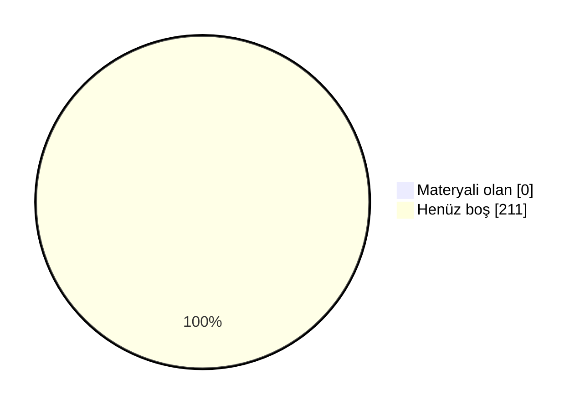

# 📖 Marmara Elektrik-Elektronik Mühendisliği Arşiv

Marmara Üniversitesi Mühendislik Fakültesi Elektrik-Elektronik Mühendisliği öğrencileri için düzenli, sürdürülebilir ve değer üreten bir akademik arşiv. Ders notları, ödev çözümleri, slaytlar, çıkmış sorular ve çalışma rehberleri tek bir yerde toplandı.

 ## 🗣️ Geri Bildirimde Bulunun

📬 Öğrenciler ve hocalar, derslerle ilgili hakaret içermeyen geri bildirimlerinizi aşağıdaki linkler aracılığıyla anonim olarak paylaşabilirsiniz.

- [✍️ **Hocalar için yorum linki**](https://docs.google.com/forms/d/e/1FAIpQLSfsmmwHRVvGeXXGtR-wl8iRNO6NbQfKRpKg16Q43qiVmwWUdA/viewform)
- [✍️ **Dersler için yorum linki**](https://docs.google.com/forms/d/e/1FAIpQLSeyWv4djF04sZxhuYrSWSSpz6xEM-YBLIFw3EG-lL5DFHuGIw/viewform)
- [⭐ **Dersler için oylama linki**](https://docs.google.com/forms/d/e/1FAIpQLSdGS_WJdAehOATDalgEyJ41QmYz5nAudNb6inqa98HRbO40Ow/viewform)

## 🤝 Katkıda Bulunun

Elinde ders notu, slayt, çıkmış soru ya da ödev çözümü varsa arşive eklemek çok kolay:

- 📁 **GitHub kullanmıyorsan:** [Google Drive klasörümüze](https://drive.google.com/drive/folders/1KRobMRVHpJxUKcCZdCEippSZ5SmgpkZq?usp=sharing) yükle. Önce BENİOKU dosyasını oku, sonra **Elektrik-Mühendislik** klasöründe kendi adınla bir klasör aç.
- 🌐 **GitHub hesabın varsa:** Repoyu fork'la, dosyayı ilgili ders klasörüne yükle ve pull request gönder. Kurulum gerekmez, her şey tarayıcıdan yapılır.
- 📖 **Adım adım rehber:** [CONTRIBUTING.md](CONTRIBUTING.md)

Pull request ile katkıda bulunanların adı sayfanın en altındaki **Katkıda Bulunanlar** listesine otomatik eklenir.

### 📺 Video Rehberler
- 🎬 **Repoya nasıl katkı yapılır?** (~10 dk): *yakında*
- 🎬 **Repo nasıl kullanılır?** Klasör yapısı, ders README'leri ve aradığını bulma: *yakında*

<b>🛠 Repo Kullanımı</b>

## 🛠 Repo Kullanımı

### ⚙️ Açıklamalar:
- 📋 Bölümde bilinen ve güvenilir bir kaynak olmak.
- 📋 Akademik network oluşturmak ve iş birliklerini kolaylaştırmak.
- 📋 Dışarıdan bakan biri için temiz, düzenli ve profesyonel bir imaj sunmak.
- 📋 İçerikler: ders slaytları, kişisel ders notları ve özetler, ödev çözümleri, atölye çalışmaları, çıkmış sorular ve analizleri, proje dosyaları ve örnekleri.

### 📝 Talimatlar:
- 👉 Repo içindeki README.md'leri ders bazlı takip edin.
- 👉 Ödevleri çalıştırmak için ilgili klasörlerdeki .py veya .cpp dosyalarını kullanabilirsiniz.
- 👉 Ders özetleri, kısa ve okunabilir şekilde markdown olarak hazırlanmıştır.
- 👉 Özet ve ödevleri birleştirip kendi öğrenme sürecinize uyarlayabilirsiniz.

<b>🔍 Kavramlar</b>

## 🔍 Kavramlar

📌 Bölümle ilgili sık karşılaşılan terimlerin kısa açıklamaları. Not: tarih/şart gibi somut rakamlar dönemden
döneme değişebilir, kesin ve güncel bilgi için bölüm/fakülte öğrenci işlerine danışın.

- 💡 **Bütünleme Sınavı**
  - 📘 **S: Bütünleme sınavı nedir?** **C:** Final sınavının ardından yapılan, dersten başarısız olanların
    (ve şartlı geçenlerin isterlerse) girebildiği ek bir sınavdır. Bütünlemeye giren bir öğrencinin notu,
    final notunun yerini alır — geri dönüş yoktur.
- 💡 **Çan Eğrisi**
  - 📘 **S: Çan eğrisi nedir?** **C:** Bir sınıfın sınav sonuçlarının ortalama ve standart sapmasına göre
    harf notlarının belirlendiği bağıl bir değerlendirme yöntemidir. Her hoca kullanmak zorunda değildir;
    bazı dersler mutlak (bareme dayalı) notlandırılır.
- 💡 **DC Notu / Şartlı Geçme**
  - 📘 **S: DC nedir?** **C:** Şartlı geçme notudur — dersi geçmiş sayılırsınız ama not ortalamanız
    (GANO) yeterince yüksek değilse dersi tekrar almanız istenebilir. Bütünlemeye isteğe bağlı girilebilir.
- 💡 **GANO / AGNO**
  - 📘 **S: GANO nedir?** **C:** Genel Ağırlıklı Not Ortalaması — o ana kadar alınan tüm derslerin kredi
    ağırlıklı not ortalamasıdır. Mezuniyet, ÇAP/yandal başvurusu gibi şartlarda kullanılır.
- 💡 **YANO**
  - 📘 **S: YANO nedir?** **C:** Yarıyıl Ağırlıklı Not Ortalaması — yalnızca ilgili dönemde alınan derslerin
    kredi ağırlıklı not ortalamasıdır. Her dönem sıfırdan hesaplanır; GANO ise tüm dönemleri kapsar.
- 💡 **Mazeret Sınavı**
  - 📘 **S: Mazeret sınavı nedir?** **C:** Sağlık raporu, resmi belgeli bir mazeret vb. nedenle vize/finale
    giremeyen öğrenciler için düzenlenen, geçerli belgeyle başvurulan ek sınavdır.
- 💡 **ÇAP / Yandal**
  - 📘 **S: ÇAP nedir?** **C:** Çift Anadal Programı — uygun GANO'ya sahip öğrencilerin, okurken ikinci bir
    bölümden de lisans diploması almasını sağlayan program.
  - 📘 **S: Yandal nedir?** **C:** Diploma vermeyen, ikinci bir alanda sertifika niteliğinde daha hafif bir
    program.
- 💡 **Staj 1 / Staj 2**
  - 📘 **S: Staj 1/2 nedir?** **C:** Müfredatta 3. ve 4. yıllarda yer alan, işletmede kısa süreli uygulamalı
    çalışmayı zorunlu kılan derslerdir. Hangi dönemde olduklarını dönem sayfalarında görebilirsin.
- 💡 **Bitirme Projesi**
  - 📘 **S: Bitirme Projesi nedir?** **C:** Son dönemde bir danışman hoca eşliğinde yürütülen, mezuniyet
    şartı olan bitirme çalışmasıdır.
- 💡 **Mesleki Seçmeli / Üniversite Seçmeli**
  - 📘 **S: Aralarındaki fark ne?** **C:** Mesleki Seçmeli dersler bölüm içi teknik derslerdir. Üniversite Seçmeli dersler ise bölüm dışı, daha genel/sosyal
    içeriklidir (örn. Girişimcilik, Osmanlı Tarihi). Bkz. [Seçmeli Dersler](#-seçmeli-dersler).

<!-- DOLULUK_BASLANGIC -->

<b>📊 Arşiv Doluluk Durumu</b>

## 📊 Arşiv Doluluk Durumu

Arşivdeki **211** dersin **0** tanesinde en az bir materyal var (genel doluluk **%0**).

| Dönem | Doluluk | Materyali olan ders |
|---|---|---|
| [1. Yıl Güz](./1-1/) | ⬜⬜⬜⬜⬜⬜⬜⬜⬜⬜ %0 | 0 / 8 |
| [1. Yıl Bahar](./1-2/) | ⬜⬜⬜⬜⬜⬜⬜⬜⬜⬜ %0 | 0 / 8 |
| [2. Yıl Güz](./2-1/) | ⬜⬜⬜⬜⬜⬜⬜⬜⬜⬜ %0 | 0 / 5 |
| [2. Yıl Bahar](./2-2/) | ⬜⬜⬜⬜⬜⬜⬜⬜⬜⬜ %0 | 0 / 5 |
| [3. Yıl Güz](./3-1/) | ⬜⬜⬜⬜⬜⬜⬜⬜⬜⬜ %0 | 0 / 6 |
| [3. Yıl Bahar](./3-2/) | ⬜⬜⬜⬜⬜⬜⬜⬜⬜⬜ %0 | 0 / 5 |
| [4. Yıl Güz](./4-1/) | ⬜⬜⬜⬜⬜⬜⬜⬜⬜⬜ %0 | 0 / 4 |
| [4. Yıl Bahar](./4-2/) | ⬜⬜⬜⬜⬜⬜⬜⬜⬜⬜ %0 | 0 / 2 |
| [Mesleki Seçmeli](./Mesleki%20Seçmeli/) | ⬜⬜⬜⬜⬜⬜⬜⬜⬜⬜ %0 | 0 / 69 |
| [Fakülte Teknik Seçmeli](./Fakülte%20Teknik%20Seçmeli/) | ⬜⬜⬜⬜⬜⬜⬜⬜⬜⬜ %0 | 0 / 34 |
| [Teknik Olmayan Seçmeli](./Teknik%20Olmayan%20Seçmeli/) | ⬜⬜⬜⬜⬜⬜⬜⬜⬜⬜ %0 | 0 / 65 |

### 🙋 Bu dersler katkını bekliyor
Elinde bu derslerden materyal varsa yukarıdaki **🤝 Katkıda Bulunun** bölümüne göz at.

- **1. Yıl Güz:** Academic Presentation Skills for Engineers, Basic Chemistry, Calculus 1, Introduction to Computer Programming, İş Sağlığı ve Güvenliği 1, Physics Lab. 1, Physics 1, Türk Dili 1
- **1. Yıl Bahar:** Calculus 2, Introduction to Electrical Engineering, İş Sağlığı ve Güvenliği 2, Linear Algebra, Object-Oriented Programming, Physics Lab. 2, Physics 2, Türk Dili 2
- **2. Yıl Güz:** Differential Equations, Digital Design, Discrete Mathematics, Electrical Circuits 1, Introduction to Materials Science
- **2. Yıl Bahar:** Electrical Circuits 2, Electronics 1, Engineering Mathematics, Microprocessor Systems, Numerical Methods
- **3. Yıl Güz:** Electronics 2, Energy Conversion, Fundamentals of Electromagnetics, Probability and Random Variables, Signals and Systems, Summer Practice 1
- **3. Yıl Bahar:** Communication Engineering, Dynamic Systems and Control, Electromagnetic Waves, Fundamentals of Machine Learning, Introduction to Digital Signal Processing
- **4. Yıl Güz:** Atatürk İlkeleri ve İnkılap Tarihi 1, Engineering Economy, Engineering Project 1, Summer Practice 2
- **4. Yıl Bahar:** Atatürk İlkeleri ve İnkılap Tarihi 2, Engineering Project 2
- **Mesleki Seçmeli:** Advanced Programming for Electrical Engineering, Antennas and Propagation, Artificial Intelligence in Health Sciences, Biomedical Instrumentation, Communication Electronics, Control Technology and Design, Design with Integrated Circuits, Digital Communication, Digital Control, Digital Electronics, Digital System Applications, Discrete Time Systems, Electrical Distribution Systems, Electrical Equipment and Applications, Electronic Measurement and Instrumentation Techniques, Exchange Program Technical Elective 1, Exchange Program Technical Elective 2, Exchange Program Technical Elective 3, Exchange Program Technical Elective 4, Exchange Program Technical Elective 5, Exchange Program Technical Elective 6, Exchange Program Technical Elective 7, Fundamentals of Computer Networks, Fundamentals of Cryptography, Fundamentals of Data Structures, High Voltage Techniques 1, High Voltage Techniques 2, Industrial Electronics, Information Systems Security, Information Systems - Analysis and Design, Introduction to Biomedical Optics, Introduction to BioMEMS, Introduction to Computer Networks, Introduction to Cryptography, Introduction to Embedded Image Processing, Introduction to Embedded Systems, Introduction to Image Processing, Introduction to Information Systems, Introduction to Information Systems Management, Introduction to Information Theory, Introduction to Machine Vision, Introduction to Microelectromechanical Devices and Systems, Introduction to Optimization Theory, Introduction to Principles of Programming Languages, Introduction to Real-time Digital Signal Processing, Introduction to Systems Security, Introduction to Quantum Computing, Kalman and Bayesian Filters, Linear System Theory, Machine Learning, Management of Information Systems, Microcontroller Applications, Microcontroller Based System Design, Microwaves, Mobile Communication, Nonlinear Control Systems, Op-Amps and Applications, Power System Analysis 1, Power System Analysis 2, Power System Protection, Process Control, Renewable Energy Systems Design, Robot Learning, Robotics and Automation, Selected Topics in Electrical and Electronics Engineering, Special Topics in Electrical and Electronics Engineering, Static Power Conversion, Utilization of Electrical Energy, VLSI Circuit Design
- **Fakülte Teknik Seçmeli:** Advanced Innovative Design Management for Entrepreneurship, Automotive Engineering, Business Management for Engineers, Chemical Engineering for Sustainable Biosphere, Construction Materials for Environmental Engineering, Control Systems, Cost Management in Chemical Industries, Design of Experiments, Designing Quality Products, Energy and the Environment, Entrepreneurship with Open-Source ERP Systems, Financial Engineering, From Waste to Value - Circular Economy Applications, Innovation and New Product Development Management, Instrumental Analysis for Engineers, Introduction to Data Science and Analytics, Introduction to Machine Learning, Introduction to Robotics, Introduction to Total Quality Management, Managing Engineering and Technology, Materials Engineering Economics and Plant Design, Mathematical Modeling in Mechanical Engineering, Mechatronics, Micro Electro Mechanical Systems, Multimedia Systems, Planning and Management of Research, Project Management for Engineers, Renewable Energy Utilization, Simulation for Engineering Systems, Software Project Management, Survey Design and Measure Development, Sustainable Innovation and Circular Economy, Total Quality Management in Materials Engineering, Quality Management System in Automotive Industry
- **Teknik Olmayan Seçmeli:** Arabic for Beginners, Basic Principles of Accessibility in Informatics and Technology, Behavioral Sciences for Engineers, Brand Creation-Branding, Business Communication, Business Intelligence for Managers, Cardiopulmonary Resuscitation and First Aid Basics, Career Development, Career Orientation, Chinese 1, Chinese 2, Chinese 3, Cinema, Communication Models and Techniques, Creativity and lnnovation Management, Design, Innovation and Entrepreneurship, Earthquake and Rescue Principles, Effects of Human Behaviour on Environment, Energy for Physical Activity, Entrepreneurship and Innovation, Environmental Sociology, Ethics in Engineering and Science, French, French for Beginners, Fundamentals of Management, Geometric Origami, German, German Communication, German for Beginners, Health and Body Sociology, Human Performance and Nutrition, Industrial and Economic Sociology, Industrial Psychology, Information Literacy in Engineering, Integrated Marketing Communication, International Business, Interpersonal Relations and Communication, Introduction to Angel Financing for Engineers, Introduction to Business World for Engineers, Introduction to Corporate Governance for Engineers, Introduction to Finance for Engineers, Introduction to Leadership & Management for Engineers, Introduction to Programming with Python, Introduction to Strategic Human Resources Management, Introduction to Strategy for Engineers, Investment Planning, Japanese 1, Japanese 2, Labor Law, Marketing in a Technology Driven world for Engineers, Organizational Behaviour, Our Biosphere, Positive Thinking, Principles of Managerial Economics & Financial Management, Report Writing in English, Self Management, Seminars in German, Sociology of Urban Life, Spanish, Spanish for Beginners, Strategic Entrepreneurship, Sustainability Management, The Culture of Radiation Safety, Trekking and Orienteering, World Cultures

<!-- DOLULUK_BITIS -->

<b>📖 Dersler</b>

## 📖 Dersler
📄 Bu bölümde, tüm dersler hakkında detaylı bilgiler ve kaynaklar bulunmaktadır. Öğrenciler bu bölümü kullanarak ders materyallerine ve içeriklerine ulaşabilirler.

### 🗓 1. Yıl - Güz

#### 📘 Basic Chemistry 
  - 🏷️ **Ders Tipi:** Zorunlu
  - 🏷️ **Müfredat:** Güncel Müfredat
  - ⭐ **Yıldız Sayıları:**
      - ℹ️ Henüz yıldız veren yok. Siz de [linkten](https://docs.google.com/forms/d/e/1FAIpQLSdGS_WJdAehOATDalgEyJ41QmYz5nAudNb6inqa98HRbO40Ow/viewform?usp=pp_url&entry.1114553489=Basic%20Chemistry) anonim şekilde oylamaya katılabilirsiniz.
  - 💬 **Öğrenci Görüşleri:**
      - ℹ️ Henüz yorum yok. Siz de [linkten](https://docs.google.com/forms/d/e/1FAIpQLSeyWv4djF04sZxhuYrSWSSpz6xEM-YBLIFw3EG-lL5DFHuGIw/viewform?usp=pp_url&entry.1753317446=Basic%20Chemistry) anonim şekilde görüşlerinizi belirtebilirsiniz.
  - 👨‍🏫 👩‍🏫 **Dersi Yürüten Akademisyenler:**
    - **2026-2027**: [DA](#‍-dr-öğretim-üyesi-didem-aycan)
  - 📂 [Ders Klasörü](./1-1/Basic%20Chemistry)

#### 📘 Introduction to Computer Programming 
  - 🏷️ **Ders Tipi:** Zorunlu
  - 🏷️ **Müfredat:** Güncel Müfredat
  - ⭐ **Yıldız Sayıları:**
      - ℹ️ Henüz yıldız veren yok. Siz de [linkten](https://docs.google.com/forms/d/e/1FAIpQLSdGS_WJdAehOATDalgEyJ41QmYz5nAudNb6inqa98HRbO40Ow/viewform?usp=pp_url&entry.1114553489=Introduction%20to%20Computer%20Programming) anonim şekilde oylamaya katılabilirsiniz.
  - 💬 **Öğrenci Görüşleri:**
      - ℹ️ Henüz yorum yok. Siz de [linkten](https://docs.google.com/forms/d/e/1FAIpQLSeyWv4djF04sZxhuYrSWSSpz6xEM-YBLIFw3EG-lL5DFHuGIw/viewform?usp=pp_url&entry.1753317446=Introduction%20to%20Computer%20Programming) anonim şekilde görüşlerinizi belirtebilirsiniz.
  - 👨‍🏫 👩‍🏫 **Dersi Yürüten Akademisyenler:**
    - **2026-2027**: [SB](#‍-doç-dr-salih-bayar)
  - 📂 [Ders Klasörü](./1-1/Introduction%20to%20Computer%20Programming)

#### 📘 Academic Presentation Skills for Engineers 
  - 🏷️ **Ders Tipi:** Zorunlu
  - 🏷️ **Müfredat:** Güncel Müfredat
  - ⭐ **Yıldız Sayıları:**
      - ℹ️ Henüz yıldız veren yok. Siz de [linkten](https://docs.google.com/forms/d/e/1FAIpQLSdGS_WJdAehOATDalgEyJ41QmYz5nAudNb6inqa98HRbO40Ow/viewform?usp=pp_url&entry.1114553489=Academic%20Presentation%20Skills%20for%20Engineers) anonim şekilde oylamaya katılabilirsiniz.
  - 💬 **Öğrenci Görüşleri:**
      - ℹ️ Henüz yorum yok. Siz de [linkten](https://docs.google.com/forms/d/e/1FAIpQLSeyWv4djF04sZxhuYrSWSSpz6xEM-YBLIFw3EG-lL5DFHuGIw/viewform?usp=pp_url&entry.1753317446=Academic%20Presentation%20Skills%20for%20Engineers) anonim şekilde görüşlerinizi belirtebilirsiniz.
  - 👨‍🏫 👩‍🏫 **Dersi Yürüten Akademisyenler:**
    - **2026-2027**: [FCA](#‍-arş-gör-dr-funda-cırık-acıkaya)
  - 📂 [Ders Klasörü](./1-1/Academic%20Presentation%20Skills%20for%20Engineers)

#### 📘 İş Sağlığı ve Güvenliği 1 
  - 🏷️ **Ders Tipi:** Zorunlu
  - 🏷️ **Müfredat:** Güncel Müfredat
  - ⭐ **Yıldız Sayıları:**
      - ℹ️ Henüz yıldız veren yok. Siz de [linkten](https://docs.google.com/forms/d/e/1FAIpQLSdGS_WJdAehOATDalgEyJ41QmYz5nAudNb6inqa98HRbO40Ow/viewform?usp=pp_url&entry.1114553489=%C4%B0%C5%9F%20Sa%C4%9Fl%C4%B1%C4%9F%C4%B1%20ve%20G%C3%BCvenli%C4%9Fi%201) anonim şekilde oylamaya katılabilirsiniz.
  - 💬 **Öğrenci Görüşleri:**
      - ℹ️ Henüz yorum yok. Siz de [linkten](https://docs.google.com/forms/d/e/1FAIpQLSeyWv4djF04sZxhuYrSWSSpz6xEM-YBLIFw3EG-lL5DFHuGIw/viewform?usp=pp_url&entry.1753317446=%C4%B0%C5%9F%20Sa%C4%9Fl%C4%B1%C4%9F%C4%B1%20ve%20G%C3%BCvenli%C4%9Fi%201) anonim şekilde görüşlerinizi belirtebilirsiniz.
  - 👨‍🏫 👩‍🏫 **Dersi Yürüten Akademisyenler:**
    - **2026-2027**: [OK](#‍-prof-dr-osman-kılıç)
  - 📂 [Ders Klasörü](./1-1/%C4%B0%C5%9F%20Sa%C4%9Fl%C4%B1%C4%9F%C4%B1%20ve%20G%C3%BCvenli%C4%9Fi%201)

#### 📘 Calculus 1 
  - 🏷️ **Ders Tipi:** Zorunlu
  - 🏷️ **Müfredat:** Güncel Müfredat
  - ⭐ **Yıldız Sayıları:**
      - ℹ️ Henüz yıldız veren yok. Siz de [linkten](https://docs.google.com/forms/d/e/1FAIpQLSdGS_WJdAehOATDalgEyJ41QmYz5nAudNb6inqa98HRbO40Ow/viewform?usp=pp_url&entry.1114553489=Calculus%201) anonim şekilde oylamaya katılabilirsiniz.
  - 💬 **Öğrenci Görüşleri:**
      - ℹ️ Henüz yorum yok. Siz de [linkten](https://docs.google.com/forms/d/e/1FAIpQLSeyWv4djF04sZxhuYrSWSSpz6xEM-YBLIFw3EG-lL5DFHuGIw/viewform?usp=pp_url&entry.1753317446=Calculus%201) anonim şekilde görüşlerinizi belirtebilirsiniz.
  - 👨‍🏫 👩‍🏫 **Dersi Yürüten Akademisyenler:**
    - **2026-2027**: [YD](#‍-dr-öğretim-üyesi-yunus-dursun)
  - 📂 [Ders Klasörü](./1-1/Calculus%201)

#### 📘 Physics 1 
  - 🏷️ **Ders Tipi:** Zorunlu
  - 🏷️ **Müfredat:** Güncel Müfredat
  - ⭐ **Yıldız Sayıları:**
      - ℹ️ Henüz yıldız veren yok. Siz de [linkten](https://docs.google.com/forms/d/e/1FAIpQLSdGS_WJdAehOATDalgEyJ41QmYz5nAudNb6inqa98HRbO40Ow/viewform?usp=pp_url&entry.1114553489=Physics%201) anonim şekilde oylamaya katılabilirsiniz.
  - 💬 **Öğrenci Görüşleri:**
      - ℹ️ Henüz yorum yok. Siz de [linkten](https://docs.google.com/forms/d/e/1FAIpQLSeyWv4djF04sZxhuYrSWSSpz6xEM-YBLIFw3EG-lL5DFHuGIw/viewform?usp=pp_url&entry.1753317446=Physics%201) anonim şekilde görüşlerinizi belirtebilirsiniz.
  - 👨‍🏫 👩‍🏫 **Dersi Yürüten Akademisyenler:**
    - **2026-2027**: [BOA](#‍-prof-dr-bülent-oktay-akkoyunlu)
  - 📂 [Ders Klasörü](./1-1/Physics%201)

#### 📘 Physics Lab. 1 
  - 🏷️ **Ders Tipi:** Zorunlu
  - 🏷️ **Müfredat:** Güncel Müfredat
  - ⭐ **Yıldız Sayıları:**
      - ℹ️ Henüz yıldız veren yok. Siz de [linkten](https://docs.google.com/forms/d/e/1FAIpQLSdGS_WJdAehOATDalgEyJ41QmYz5nAudNb6inqa98HRbO40Ow/viewform?usp=pp_url&entry.1114553489=Physics%20Lab.%201) anonim şekilde oylamaya katılabilirsiniz.
  - 💬 **Öğrenci Görüşleri:**
      - ℹ️ Henüz yorum yok. Siz de [linkten](https://docs.google.com/forms/d/e/1FAIpQLSeyWv4djF04sZxhuYrSWSSpz6xEM-YBLIFw3EG-lL5DFHuGIw/viewform?usp=pp_url&entry.1753317446=Physics%20Lab.%201) anonim şekilde görüşlerinizi belirtebilirsiniz.
  - 👨‍🏫 👩‍🏫 **Dersi Yürüten Akademisyenler:**
    - **2026-2027**: [FCA](#‍-arş-gör-dr-funda-cırık-acıkaya), [HY](#‍-arş-gör-hüseyin-yaltırık)
  - 📂 [Ders Klasörü](./1-1/Physics%20Lab.%201)

#### 📘 Türk Dili 1 
  - 🏷️ **Ders Tipi:** Zorunlu
  - 🏷️ **Müfredat:** Güncel Müfredat
  - ⭐ **Yıldız Sayıları:**
      - ℹ️ Henüz yıldız veren yok. Siz de [linkten](https://docs.google.com/forms/d/e/1FAIpQLSdGS_WJdAehOATDalgEyJ41QmYz5nAudNb6inqa98HRbO40Ow/viewform?usp=pp_url&entry.1114553489=T%C3%BCrk%20Dili%201) anonim şekilde oylamaya katılabilirsiniz.
  - 💬 **Öğrenci Görüşleri:**
      - ℹ️ Henüz yorum yok. Siz de [linkten](https://docs.google.com/forms/d/e/1FAIpQLSeyWv4djF04sZxhuYrSWSSpz6xEM-YBLIFw3EG-lL5DFHuGIw/viewform?usp=pp_url&entry.1753317446=T%C3%BCrk%20Dili%201) anonim şekilde görüşlerinizi belirtebilirsiniz.
  - 👨‍🏫 👩‍🏫 **Dersi Yürüten Akademisyenler:**
    - **2026-2027**: [NYIL](#‍-öğr-gör-dr-nurgül-yıldız)
  - 📂 [Ders Klasörü](./1-1/T%C3%BCrk%20Dili%201)

### 🗓 1. Yıl - Bahar

#### 📘 Object-Oriented Programming 
  - 🏷️ **Ders Tipi:** Zorunlu
  - 🏷️ **Müfredat:** Güncel Müfredat
  - ⭐ **Yıldız Sayıları:**
      - ℹ️ Henüz yıldız veren yok. Siz de [linkten](https://docs.google.com/forms/d/e/1FAIpQLSdGS_WJdAehOATDalgEyJ41QmYz5nAudNb6inqa98HRbO40Ow/viewform?usp=pp_url&entry.1114553489=Object-Oriented%20Programming) anonim şekilde oylamaya katılabilirsiniz.
  - 💬 **Öğrenci Görüşleri:**
      - ℹ️ Henüz yorum yok. Siz de [linkten](https://docs.google.com/forms/d/e/1FAIpQLSeyWv4djF04sZxhuYrSWSSpz6xEM-YBLIFw3EG-lL5DFHuGIw/viewform?usp=pp_url&entry.1753317446=Object-Oriented%20Programming) anonim şekilde görüşlerinizi belirtebilirsiniz.
  - 👨‍🏫 👩‍🏫 **Dersi Yürüten Akademisyenler:**
    - **2025-2026**: [SB](#‍-doç-dr-salih-bayar)
  - 📂 [Ders Klasörü](./1-2/Object-Oriented%20Programming)

#### 📘 Introduction to Electrical Engineering 
  - 🏷️ **Ders Tipi:** Zorunlu
  - 🏷️ **Müfredat:** Güncel Müfredat
  - ⭐ **Yıldız Sayıları:**
      - ℹ️ Henüz yıldız veren yok. Siz de [linkten](https://docs.google.com/forms/d/e/1FAIpQLSdGS_WJdAehOATDalgEyJ41QmYz5nAudNb6inqa98HRbO40Ow/viewform?usp=pp_url&entry.1114553489=Introduction%20to%20Electrical%20Engineering) anonim şekilde oylamaya katılabilirsiniz.
  - 💬 **Öğrenci Görüşleri:**
      - ℹ️ Henüz yorum yok. Siz de [linkten](https://docs.google.com/forms/d/e/1FAIpQLSeyWv4djF04sZxhuYrSWSSpz6xEM-YBLIFw3EG-lL5DFHuGIw/viewform?usp=pp_url&entry.1753317446=Introduction%20to%20Electrical%20Engineering) anonim şekilde görüşlerinizi belirtebilirsiniz.
  - 👨‍🏫 👩‍🏫 **Dersi Yürüten Akademisyenler:**
    - **2025-2026**: [FCA](#‍-arş-gör-dr-funda-cırık-acıkaya)
  - 📂 [Ders Klasörü](./1-2/Introduction%20to%20Electrical%20Engineering)

#### 📘 İş Sağlığı ve Güvenliği 2 
  - 🏷️ **Ders Tipi:** Zorunlu
  - 🏷️ **Müfredat:** Güncel Müfredat
  - ⭐ **Yıldız Sayıları:**
      - ℹ️ Henüz yıldız veren yok. Siz de [linkten](https://docs.google.com/forms/d/e/1FAIpQLSdGS_WJdAehOATDalgEyJ41QmYz5nAudNb6inqa98HRbO40Ow/viewform?usp=pp_url&entry.1114553489=%C4%B0%C5%9F%20Sa%C4%9Fl%C4%B1%C4%9F%C4%B1%20ve%20G%C3%BCvenli%C4%9Fi%202) anonim şekilde oylamaya katılabilirsiniz.
  - 💬 **Öğrenci Görüşleri:**
      - ℹ️ Henüz yorum yok. Siz de [linkten](https://docs.google.com/forms/d/e/1FAIpQLSeyWv4djF04sZxhuYrSWSSpz6xEM-YBLIFw3EG-lL5DFHuGIw/viewform?usp=pp_url&entry.1753317446=%C4%B0%C5%9F%20Sa%C4%9Fl%C4%B1%C4%9F%C4%B1%20ve%20G%C3%BCvenli%C4%9Fi%202) anonim şekilde görüşlerinizi belirtebilirsiniz.
  - 👨‍🏫 👩‍🏫 **Dersi Yürüten Akademisyenler:**
    - **2025-2026**: [US](#‍-dr-öğretim-üyesi-uğur-serencam)
  - 📂 [Ders Klasörü](./1-2/%C4%B0%C5%9F%20Sa%C4%9Fl%C4%B1%C4%9F%C4%B1%20ve%20G%C3%BCvenli%C4%9Fi%202)

#### 📘 Calculus 2 
  - 🏷️ **Ders Tipi:** Zorunlu
  - 🏷️ **Müfredat:** Güncel Müfredat
  - ⭐ **Yıldız Sayıları:**
      - ℹ️ Henüz yıldız veren yok. Siz de [linkten](https://docs.google.com/forms/d/e/1FAIpQLSdGS_WJdAehOATDalgEyJ41QmYz5nAudNb6inqa98HRbO40Ow/viewform?usp=pp_url&entry.1114553489=Calculus%202) anonim şekilde oylamaya katılabilirsiniz.
  - 💬 **Öğrenci Görüşleri:**
      - ℹ️ Henüz yorum yok. Siz de [linkten](https://docs.google.com/forms/d/e/1FAIpQLSeyWv4djF04sZxhuYrSWSSpz6xEM-YBLIFw3EG-lL5DFHuGIw/viewform?usp=pp_url&entry.1753317446=Calculus%202) anonim şekilde görüşlerinizi belirtebilirsiniz.
  - 👨‍🏫 👩‍🏫 **Dersi Yürüten Akademisyenler:**
    - **2025-2026**: [YD](#‍-dr-öğretim-üyesi-yunus-dursun)
  - 📂 [Ders Klasörü](./1-2/Calculus%202)

#### 📘 Linear Algebra 
  - 🏷️ **Ders Tipi:** Zorunlu
  - 🏷️ **Müfredat:** Güncel Müfredat
  - ⭐ **Yıldız Sayıları:**
      - ℹ️ Henüz yıldız veren yok. Siz de [linkten](https://docs.google.com/forms/d/e/1FAIpQLSdGS_WJdAehOATDalgEyJ41QmYz5nAudNb6inqa98HRbO40Ow/viewform?usp=pp_url&entry.1114553489=Linear%20Algebra) anonim şekilde oylamaya katılabilirsiniz.
  - 💬 **Öğrenci Görüşleri:**
      - ℹ️ Henüz yorum yok. Siz de [linkten](https://docs.google.com/forms/d/e/1FAIpQLSeyWv4djF04sZxhuYrSWSSpz6xEM-YBLIFw3EG-lL5DFHuGIw/viewform?usp=pp_url&entry.1753317446=Linear%20Algebra) anonim şekilde görüşlerinizi belirtebilirsiniz.
  - 👨‍🏫 👩‍🏫 **Dersi Yürüten Akademisyenler:**
    - **2025-2026**: [OCİH](#‍-doç-dr-onur-cihan)
  - 📂 [Ders Klasörü](./1-2/Linear%20Algebra)

#### 📘 Physics 2 
  - 🏷️ **Ders Tipi:** Zorunlu
  - 🏷️ **Müfredat:** Güncel Müfredat
  - ⭐ **Yıldız Sayıları:**
      - ℹ️ Henüz yıldız veren yok. Siz de [linkten](https://docs.google.com/forms/d/e/1FAIpQLSdGS_WJdAehOATDalgEyJ41QmYz5nAudNb6inqa98HRbO40Ow/viewform?usp=pp_url&entry.1114553489=Physics%202) anonim şekilde oylamaya katılabilirsiniz.
  - 💬 **Öğrenci Görüşleri:**
      - ℹ️ Henüz yorum yok. Siz de [linkten](https://docs.google.com/forms/d/e/1FAIpQLSeyWv4djF04sZxhuYrSWSSpz6xEM-YBLIFw3EG-lL5DFHuGIw/viewform?usp=pp_url&entry.1753317446=Physics%202) anonim şekilde görüşlerinizi belirtebilirsiniz.
  - 👨‍🏫 👩‍🏫 **Dersi Yürüten Akademisyenler:**
    - **2026-2027**: [MT](#‍-dr-öğretim-üyesi-makbule-tamkaş), [FD](#‍-prof-dr-fatih-dumludağ)
  - 📂 [Ders Klasörü](./1-2/Physics%202)

#### 📘 Physics Lab. 2 
  - 🏷️ **Ders Tipi:** Zorunlu
  - 🏷️ **Müfredat:** Güncel Müfredat
  - ⭐ **Yıldız Sayıları:**
      - ℹ️ Henüz yıldız veren yok. Siz de [linkten](https://docs.google.com/forms/d/e/1FAIpQLSdGS_WJdAehOATDalgEyJ41QmYz5nAudNb6inqa98HRbO40Ow/viewform?usp=pp_url&entry.1114553489=Physics%20Lab.%202) anonim şekilde oylamaya katılabilirsiniz.
  - 💬 **Öğrenci Görüşleri:**
      - ℹ️ Henüz yorum yok. Siz de [linkten](https://docs.google.com/forms/d/e/1FAIpQLSeyWv4djF04sZxhuYrSWSSpz6xEM-YBLIFw3EG-lL5DFHuGIw/viewform?usp=pp_url&entry.1753317446=Physics%20Lab.%202) anonim şekilde görüşlerinizi belirtebilirsiniz.
  - 👨‍🏫 👩‍🏫 **Dersi Yürüten Akademisyenler:**
    - **2025-2026**: [FCA](#‍-arş-gör-dr-funda-cırık-acıkaya)
  - 📂 [Ders Klasörü](./1-2/Physics%20Lab.%202)

#### 📘 Türk Dili 2 
  - 🏷️ **Ders Tipi:** Zorunlu
  - 🏷️ **Müfredat:** Güncel Müfredat
  - ⭐ **Yıldız Sayıları:**
      - ℹ️ Henüz yıldız veren yok. Siz de [linkten](https://docs.google.com/forms/d/e/1FAIpQLSdGS_WJdAehOATDalgEyJ41QmYz5nAudNb6inqa98HRbO40Ow/viewform?usp=pp_url&entry.1114553489=T%C3%BCrk%20Dili%202) anonim şekilde oylamaya katılabilirsiniz.
  - 💬 **Öğrenci Görüşleri:**
      - ℹ️ Henüz yorum yok. Siz de [linkten](https://docs.google.com/forms/d/e/1FAIpQLSeyWv4djF04sZxhuYrSWSSpz6xEM-YBLIFw3EG-lL5DFHuGIw/viewform?usp=pp_url&entry.1753317446=T%C3%BCrk%20Dili%202) anonim şekilde görüşlerinizi belirtebilirsiniz.
  - 👨‍🏫 👩‍🏫 **Dersi Yürüten Akademisyenler:**
    - **2025-2026**: [NYIL](#‍-öğr-gör-dr-nurgül-yıldız)
  - 📂 [Ders Klasörü](./1-2/T%C3%BCrk%20Dili%202)

### 🗓 2. Yıl - Güz

#### 📘 Electrical Circuits 1 
  - 🏷️ **Ders Tipi:** Zorunlu
  - 🏷️ **Müfredat:** Güncel Müfredat
  - ⭐ **Yıldız Sayıları:**
      - ℹ️ Henüz yıldız veren yok. Siz de [linkten](https://docs.google.com/forms/d/e/1FAIpQLSdGS_WJdAehOATDalgEyJ41QmYz5nAudNb6inqa98HRbO40Ow/viewform?usp=pp_url&entry.1114553489=Electrical%20Circuits%201) anonim şekilde oylamaya katılabilirsiniz.
  - 💬 **Öğrenci Görüşleri:**
      - ℹ️ Henüz yorum yok. Siz de [linkten](https://docs.google.com/forms/d/e/1FAIpQLSeyWv4djF04sZxhuYrSWSSpz6xEM-YBLIFw3EG-lL5DFHuGIw/viewform?usp=pp_url&entry.1753317446=Electrical%20Circuits%201) anonim şekilde görüşlerinizi belirtebilirsiniz.
  - 👨‍🏫 👩‍🏫 **Dersi Yürüten Akademisyenler:**
    - **2026-2027**: [MAZ](#‍-dr-öğretim-üyesi-mustafa-alparslan-zehir)
  - 📂 [Ders Klasörü](./2-1/Electrical%20Circuits%201)

#### 📘 Digital Design 
  - 🏷️ **Ders Tipi:** Zorunlu
  - 🏷️ **Müfredat:** Güncel Müfredat
  - ⭐ **Yıldız Sayıları:**
      - ℹ️ Henüz yıldız veren yok. Siz de [linkten](https://docs.google.com/forms/d/e/1FAIpQLSdGS_WJdAehOATDalgEyJ41QmYz5nAudNb6inqa98HRbO40Ow/viewform?usp=pp_url&entry.1114553489=Digital%20Design) anonim şekilde oylamaya katılabilirsiniz.
  - 💬 **Öğrenci Görüşleri:**
      - ℹ️ Henüz yorum yok. Siz de [linkten](https://docs.google.com/forms/d/e/1FAIpQLSeyWv4djF04sZxhuYrSWSSpz6xEM-YBLIFw3EG-lL5DFHuGIw/viewform?usp=pp_url&entry.1753317446=Digital%20Design) anonim şekilde görüşlerinizi belirtebilirsiniz.
  - 👨‍🏫 👩‍🏫 **Dersi Yürüten Akademisyenler:**
    - **2026-2027**: [SB](#‍-doç-dr-salih-bayar)
  - 📂 [Ders Klasörü](./2-1/Digital%20Design)

#### 📘 Differential Equations 
  - 🏷️ **Ders Tipi:** Zorunlu
  - 🏷️ **Müfredat:** Güncel Müfredat
  - ⭐ **Yıldız Sayıları:**
      - ℹ️ Henüz yıldız veren yok. Siz de [linkten](https://docs.google.com/forms/d/e/1FAIpQLSdGS_WJdAehOATDalgEyJ41QmYz5nAudNb6inqa98HRbO40Ow/viewform?usp=pp_url&entry.1114553489=Differential%20Equations) anonim şekilde oylamaya katılabilirsiniz.
  - 💬 **Öğrenci Görüşleri:**
      - ℹ️ Henüz yorum yok. Siz de [linkten](https://docs.google.com/forms/d/e/1FAIpQLSeyWv4djF04sZxhuYrSWSSpz6xEM-YBLIFw3EG-lL5DFHuGIw/viewform?usp=pp_url&entry.1753317446=Differential%20Equations) anonim şekilde görüşlerinizi belirtebilirsiniz.
  - 👨‍🏫 👩‍🏫 **Dersi Yürüten Akademisyenler:**
    - **2026-2027**: [İY](#‍-prof-dr-i̇lhan-yavuz)
  - 📂 [Ders Klasörü](./2-1/Differential%20Equations)

#### 📘 Discrete Mathematics 
  - 🏷️ **Ders Tipi:** Zorunlu
  - 🏷️ **Müfredat:** Güncel Müfredat
  - ⭐ **Yıldız Sayıları:**
      - ℹ️ Henüz yıldız veren yok. Siz de [linkten](https://docs.google.com/forms/d/e/1FAIpQLSdGS_WJdAehOATDalgEyJ41QmYz5nAudNb6inqa98HRbO40Ow/viewform?usp=pp_url&entry.1114553489=Discrete%20Mathematics) anonim şekilde oylamaya katılabilirsiniz.
  - 💬 **Öğrenci Görüşleri:**
      - ℹ️ Henüz yorum yok. Siz de [linkten](https://docs.google.com/forms/d/e/1FAIpQLSeyWv4djF04sZxhuYrSWSSpz6xEM-YBLIFw3EG-lL5DFHuGIw/viewform?usp=pp_url&entry.1753317446=Discrete%20Mathematics) anonim şekilde görüşlerinizi belirtebilirsiniz.
  - 👨‍🏫 👩‍🏫 **Dersi Yürüten Akademisyenler:**
    - **2026-2027**: [YD](#‍-dr-öğretim-üyesi-yunus-dursun)
  - 📂 [Ders Klasörü](./2-1/Discrete%20Mathematics)

#### 📘 Introduction to Materials Science 
  - 🏷️ **Ders Tipi:** Zorunlu
  - 🏷️ **Müfredat:** Güncel Müfredat
  - ⭐ **Yıldız Sayıları:**
      - ℹ️ Henüz yıldız veren yok. Siz de [linkten](https://docs.google.com/forms/d/e/1FAIpQLSdGS_WJdAehOATDalgEyJ41QmYz5nAudNb6inqa98HRbO40Ow/viewform?usp=pp_url&entry.1114553489=Introduction%20to%20Materials%20Science) anonim şekilde oylamaya katılabilirsiniz.
  - 💬 **Öğrenci Görüşleri:**
      - ℹ️ Henüz yorum yok. Siz de [linkten](https://docs.google.com/forms/d/e/1FAIpQLSeyWv4djF04sZxhuYrSWSSpz6xEM-YBLIFw3EG-lL5DFHuGIw/viewform?usp=pp_url&entry.1753317446=Introduction%20to%20Materials%20Science) anonim şekilde görüşlerinizi belirtebilirsiniz.
  - 👨‍🏫 👩‍🏫 **Dersi Yürüten Akademisyenler:**
    - **2026-2027**: [MFT](#‍-dr-öğretim-üyesi-muhammet-fatih-toksoy)
  - 📂 [Ders Klasörü](./2-1/Introduction%20to%20Materials%20Science)

### 🗓 2. Yıl - Bahar

#### 📘 Electrical Circuits 2 
  - 🏷️ **Ders Tipi:** Zorunlu
  - 🏷️ **Müfredat:** Güncel Müfredat
  - ⭐ **Yıldız Sayıları:**
      - ℹ️ Henüz yıldız veren yok. Siz de [linkten](https://docs.google.com/forms/d/e/1FAIpQLSdGS_WJdAehOATDalgEyJ41QmYz5nAudNb6inqa98HRbO40Ow/viewform?usp=pp_url&entry.1114553489=Electrical%20Circuits%202) anonim şekilde oylamaya katılabilirsiniz.
  - 💬 **Öğrenci Görüşleri:**
      - ℹ️ Henüz yorum yok. Siz de [linkten](https://docs.google.com/forms/d/e/1FAIpQLSeyWv4djF04sZxhuYrSWSSpz6xEM-YBLIFw3EG-lL5DFHuGIw/viewform?usp=pp_url&entry.1753317446=Electrical%20Circuits%202) anonim şekilde görüşlerinizi belirtebilirsiniz.
  - 👨‍🏫 👩‍🏫 **Dersi Yürüten Akademisyenler:**
    - **2025-2026**: [MAZ](#‍-dr-öğretim-üyesi-mustafa-alparslan-zehir)
  - 📂 [Ders Klasörü](./2-2/Electrical%20Circuits%202)

#### 📘 Microprocessor Systems 
  - 🏷️ **Ders Tipi:** Zorunlu
  - 🏷️ **Müfredat:** Güncel Müfredat
  - ⭐ **Yıldız Sayıları:**
      - ℹ️ Henüz yıldız veren yok. Siz de [linkten](https://docs.google.com/forms/d/e/1FAIpQLSdGS_WJdAehOATDalgEyJ41QmYz5nAudNb6inqa98HRbO40Ow/viewform?usp=pp_url&entry.1114553489=Microprocessor%20Systems) anonim şekilde oylamaya katılabilirsiniz.
  - 💬 **Öğrenci Görüşleri:**
      - ℹ️ Henüz yorum yok. Siz de [linkten](https://docs.google.com/forms/d/e/1FAIpQLSeyWv4djF04sZxhuYrSWSSpz6xEM-YBLIFw3EG-lL5DFHuGIw/viewform?usp=pp_url&entry.1753317446=Microprocessor%20Systems) anonim şekilde görüşlerinizi belirtebilirsiniz.
  - 👨‍🏫 👩‍🏫 **Dersi Yürüten Akademisyenler:**
    - **2025-2026**: [FKB](#‍-arş-gör-dr-fazlı-kemal-bayat)
  - 📂 [Ders Klasörü](./2-2/Microprocessor%20Systems)

#### 📘 Electronics 1 
  - 🏷️ **Ders Tipi:** Zorunlu
  - 🏷️ **Müfredat:** Güncel Müfredat
  - ⭐ **Yıldız Sayıları:**
      - ℹ️ Henüz yıldız veren yok. Siz de [linkten](https://docs.google.com/forms/d/e/1FAIpQLSdGS_WJdAehOATDalgEyJ41QmYz5nAudNb6inqa98HRbO40Ow/viewform?usp=pp_url&entry.1114553489=Electronics%201) anonim şekilde oylamaya katılabilirsiniz.
  - 💬 **Öğrenci Görüşleri:**
      - ℹ️ Henüz yorum yok. Siz de [linkten](https://docs.google.com/forms/d/e/1FAIpQLSeyWv4djF04sZxhuYrSWSSpz6xEM-YBLIFw3EG-lL5DFHuGIw/viewform?usp=pp_url&entry.1753317446=Electronics%201) anonim şekilde görüşlerinizi belirtebilirsiniz.
  - 👨‍🏫 👩‍🏫 **Dersi Yürüten Akademisyenler:**
    - **2025-2026**: [EM](#‍-prof-dr-engin-maşazade)
  - 📂 [Ders Klasörü](./2-2/Electronics%201)

#### 📘 Engineering Mathematics 
  - 🏷️ **Ders Tipi:** Zorunlu
  - 🏷️ **Müfredat:** Güncel Müfredat
  - ⭐ **Yıldız Sayıları:**
      - ℹ️ Henüz yıldız veren yok. Siz de [linkten](https://docs.google.com/forms/d/e/1FAIpQLSdGS_WJdAehOATDalgEyJ41QmYz5nAudNb6inqa98HRbO40Ow/viewform?usp=pp_url&entry.1114553489=Engineering%20Mathematics) anonim şekilde oylamaya katılabilirsiniz.
  - 💬 **Öğrenci Görüşleri:**
      - ℹ️ Henüz yorum yok. Siz de [linkten](https://docs.google.com/forms/d/e/1FAIpQLSeyWv4djF04sZxhuYrSWSSpz6xEM-YBLIFw3EG-lL5DFHuGIw/viewform?usp=pp_url&entry.1753317446=Engineering%20Mathematics) anonim şekilde görüşlerinizi belirtebilirsiniz.
  - 👨‍🏫 👩‍🏫 **Dersi Yürüten Akademisyenler:**
    - **2025-2026**: [YD](#‍-dr-öğretim-üyesi-yunus-dursun)
  - 📂 [Ders Klasörü](./2-2/Engineering%20Mathematics)

#### 📘 Numerical Methods 
  - 🏷️ **Ders Tipi:** Zorunlu
  - 🏷️ **Müfredat:** Güncel Müfredat
  - ⭐ **Yıldız Sayıları:**
      - ℹ️ Henüz yıldız veren yok. Siz de [linkten](https://docs.google.com/forms/d/e/1FAIpQLSdGS_WJdAehOATDalgEyJ41QmYz5nAudNb6inqa98HRbO40Ow/viewform?usp=pp_url&entry.1114553489=Numerical%20Methods) anonim şekilde oylamaya katılabilirsiniz.
  - 💬 **Öğrenci Görüşleri:**
      - ℹ️ Henüz yorum yok. Siz de [linkten](https://docs.google.com/forms/d/e/1FAIpQLSeyWv4djF04sZxhuYrSWSSpz6xEM-YBLIFw3EG-lL5DFHuGIw/viewform?usp=pp_url&entry.1753317446=Numerical%20Methods) anonim şekilde görüşlerinizi belirtebilirsiniz.
  - 👨‍🏫 👩‍🏫 **Dersi Yürüten Akademisyenler:**
    - **2025-2026**: [FÇ](#‍-doç-dr-fulya-çallıalp)
  - 📂 [Ders Klasörü](./2-2/Numerical%20Methods)

### 🗓 3. Yıl - Güz

#### 📘 Summer Practice 1 
  - 🏷️ **Ders Tipi:** Zorunlu
  - 🏷️ **Müfredat:** Güncel Müfredat
  - ⭐ **Yıldız Sayıları:**
      - ℹ️ Henüz yıldız veren yok. Siz de [linkten](https://docs.google.com/forms/d/e/1FAIpQLSdGS_WJdAehOATDalgEyJ41QmYz5nAudNb6inqa98HRbO40Ow/viewform?usp=pp_url&entry.1114553489=Summer%20Practice%201) anonim şekilde oylamaya katılabilirsiniz.
  - 💬 **Öğrenci Görüşleri:**
      - ℹ️ Henüz yorum yok. Siz de [linkten](https://docs.google.com/forms/d/e/1FAIpQLSeyWv4djF04sZxhuYrSWSSpz6xEM-YBLIFw3EG-lL5DFHuGIw/viewform?usp=pp_url&entry.1753317446=Summer%20Practice%201) anonim şekilde görüşlerinizi belirtebilirsiniz.
  - 📂 [Ders Klasörü](./3-1/Summer%20Practice%201)

#### 📘 Electronics 2 
  - 🏷️ **Ders Tipi:** Zorunlu
  - 🏷️ **Müfredat:** Güncel Müfredat
  - ⭐ **Yıldız Sayıları:**
      - ℹ️ Henüz yıldız veren yok. Siz de [linkten](https://docs.google.com/forms/d/e/1FAIpQLSdGS_WJdAehOATDalgEyJ41QmYz5nAudNb6inqa98HRbO40Ow/viewform?usp=pp_url&entry.1114553489=Electronics%202) anonim şekilde oylamaya katılabilirsiniz.
  - 💬 **Öğrenci Görüşleri:**
      - ℹ️ Henüz yorum yok. Siz de [linkten](https://docs.google.com/forms/d/e/1FAIpQLSeyWv4djF04sZxhuYrSWSSpz6xEM-YBLIFw3EG-lL5DFHuGIw/viewform?usp=pp_url&entry.1753317446=Electronics%202) anonim şekilde görüşlerinizi belirtebilirsiniz.
  - 👨‍🏫 👩‍🏫 **Dersi Yürüten Akademisyenler:**
    - **2026-2027**: [ST](#‍-prof-dr-serkan-topaloğlu)
  - 📂 [Ders Klasörü](./3-1/Electronics%202)

#### 📘 Energy Conversion 
  - 🏷️ **Ders Tipi:** Zorunlu
  - 🏷️ **Müfredat:** Güncel Müfredat
  - ⭐ **Yıldız Sayıları:**
      - ℹ️ Henüz yıldız veren yok. Siz de [linkten](https://docs.google.com/forms/d/e/1FAIpQLSdGS_WJdAehOATDalgEyJ41QmYz5nAudNb6inqa98HRbO40Ow/viewform?usp=pp_url&entry.1114553489=Energy%20Conversion) anonim şekilde oylamaya katılabilirsiniz.
  - 💬 **Öğrenci Görüşleri:**
      - ℹ️ Henüz yorum yok. Siz de [linkten](https://docs.google.com/forms/d/e/1FAIpQLSeyWv4djF04sZxhuYrSWSSpz6xEM-YBLIFw3EG-lL5DFHuGIw/viewform?usp=pp_url&entry.1753317446=Energy%20Conversion) anonim şekilde görüşlerinizi belirtebilirsiniz.
  - 👨‍🏫 👩‍🏫 **Dersi Yürüten Akademisyenler:**
    - **2026-2027**: [MO](#‍-prof-dr-mustafa-onat)
  - 📂 [Ders Klasörü](./3-1/Energy%20Conversion)

#### 📘 Fundamentals of Electromagnetics 
  - 🏷️ **Ders Tipi:** Zorunlu
  - 🏷️ **Müfredat:** Güncel Müfredat
  - ⭐ **Yıldız Sayıları:**
      - ℹ️ Henüz yıldız veren yok. Siz de [linkten](https://docs.google.com/forms/d/e/1FAIpQLSdGS_WJdAehOATDalgEyJ41QmYz5nAudNb6inqa98HRbO40Ow/viewform?usp=pp_url&entry.1114553489=Fundamentals%20of%20Electromagnetics) anonim şekilde oylamaya katılabilirsiniz.
  - 💬 **Öğrenci Görüşleri:**
      - ℹ️ Henüz yorum yok. Siz de [linkten](https://docs.google.com/forms/d/e/1FAIpQLSeyWv4djF04sZxhuYrSWSSpz6xEM-YBLIFw3EG-lL5DFHuGIw/viewform?usp=pp_url&entry.1753317446=Fundamentals%20of%20Electromagnetics) anonim şekilde görüşlerinizi belirtebilirsiniz.
  - 👨‍🏫 👩‍🏫 **Dersi Yürüten Akademisyenler:**
    - **2026-2027**: [FÇ](#‍-doç-dr-fulya-çallıalp)
  - 📂 [Ders Klasörü](./3-1/Fundamentals%20of%20Electromagnetics)

#### 📘 Signals and Systems 
  - 🏷️ **Ders Tipi:** Zorunlu
  - 🏷️ **Müfredat:** Güncel Müfredat
  - ⭐ **Yıldız Sayıları:**
      - ℹ️ Henüz yıldız veren yok. Siz de [linkten](https://docs.google.com/forms/d/e/1FAIpQLSdGS_WJdAehOATDalgEyJ41QmYz5nAudNb6inqa98HRbO40Ow/viewform?usp=pp_url&entry.1114553489=Signals%20and%20Systems) anonim şekilde oylamaya katılabilirsiniz.
  - 💬 **Öğrenci Görüşleri:**
      - ℹ️ Henüz yorum yok. Siz de [linkten](https://docs.google.com/forms/d/e/1FAIpQLSeyWv4djF04sZxhuYrSWSSpz6xEM-YBLIFw3EG-lL5DFHuGIw/viewform?usp=pp_url&entry.1753317446=Signals%20and%20Systems) anonim şekilde görüşlerinizi belirtebilirsiniz.
  - 👨‍🏫 👩‍🏫 **Dersi Yürüten Akademisyenler:**
    - **2026-2027**: [OCİH](#‍-doç-dr-onur-cihan)
  - 📂 [Ders Klasörü](./3-1/Signals%20and%20Systems)

#### 📘 Probability and Random Variables 
  - 🏷️ **Ders Tipi:** Zorunlu
  - 🏷️ **Müfredat:** Güncel Müfredat
  - ⭐ **Yıldız Sayıları:**
      - ℹ️ Henüz yıldız veren yok. Siz de [linkten](https://docs.google.com/forms/d/e/1FAIpQLSdGS_WJdAehOATDalgEyJ41QmYz5nAudNb6inqa98HRbO40Ow/viewform?usp=pp_url&entry.1114553489=Probability%20and%20Random%20Variables) anonim şekilde oylamaya katılabilirsiniz.
  - 💬 **Öğrenci Görüşleri:**
      - ℹ️ Henüz yorum yok. Siz de [linkten](https://docs.google.com/forms/d/e/1FAIpQLSeyWv4djF04sZxhuYrSWSSpz6xEM-YBLIFw3EG-lL5DFHuGIw/viewform?usp=pp_url&entry.1753317446=Probability%20and%20Random%20Variables) anonim şekilde görüşlerinizi belirtebilirsiniz.
  - 👨‍🏫 👩‍🏫 **Dersi Yürüten Akademisyenler:**
    - **2026-2027**: [EM](#‍-prof-dr-engin-maşazade)
  - 📂 [Ders Klasörü](./3-1/Probability%20and%20Random%20Variables)

### 🗓 3. Yıl - Bahar

#### 📘 Dynamic Systems and Control 
  - 🏷️ **Ders Tipi:** Zorunlu
  - 🏷️ **Müfredat:** Güncel Müfredat
  - ⭐ **Yıldız Sayıları:**
      - ℹ️ Henüz yıldız veren yok. Siz de [linkten](https://docs.google.com/forms/d/e/1FAIpQLSdGS_WJdAehOATDalgEyJ41QmYz5nAudNb6inqa98HRbO40Ow/viewform?usp=pp_url&entry.1114553489=Dynamic%20Systems%20and%20Control) anonim şekilde oylamaya katılabilirsiniz.
  - 💬 **Öğrenci Görüşleri:**
      - ℹ️ Henüz yorum yok. Siz de [linkten](https://docs.google.com/forms/d/e/1FAIpQLSeyWv4djF04sZxhuYrSWSSpz6xEM-YBLIFw3EG-lL5DFHuGIw/viewform?usp=pp_url&entry.1753317446=Dynamic%20Systems%20and%20Control) anonim şekilde görüşlerinizi belirtebilirsiniz.
  - 👨‍🏫 👩‍🏫 **Dersi Yürüten Akademisyenler:**
    - **2025-2026**: [OCİH](#‍-doç-dr-onur-cihan), [MO](#‍-prof-dr-mustafa-onat)
  - 📂 [Ders Klasörü](./3-2/Dynamic%20Systems%20and%20Control)

#### 📘 Communication Engineering 
  - 🏷️ **Ders Tipi:** Zorunlu
  - 🏷️ **Müfredat:** Güncel Müfredat
  - ⭐ **Yıldız Sayıları:**
      - ℹ️ Henüz yıldız veren yok. Siz de [linkten](https://docs.google.com/forms/d/e/1FAIpQLSdGS_WJdAehOATDalgEyJ41QmYz5nAudNb6inqa98HRbO40Ow/viewform?usp=pp_url&entry.1114553489=Communication%20Engineering) anonim şekilde oylamaya katılabilirsiniz.
  - 💬 **Öğrenci Görüşleri:**
      - ℹ️ Henüz yorum yok. Siz de [linkten](https://docs.google.com/forms/d/e/1FAIpQLSeyWv4djF04sZxhuYrSWSSpz6xEM-YBLIFw3EG-lL5DFHuGIw/viewform?usp=pp_url&entry.1753317446=Communication%20Engineering) anonim şekilde görüşlerinizi belirtebilirsiniz.
  - 👨‍🏫 👩‍🏫 **Dersi Yürüten Akademisyenler:**
    - **2025-2026**: [EM](#‍-prof-dr-engin-maşazade)
  - 📂 [Ders Klasörü](./3-2/Communication%20Engineering)

#### 📘 Introduction to Digital Signal Processing 
  - 🏷️ **Ders Tipi:** Zorunlu
  - 🏷️ **Müfredat:** Güncel Müfredat
  - ⭐ **Yıldız Sayıları:**
      - ℹ️ Henüz yıldız veren yok. Siz de [linkten](https://docs.google.com/forms/d/e/1FAIpQLSdGS_WJdAehOATDalgEyJ41QmYz5nAudNb6inqa98HRbO40Ow/viewform?usp=pp_url&entry.1114553489=Introduction%20to%20Digital%20Signal%20Processing) anonim şekilde oylamaya katılabilirsiniz.
  - 💬 **Öğrenci Görüşleri:**
      - ℹ️ Henüz yorum yok. Siz de [linkten](https://docs.google.com/forms/d/e/1FAIpQLSeyWv4djF04sZxhuYrSWSSpz6xEM-YBLIFw3EG-lL5DFHuGIw/viewform?usp=pp_url&entry.1753317446=Introduction%20to%20Digital%20Signal%20Processing) anonim şekilde görüşlerinizi belirtebilirsiniz.
  - 👨‍🏫 👩‍🏫 **Dersi Yürüten Akademisyenler:**
    - **2025-2026**: [CV](#‍-prof-dr-cabir-vural)
  - 📂 [Ders Klasörü](./3-2/Introduction%20to%20Digital%20Signal%20Processing)

#### 📘 Electromagnetic Waves 
  - 🏷️ **Ders Tipi:** Zorunlu
  - 🏷️ **Müfredat:** Güncel Müfredat
  - ⭐ **Yıldız Sayıları:**
      - ℹ️ Henüz yıldız veren yok. Siz de [linkten](https://docs.google.com/forms/d/e/1FAIpQLSdGS_WJdAehOATDalgEyJ41QmYz5nAudNb6inqa98HRbO40Ow/viewform?usp=pp_url&entry.1114553489=Electromagnetic%20Waves) anonim şekilde oylamaya katılabilirsiniz.
  - 💬 **Öğrenci Görüşleri:**
      - ℹ️ Henüz yorum yok. Siz de [linkten](https://docs.google.com/forms/d/e/1FAIpQLSeyWv4djF04sZxhuYrSWSSpz6xEM-YBLIFw3EG-lL5DFHuGIw/viewform?usp=pp_url&entry.1753317446=Electromagnetic%20Waves) anonim şekilde görüşlerinizi belirtebilirsiniz.
  - 👨‍🏫 👩‍🏫 **Dersi Yürüten Akademisyenler:**
    - **2025-2026**: [FÇ](#‍-doç-dr-fulya-çallıalp)
  - 📂 [Ders Klasörü](./3-2/Electromagnetic%20Waves)

#### 📘 Fundamentals of Machine Learning 
  - 🏷️ **Ders Tipi:** Zorunlu
  - 🏷️ **Müfredat:** Güncel Müfredat
  - ⭐ **Yıldız Sayıları:**
      - ℹ️ Henüz yıldız veren yok. Siz de [linkten](https://docs.google.com/forms/d/e/1FAIpQLSdGS_WJdAehOATDalgEyJ41QmYz5nAudNb6inqa98HRbO40Ow/viewform?usp=pp_url&entry.1114553489=Fundamentals%20of%20Machine%20Learning) anonim şekilde oylamaya katılabilirsiniz.
  - 💬 **Öğrenci Görüşleri:**
      - ℹ️ Henüz yorum yok. Siz de [linkten](https://docs.google.com/forms/d/e/1FAIpQLSeyWv4djF04sZxhuYrSWSSpz6xEM-YBLIFw3EG-lL5DFHuGIw/viewform?usp=pp_url&entry.1753317446=Fundamentals%20of%20Machine%20Learning) anonim şekilde görüşlerinizi belirtebilirsiniz.
  - 👨‍🏫 👩‍🏫 **Dersi Yürüten Akademisyenler:**
    - **2025-2026**: [CV](#‍-prof-dr-cabir-vural)
  - 📂 [Ders Klasörü](./3-2/Fundamentals%20of%20Machine%20Learning)

### 🗓 4. Yıl - Güz

#### 📘 Atatürk İlkeleri ve İnkılap Tarihi 1 
  - 🏷️ **Ders Tipi:** Zorunlu
  - 🏷️ **Müfredat:** Güncel Müfredat
  - ⭐ **Yıldız Sayıları:**
      - ℹ️ Henüz yıldız veren yok. Siz de [linkten](https://docs.google.com/forms/d/e/1FAIpQLSdGS_WJdAehOATDalgEyJ41QmYz5nAudNb6inqa98HRbO40Ow/viewform?usp=pp_url&entry.1114553489=Atat%C3%BCrk%20%C4%B0lkeleri%20ve%20%C4%B0nk%C4%B1lap%20Tarihi%201) anonim şekilde oylamaya katılabilirsiniz.
  - 💬 **Öğrenci Görüşleri:**
      - ℹ️ Henüz yorum yok. Siz de [linkten](https://docs.google.com/forms/d/e/1FAIpQLSeyWv4djF04sZxhuYrSWSSpz6xEM-YBLIFw3EG-lL5DFHuGIw/viewform?usp=pp_url&entry.1753317446=Atat%C3%BCrk%20%C4%B0lkeleri%20ve%20%C4%B0nk%C4%B1lap%20Tarihi%201) anonim şekilde görüşlerinizi belirtebilirsiniz.
  - 👨‍🏫 👩‍🏫 **Dersi Yürüten Akademisyenler:**
    - **2026-2027**: [HÖ](#‍-öğr-gör-hülya-özler)
  - 📂 [Ders Klasörü](./4-1/Atat%C3%BCrk%20%C4%B0lkeleri%20ve%20%C4%B0nk%C4%B1lap%20Tarihi%201)

#### 📘 Engineering Economy 
  - 🏷️ **Ders Tipi:** Zorunlu
  - 🏷️ **Müfredat:** Güncel Müfredat
  - ⭐ **Yıldız Sayıları:**
      - ℹ️ Henüz yıldız veren yok. Siz de [linkten](https://docs.google.com/forms/d/e/1FAIpQLSdGS_WJdAehOATDalgEyJ41QmYz5nAudNb6inqa98HRbO40Ow/viewform?usp=pp_url&entry.1114553489=Engineering%20Economy) anonim şekilde oylamaya katılabilirsiniz.
  - 💬 **Öğrenci Görüşleri:**
      - ℹ️ Henüz yorum yok. Siz de [linkten](https://docs.google.com/forms/d/e/1FAIpQLSeyWv4djF04sZxhuYrSWSSpz6xEM-YBLIFw3EG-lL5DFHuGIw/viewform?usp=pp_url&entry.1753317446=Engineering%20Economy) anonim şekilde görüşlerinizi belirtebilirsiniz.
  - 👨‍🏫 👩‍🏫 **Dersi Yürüten Akademisyenler:**
    - **2026-2027**: [MB](#‍-dr-öğretim-üyesi-murat-bilsel)
  - 📂 [Ders Klasörü](./4-1/Engineering%20Economy)

#### 📘 Summer Practice 2 
  - 🏷️ **Ders Tipi:** Zorunlu
  - 🏷️ **Müfredat:** Güncel Müfredat
  - ⭐ **Yıldız Sayıları:**
      - ℹ️ Henüz yıldız veren yok. Siz de [linkten](https://docs.google.com/forms/d/e/1FAIpQLSdGS_WJdAehOATDalgEyJ41QmYz5nAudNb6inqa98HRbO40Ow/viewform?usp=pp_url&entry.1114553489=Summer%20Practice%202) anonim şekilde oylamaya katılabilirsiniz.
  - 💬 **Öğrenci Görüşleri:**
      - ℹ️ Henüz yorum yok. Siz de [linkten](https://docs.google.com/forms/d/e/1FAIpQLSeyWv4djF04sZxhuYrSWSSpz6xEM-YBLIFw3EG-lL5DFHuGIw/viewform?usp=pp_url&entry.1753317446=Summer%20Practice%202) anonim şekilde görüşlerinizi belirtebilirsiniz.
  - 📂 [Ders Klasörü](./4-1/Summer%20Practice%202)

#### 📘 Engineering Project 1 
  - 🏷️ **Ders Tipi:** Zorunlu
  - 🏷️ **Müfredat:** Güncel Müfredat
  - ⭐ **Yıldız Sayıları:**
      - ℹ️ Henüz yıldız veren yok. Siz de [linkten](https://docs.google.com/forms/d/e/1FAIpQLSdGS_WJdAehOATDalgEyJ41QmYz5nAudNb6inqa98HRbO40Ow/viewform?usp=pp_url&entry.1114553489=Engineering%20Project%201) anonim şekilde oylamaya katılabilirsiniz.
  - 💬 **Öğrenci Görüşleri:**
      - ℹ️ Henüz yorum yok. Siz de [linkten](https://docs.google.com/forms/d/e/1FAIpQLSeyWv4djF04sZxhuYrSWSSpz6xEM-YBLIFw3EG-lL5DFHuGIw/viewform?usp=pp_url&entry.1753317446=Engineering%20Project%201) anonim şekilde görüşlerinizi belirtebilirsiniz.
  - 👨‍🏫 👩‍🏫 **Dersi Yürüten Akademisyenler:**
    - **2026-2027**: [CV](#‍-prof-dr-cabir-vural), [FKB](#‍-arş-gör-dr-fazlı-kemal-bayat), [OK](#‍-prof-dr-osman-kılıç), [MO](#‍-prof-dr-mustafa-onat), [EM](#‍-prof-dr-engin-maşazade), [FÇ](#‍-doç-dr-fulya-çallıalp), [OCİH](#‍-doç-dr-onur-cihan), [MAZ](#‍-dr-öğretim-üyesi-mustafa-alparslan-zehir), [SB](#‍-doç-dr-salih-bayar), [YD](#‍-dr-öğretim-üyesi-yunus-dursun), [HAÜ](#‍-prof-dr-hüseyin-arda-ülkü), [RVŞ](#‍-dr-öğretim-üyesi-rıfat-volkan-şenyuva), [ST](#‍-prof-dr-serkan-topaloğlu)
  - 📂 [Ders Klasörü](./4-1/Engineering%20Project%201)

### 🗓 4. Yıl - Bahar

#### 📘 Atatürk İlkeleri ve İnkılap Tarihi 2 
  - 🏷️ **Ders Tipi:** Zorunlu
  - 🏷️ **Müfredat:** Güncel Müfredat
  - ⭐ **Yıldız Sayıları:**
      - ℹ️ Henüz yıldız veren yok. Siz de [linkten](https://docs.google.com/forms/d/e/1FAIpQLSdGS_WJdAehOATDalgEyJ41QmYz5nAudNb6inqa98HRbO40Ow/viewform?usp=pp_url&entry.1114553489=Atat%C3%BCrk%20%C4%B0lkeleri%20ve%20%C4%B0nk%C4%B1lap%20Tarihi%202) anonim şekilde oylamaya katılabilirsiniz.
  - 💬 **Öğrenci Görüşleri:**
      - ℹ️ Henüz yorum yok. Siz de [linkten](https://docs.google.com/forms/d/e/1FAIpQLSeyWv4djF04sZxhuYrSWSSpz6xEM-YBLIFw3EG-lL5DFHuGIw/viewform?usp=pp_url&entry.1753317446=Atat%C3%BCrk%20%C4%B0lkeleri%20ve%20%C4%B0nk%C4%B1lap%20Tarihi%202) anonim şekilde görüşlerinizi belirtebilirsiniz.
  - 👨‍🏫 👩‍🏫 **Dersi Yürüten Akademisyenler:**
    - **2025-2026**: [HÖ](#‍-öğr-gör-hülya-özler)
  - 📂 [Ders Klasörü](./4-2/Atat%C3%BCrk%20%C4%B0lkeleri%20ve%20%C4%B0nk%C4%B1lap%20Tarihi%202)

#### 📘 Engineering Project 2 
  - 🏷️ **Ders Tipi:** Zorunlu
  - 🏷️ **Müfredat:** Güncel Müfredat
  - ⭐ **Yıldız Sayıları:**
      - ℹ️ Henüz yıldız veren yok. Siz de [linkten](https://docs.google.com/forms/d/e/1FAIpQLSdGS_WJdAehOATDalgEyJ41QmYz5nAudNb6inqa98HRbO40Ow/viewform?usp=pp_url&entry.1114553489=Engineering%20Project%202) anonim şekilde oylamaya katılabilirsiniz.
  - 💬 **Öğrenci Görüşleri:**
      - ℹ️ Henüz yorum yok. Siz de [linkten](https://docs.google.com/forms/d/e/1FAIpQLSeyWv4djF04sZxhuYrSWSSpz6xEM-YBLIFw3EG-lL5DFHuGIw/viewform?usp=pp_url&entry.1753317446=Engineering%20Project%202) anonim şekilde görüşlerinizi belirtebilirsiniz.
  - 👨‍🏫 👩‍🏫 **Dersi Yürüten Akademisyenler:**
    - **2026-2027**: [OCİH](#‍-doç-dr-onur-cihan), [MO](#‍-prof-dr-mustafa-onat)
  - 📂 [Ders Klasörü](./4-2/Engineering%20Project%202)

<b>🧩 Seçmeli Dersler</b>

## 🧩 Seçmeli Dersler
📌 Bu dersler belirli bir yıl/döneme sabit değildir, öğrenciler ilgili yarıyıllarda havuzdan seçer. Hangi dersin hangi dönemde açıldığı değişebilir.

### 🗂 Mesleki Seçmeli

#### 📘 Advanced Programming for Electrical Engineering 
  - 🏷️ **Ders Tipi:** Seçmeli
  - 🏷️ **Müfredat:** Güncel Müfredat
  - ⭐ **Yıldız Sayıları:**
      - ℹ️ Henüz yıldız veren yok. Siz de [linkten](https://docs.google.com/forms/d/e/1FAIpQLSdGS_WJdAehOATDalgEyJ41QmYz5nAudNb6inqa98HRbO40Ow/viewform?usp=pp_url&entry.1114553489=Advanced%20Programming%20for%20Electrical%20Engineering) anonim şekilde oylamaya katılabilirsiniz.
  - 💬 **Öğrenci Görüşleri:**
      - ℹ️ Henüz yorum yok. Siz de [linkten](https://docs.google.com/forms/d/e/1FAIpQLSeyWv4djF04sZxhuYrSWSSpz6xEM-YBLIFw3EG-lL5DFHuGIw/viewform?usp=pp_url&entry.1753317446=Advanced%20Programming%20for%20Electrical%20Engineering) anonim şekilde görüşlerinizi belirtebilirsiniz.
  - 👨‍🏫 👩‍🏫 **Dersi Yürüten Akademisyenler:**
    - **2024-2025**: [OC](#‍-dr-öğretim-üyesi-oğuzhan-ceylan)
  - 📂 [Ders Klasörü](./Mesleki%20Se%C3%A7meli/Advanced%20Programming%20for%20Electrical%20Engineering)

#### 📘 Antennas and Propagation 
  - 🏷️ **Ders Tipi:** Seçmeli
  - 🏷️ **Müfredat:** Güncel Müfredat
  - ⭐ **Yıldız Sayıları:**
      - ℹ️ Henüz yıldız veren yok. Siz de [linkten](https://docs.google.com/forms/d/e/1FAIpQLSdGS_WJdAehOATDalgEyJ41QmYz5nAudNb6inqa98HRbO40Ow/viewform?usp=pp_url&entry.1114553489=Antennas%20and%20Propagation) anonim şekilde oylamaya katılabilirsiniz.
  - 💬 **Öğrenci Görüşleri:**
      - ℹ️ Henüz yorum yok. Siz de [linkten](https://docs.google.com/forms/d/e/1FAIpQLSeyWv4djF04sZxhuYrSWSSpz6xEM-YBLIFw3EG-lL5DFHuGIw/viewform?usp=pp_url&entry.1753317446=Antennas%20and%20Propagation) anonim şekilde görüşlerinizi belirtebilirsiniz.
  - 👨‍🏫 👩‍🏫 **Dersi Yürüten Akademisyenler:**
    - **2026-2027**: [HAÜ](#‍-prof-dr-hüseyin-arda-ülkü)
  - 📂 [Ders Klasörü](./Mesleki%20Se%C3%A7meli/Antennas%20and%20Propagation)

#### 📘 Artificial Intelligence in Health Sciences 
  - 🏷️ **Ders Tipi:** Seçmeli
  - 🏷️ **Müfredat:** Güncel Müfredat
  - ⭐ **Yıldız Sayıları:**
      - ℹ️ Henüz yıldız veren yok. Siz de [linkten](https://docs.google.com/forms/d/e/1FAIpQLSdGS_WJdAehOATDalgEyJ41QmYz5nAudNb6inqa98HRbO40Ow/viewform?usp=pp_url&entry.1114553489=Artificial%20Intelligence%20in%20Health%20Sciences) anonim şekilde oylamaya katılabilirsiniz.
  - 💬 **Öğrenci Görüşleri:**
      - ℹ️ Henüz yorum yok. Siz de [linkten](https://docs.google.com/forms/d/e/1FAIpQLSeyWv4djF04sZxhuYrSWSSpz6xEM-YBLIFw3EG-lL5DFHuGIw/viewform?usp=pp_url&entry.1753317446=Artificial%20Intelligence%20in%20Health%20Sciences) anonim şekilde görüşlerinizi belirtebilirsiniz.
  - 👨‍🏫 👩‍🏫 **Dersi Yürüten Akademisyenler:**
    - **2024-2025**: [GBE](#‍-prof-dr-gökhan-bora-esmer)
  - 📂 [Ders Klasörü](./Mesleki%20Se%C3%A7meli/Artificial%20Intelligence%20in%20Health%20Sciences)

#### 📘 Biomedical Instrumentation 
  - 🏷️ **Ders Tipi:** Seçmeli
  - 🏷️ **Müfredat:** Güncel Müfredat
  - ⭐ **Yıldız Sayıları:**
      - ℹ️ Henüz yıldız veren yok. Siz de [linkten](https://docs.google.com/forms/d/e/1FAIpQLSdGS_WJdAehOATDalgEyJ41QmYz5nAudNb6inqa98HRbO40Ow/viewform?usp=pp_url&entry.1114553489=Biomedical%20Instrumentation) anonim şekilde oylamaya katılabilirsiniz.
  - 💬 **Öğrenci Görüşleri:**
      - ℹ️ Henüz yorum yok. Siz de [linkten](https://docs.google.com/forms/d/e/1FAIpQLSeyWv4djF04sZxhuYrSWSSpz6xEM-YBLIFw3EG-lL5DFHuGIw/viewform?usp=pp_url&entry.1753317446=Biomedical%20Instrumentation) anonim şekilde görüşlerinizi belirtebilirsiniz.
  - 👨‍🏫 👩‍🏫 **Dersi Yürüten Akademisyenler:**
    - **2026-2027**: [FKB](#‍-arş-gör-dr-fazlı-kemal-bayat)
  - 📂 [Ders Klasörü](./Mesleki%20Se%C3%A7meli/Biomedical%20Instrumentation)

#### 📘 Communication Electronics 
  - 🏷️ **Ders Tipi:** Seçmeli
  - 🏷️ **Müfredat:** Güncel Müfredat
  - ⭐ **Yıldız Sayıları:**
      - ℹ️ Henüz yıldız veren yok. Siz de [linkten](https://docs.google.com/forms/d/e/1FAIpQLSdGS_WJdAehOATDalgEyJ41QmYz5nAudNb6inqa98HRbO40Ow/viewform?usp=pp_url&entry.1114553489=Communication%20Electronics) anonim şekilde oylamaya katılabilirsiniz.
  - 💬 **Öğrenci Görüşleri:**
      - ℹ️ Henüz yorum yok. Siz de [linkten](https://docs.google.com/forms/d/e/1FAIpQLSeyWv4djF04sZxhuYrSWSSpz6xEM-YBLIFw3EG-lL5DFHuGIw/viewform?usp=pp_url&entry.1753317446=Communication%20Electronics) anonim şekilde görüşlerinizi belirtebilirsiniz.
  - 📂 [Ders Klasörü](./Mesleki%20Se%C3%A7meli/Communication%20Electronics)

#### 📘 Control Technology and Design 
  - 🏷️ **Ders Tipi:** Seçmeli
  - 🏷️ **Müfredat:** Güncel Müfredat
  - ⭐ **Yıldız Sayıları:**
      - ℹ️ Henüz yıldız veren yok. Siz de [linkten](https://docs.google.com/forms/d/e/1FAIpQLSdGS_WJdAehOATDalgEyJ41QmYz5nAudNb6inqa98HRbO40Ow/viewform?usp=pp_url&entry.1114553489=Control%20Technology%20and%20Design) anonim şekilde oylamaya katılabilirsiniz.
  - 💬 **Öğrenci Görüşleri:**
      - ℹ️ Henüz yorum yok. Siz de [linkten](https://docs.google.com/forms/d/e/1FAIpQLSeyWv4djF04sZxhuYrSWSSpz6xEM-YBLIFw3EG-lL5DFHuGIw/viewform?usp=pp_url&entry.1753317446=Control%20Technology%20and%20Design) anonim şekilde görüşlerinizi belirtebilirsiniz.
  - 👨‍🏫 👩‍🏫 **Dersi Yürüten Akademisyenler:**
    - **2025-2026**: [MO](#‍-prof-dr-mustafa-onat)
  - 📂 [Ders Klasörü](./Mesleki%20Se%C3%A7meli/Control%20Technology%20and%20Design)

#### 📘 Design with Integrated Circuits 
  - 🏷️ **Ders Tipi:** Seçmeli
  - 🏷️ **Müfredat:** Güncel Müfredat
  - ⭐ **Yıldız Sayıları:**
      - ℹ️ Henüz yıldız veren yok. Siz de [linkten](https://docs.google.com/forms/d/e/1FAIpQLSdGS_WJdAehOATDalgEyJ41QmYz5nAudNb6inqa98HRbO40Ow/viewform?usp=pp_url&entry.1114553489=Design%20with%20Integrated%20Circuits) anonim şekilde oylamaya katılabilirsiniz.
  - 💬 **Öğrenci Görüşleri:**
      - ℹ️ Henüz yorum yok. Siz de [linkten](https://docs.google.com/forms/d/e/1FAIpQLSeyWv4djF04sZxhuYrSWSSpz6xEM-YBLIFw3EG-lL5DFHuGIw/viewform?usp=pp_url&entry.1753317446=Design%20with%20Integrated%20Circuits) anonim şekilde görüşlerinizi belirtebilirsiniz.
  - 📂 [Ders Klasörü](./Mesleki%20Se%C3%A7meli/Design%20with%20Integrated%20Circuits)

#### 📘 Digital Communication 
  - 🏷️ **Ders Tipi:** Seçmeli
  - 🏷️ **Müfredat:** Güncel Müfredat
  - ⭐ **Yıldız Sayıları:**
      - ℹ️ Henüz yıldız veren yok. Siz de [linkten](https://docs.google.com/forms/d/e/1FAIpQLSdGS_WJdAehOATDalgEyJ41QmYz5nAudNb6inqa98HRbO40Ow/viewform?usp=pp_url&entry.1114553489=Digital%20Communication) anonim şekilde oylamaya katılabilirsiniz.
  - 💬 **Öğrenci Görüşleri:**
      - ℹ️ Henüz yorum yok. Siz de [linkten](https://docs.google.com/forms/d/e/1FAIpQLSeyWv4djF04sZxhuYrSWSSpz6xEM-YBLIFw3EG-lL5DFHuGIw/viewform?usp=pp_url&entry.1753317446=Digital%20Communication) anonim şekilde görüşlerinizi belirtebilirsiniz.
  - 👨‍🏫 👩‍🏫 **Dersi Yürüten Akademisyenler:**
    - **2026-2027**: [EM](#‍-prof-dr-engin-maşazade)
  - 📂 [Ders Klasörü](./Mesleki%20Se%C3%A7meli/Digital%20Communication)

#### 📘 Digital Control 
  - 🏷️ **Ders Tipi:** Seçmeli
  - 🏷️ **Müfredat:** Güncel Müfredat
  - ⭐ **Yıldız Sayıları:**
      - ℹ️ Henüz yıldız veren yok. Siz de [linkten](https://docs.google.com/forms/d/e/1FAIpQLSdGS_WJdAehOATDalgEyJ41QmYz5nAudNb6inqa98HRbO40Ow/viewform?usp=pp_url&entry.1114553489=Digital%20Control) anonim şekilde oylamaya katılabilirsiniz.
  - 💬 **Öğrenci Görüşleri:**
      - ℹ️ Henüz yorum yok. Siz de [linkten](https://docs.google.com/forms/d/e/1FAIpQLSeyWv4djF04sZxhuYrSWSSpz6xEM-YBLIFw3EG-lL5DFHuGIw/viewform?usp=pp_url&entry.1753317446=Digital%20Control) anonim şekilde görüşlerinizi belirtebilirsiniz.
  - 📂 [Ders Klasörü](./Mesleki%20Se%C3%A7meli/Digital%20Control)

#### 📘 Digital Electronics 
  - 🏷️ **Ders Tipi:** Seçmeli
  - 🏷️ **Müfredat:** Güncel Müfredat
  - ⭐ **Yıldız Sayıları:**
      - ℹ️ Henüz yıldız veren yok. Siz de [linkten](https://docs.google.com/forms/d/e/1FAIpQLSdGS_WJdAehOATDalgEyJ41QmYz5nAudNb6inqa98HRbO40Ow/viewform?usp=pp_url&entry.1114553489=Digital%20Electronics) anonim şekilde oylamaya katılabilirsiniz.
  - 💬 **Öğrenci Görüşleri:**
      - ℹ️ Henüz yorum yok. Siz de [linkten](https://docs.google.com/forms/d/e/1FAIpQLSeyWv4djF04sZxhuYrSWSSpz6xEM-YBLIFw3EG-lL5DFHuGIw/viewform?usp=pp_url&entry.1753317446=Digital%20Electronics) anonim şekilde görüşlerinizi belirtebilirsiniz.
  - 👨‍🏫 👩‍🏫 **Dersi Yürüten Akademisyenler:**
    - **2024-2025**: [AU](#‍-dr-öğretim-üyesi-ahmet-unutulmaz)
  - 📂 [Ders Klasörü](./Mesleki%20Se%C3%A7meli/Digital%20Electronics)

#### 📘 Digital System Applications 
  - 🏷️ **Ders Tipi:** Seçmeli
  - 🏷️ **Müfredat:** Güncel Müfredat
  - ⭐ **Yıldız Sayıları:**
      - ℹ️ Henüz yıldız veren yok. Siz de [linkten](https://docs.google.com/forms/d/e/1FAIpQLSdGS_WJdAehOATDalgEyJ41QmYz5nAudNb6inqa98HRbO40Ow/viewform?usp=pp_url&entry.1114553489=Digital%20System%20Applications) anonim şekilde oylamaya katılabilirsiniz.
  - 💬 **Öğrenci Görüşleri:**
      - ℹ️ Henüz yorum yok. Siz de [linkten](https://docs.google.com/forms/d/e/1FAIpQLSeyWv4djF04sZxhuYrSWSSpz6xEM-YBLIFw3EG-lL5DFHuGIw/viewform?usp=pp_url&entry.1753317446=Digital%20System%20Applications) anonim şekilde görüşlerinizi belirtebilirsiniz.
  - 📂 [Ders Klasörü](./Mesleki%20Se%C3%A7meli/Digital%20System%20Applications)

#### 📘 Discrete Time Systems 
  - 🏷️ **Ders Tipi:** Seçmeli
  - 🏷️ **Müfredat:** Güncel Müfredat
  - ⭐ **Yıldız Sayıları:**
      - ℹ️ Henüz yıldız veren yok. Siz de [linkten](https://docs.google.com/forms/d/e/1FAIpQLSdGS_WJdAehOATDalgEyJ41QmYz5nAudNb6inqa98HRbO40Ow/viewform?usp=pp_url&entry.1114553489=Discrete%20Time%20Systems) anonim şekilde oylamaya katılabilirsiniz.
  - 💬 **Öğrenci Görüşleri:**
      - ℹ️ Henüz yorum yok. Siz de [linkten](https://docs.google.com/forms/d/e/1FAIpQLSeyWv4djF04sZxhuYrSWSSpz6xEM-YBLIFw3EG-lL5DFHuGIw/viewform?usp=pp_url&entry.1753317446=Discrete%20Time%20Systems) anonim şekilde görüşlerinizi belirtebilirsiniz.
  - 📂 [Ders Klasörü](./Mesleki%20Se%C3%A7meli/Discrete%20Time%20Systems)

#### 📘 Electrical Distribution Systems 
  - 🏷️ **Ders Tipi:** Seçmeli
  - 🏷️ **Müfredat:** Güncel Müfredat
  - ⭐ **Yıldız Sayıları:**
      - ℹ️ Henüz yıldız veren yok. Siz de [linkten](https://docs.google.com/forms/d/e/1FAIpQLSdGS_WJdAehOATDalgEyJ41QmYz5nAudNb6inqa98HRbO40Ow/viewform?usp=pp_url&entry.1114553489=Electrical%20Distribution%20Systems) anonim şekilde oylamaya katılabilirsiniz.
  - 💬 **Öğrenci Görüşleri:**
      - ℹ️ Henüz yorum yok. Siz de [linkten](https://docs.google.com/forms/d/e/1FAIpQLSeyWv4djF04sZxhuYrSWSSpz6xEM-YBLIFw3EG-lL5DFHuGIw/viewform?usp=pp_url&entry.1753317446=Electrical%20Distribution%20Systems) anonim şekilde görüşlerinizi belirtebilirsiniz.
  - 👨‍🏫 👩‍🏫 **Dersi Yürüten Akademisyenler:**
    - **2025-2026**: [OK](#‍-prof-dr-osman-kılıç)
  - 📂 [Ders Klasörü](./Mesleki%20Se%C3%A7meli/Electrical%20Distribution%20Systems)

#### 📘 Electrical Equipment and Applications 
  - 🏷️ **Ders Tipi:** Seçmeli
  - 🏷️ **Müfredat:** Güncel Müfredat
  - ⭐ **Yıldız Sayıları:**
      - ℹ️ Henüz yıldız veren yok. Siz de [linkten](https://docs.google.com/forms/d/e/1FAIpQLSdGS_WJdAehOATDalgEyJ41QmYz5nAudNb6inqa98HRbO40Ow/viewform?usp=pp_url&entry.1114553489=Electrical%20Equipment%20and%20Applications) anonim şekilde oylamaya katılabilirsiniz.
  - 💬 **Öğrenci Görüşleri:**
      - ℹ️ Henüz yorum yok. Siz de [linkten](https://docs.google.com/forms/d/e/1FAIpQLSeyWv4djF04sZxhuYrSWSSpz6xEM-YBLIFw3EG-lL5DFHuGIw/viewform?usp=pp_url&entry.1753317446=Electrical%20Equipment%20and%20Applications) anonim şekilde görüşlerinizi belirtebilirsiniz.
  - 📂 [Ders Klasörü](./Mesleki%20Se%C3%A7meli/Electrical%20Equipment%20and%20Applications)

#### 📘 Electronic Measurement and Instrumentation Techniques 
  - 🏷️ **Ders Tipi:** Seçmeli
  - 🏷️ **Müfredat:** Güncel Müfredat
  - ⭐ **Yıldız Sayıları:**
      - ℹ️ Henüz yıldız veren yok. Siz de [linkten](https://docs.google.com/forms/d/e/1FAIpQLSdGS_WJdAehOATDalgEyJ41QmYz5nAudNb6inqa98HRbO40Ow/viewform?usp=pp_url&entry.1114553489=Electronic%20Measurement%20and%20Instrumentation%20Techniques) anonim şekilde oylamaya katılabilirsiniz.
  - 💬 **Öğrenci Görüşleri:**
      - ℹ️ Henüz yorum yok. Siz de [linkten](https://docs.google.com/forms/d/e/1FAIpQLSeyWv4djF04sZxhuYrSWSSpz6xEM-YBLIFw3EG-lL5DFHuGIw/viewform?usp=pp_url&entry.1753317446=Electronic%20Measurement%20and%20Instrumentation%20Techniques) anonim şekilde görüşlerinizi belirtebilirsiniz.
  - 📂 [Ders Klasörü](./Mesleki%20Se%C3%A7meli/Electronic%20Measurement%20and%20Instrumentation%20Techniques)

#### 📘 Exchange Program Technical Elective 1 
  - 🏷️ **Ders Tipi:** Seçmeli
  - 🏷️ **Müfredat:** Güncel Müfredat
  - ⭐ **Yıldız Sayıları:**
      - ℹ️ Henüz yıldız veren yok. Siz de [linkten](https://docs.google.com/forms/d/e/1FAIpQLSdGS_WJdAehOATDalgEyJ41QmYz5nAudNb6inqa98HRbO40Ow/viewform?usp=pp_url&entry.1114553489=Exchange%20Program%20Technical%20Elective%201) anonim şekilde oylamaya katılabilirsiniz.
  - 💬 **Öğrenci Görüşleri:**
      - ℹ️ Henüz yorum yok. Siz de [linkten](https://docs.google.com/forms/d/e/1FAIpQLSeyWv4djF04sZxhuYrSWSSpz6xEM-YBLIFw3EG-lL5DFHuGIw/viewform?usp=pp_url&entry.1753317446=Exchange%20Program%20Technical%20Elective%201) anonim şekilde görüşlerinizi belirtebilirsiniz.
  - 📂 [Ders Klasörü](./Mesleki%20Se%C3%A7meli/Exchange%20Program%20Technical%20Elective%201)

#### 📘 Exchange Program Technical Elective 2 
  - 🏷️ **Ders Tipi:** Seçmeli
  - 🏷️ **Müfredat:** Güncel Müfredat
  - ⭐ **Yıldız Sayıları:**
      - ℹ️ Henüz yıldız veren yok. Siz de [linkten](https://docs.google.com/forms/d/e/1FAIpQLSdGS_WJdAehOATDalgEyJ41QmYz5nAudNb6inqa98HRbO40Ow/viewform?usp=pp_url&entry.1114553489=Exchange%20Program%20Technical%20Elective%202) anonim şekilde oylamaya katılabilirsiniz.
  - 💬 **Öğrenci Görüşleri:**
      - ℹ️ Henüz yorum yok. Siz de [linkten](https://docs.google.com/forms/d/e/1FAIpQLSeyWv4djF04sZxhuYrSWSSpz6xEM-YBLIFw3EG-lL5DFHuGIw/viewform?usp=pp_url&entry.1753317446=Exchange%20Program%20Technical%20Elective%202) anonim şekilde görüşlerinizi belirtebilirsiniz.
  - 📂 [Ders Klasörü](./Mesleki%20Se%C3%A7meli/Exchange%20Program%20Technical%20Elective%202)

#### 📘 Exchange Program Technical Elective 3 
  - 🏷️ **Ders Tipi:** Seçmeli
  - 🏷️ **Müfredat:** Güncel Müfredat
  - ⭐ **Yıldız Sayıları:**
      - ℹ️ Henüz yıldız veren yok. Siz de [linkten](https://docs.google.com/forms/d/e/1FAIpQLSdGS_WJdAehOATDalgEyJ41QmYz5nAudNb6inqa98HRbO40Ow/viewform?usp=pp_url&entry.1114553489=Exchange%20Program%20Technical%20Elective%203) anonim şekilde oylamaya katılabilirsiniz.
  - 💬 **Öğrenci Görüşleri:**
      - ℹ️ Henüz yorum yok. Siz de [linkten](https://docs.google.com/forms/d/e/1FAIpQLSeyWv4djF04sZxhuYrSWSSpz6xEM-YBLIFw3EG-lL5DFHuGIw/viewform?usp=pp_url&entry.1753317446=Exchange%20Program%20Technical%20Elective%203) anonim şekilde görüşlerinizi belirtebilirsiniz.
  - 📂 [Ders Klasörü](./Mesleki%20Se%C3%A7meli/Exchange%20Program%20Technical%20Elective%203)

#### 📘 Exchange Program Technical Elective 4 
  - 🏷️ **Ders Tipi:** Seçmeli
  - 🏷️ **Müfredat:** Güncel Müfredat
  - ⭐ **Yıldız Sayıları:**
      - ℹ️ Henüz yıldız veren yok. Siz de [linkten](https://docs.google.com/forms/d/e/1FAIpQLSdGS_WJdAehOATDalgEyJ41QmYz5nAudNb6inqa98HRbO40Ow/viewform?usp=pp_url&entry.1114553489=Exchange%20Program%20Technical%20Elective%204) anonim şekilde oylamaya katılabilirsiniz.
  - 💬 **Öğrenci Görüşleri:**
      - ℹ️ Henüz yorum yok. Siz de [linkten](https://docs.google.com/forms/d/e/1FAIpQLSeyWv4djF04sZxhuYrSWSSpz6xEM-YBLIFw3EG-lL5DFHuGIw/viewform?usp=pp_url&entry.1753317446=Exchange%20Program%20Technical%20Elective%204) anonim şekilde görüşlerinizi belirtebilirsiniz.
  - 📂 [Ders Klasörü](./Mesleki%20Se%C3%A7meli/Exchange%20Program%20Technical%20Elective%204)

#### 📘 Exchange Program Technical Elective 5 
  - 🏷️ **Ders Tipi:** Seçmeli
  - 🏷️ **Müfredat:** Güncel Müfredat
  - ⭐ **Yıldız Sayıları:**
      - ℹ️ Henüz yıldız veren yok. Siz de [linkten](https://docs.google.com/forms/d/e/1FAIpQLSdGS_WJdAehOATDalgEyJ41QmYz5nAudNb6inqa98HRbO40Ow/viewform?usp=pp_url&entry.1114553489=Exchange%20Program%20Technical%20Elective%205) anonim şekilde oylamaya katılabilirsiniz.
  - 💬 **Öğrenci Görüşleri:**
      - ℹ️ Henüz yorum yok. Siz de [linkten](https://docs.google.com/forms/d/e/1FAIpQLSeyWv4djF04sZxhuYrSWSSpz6xEM-YBLIFw3EG-lL5DFHuGIw/viewform?usp=pp_url&entry.1753317446=Exchange%20Program%20Technical%20Elective%205) anonim şekilde görüşlerinizi belirtebilirsiniz.
  - 📂 [Ders Klasörü](./Mesleki%20Se%C3%A7meli/Exchange%20Program%20Technical%20Elective%205)

#### 📘 Exchange Program Technical Elective 6 
  - 🏷️ **Ders Tipi:** Seçmeli
  - 🏷️ **Müfredat:** Güncel Müfredat
  - ⭐ **Yıldız Sayıları:**
      - ℹ️ Henüz yıldız veren yok. Siz de [linkten](https://docs.google.com/forms/d/e/1FAIpQLSdGS_WJdAehOATDalgEyJ41QmYz5nAudNb6inqa98HRbO40Ow/viewform?usp=pp_url&entry.1114553489=Exchange%20Program%20Technical%20Elective%206) anonim şekilde oylamaya katılabilirsiniz.
  - 💬 **Öğrenci Görüşleri:**
      - ℹ️ Henüz yorum yok. Siz de [linkten](https://docs.google.com/forms/d/e/1FAIpQLSeyWv4djF04sZxhuYrSWSSpz6xEM-YBLIFw3EG-lL5DFHuGIw/viewform?usp=pp_url&entry.1753317446=Exchange%20Program%20Technical%20Elective%206) anonim şekilde görüşlerinizi belirtebilirsiniz.
  - 📂 [Ders Klasörü](./Mesleki%20Se%C3%A7meli/Exchange%20Program%20Technical%20Elective%206)

#### 📘 Exchange Program Technical Elective 7 
  - 🏷️ **Ders Tipi:** Seçmeli
  - 🏷️ **Müfredat:** Güncel Müfredat
  - ⭐ **Yıldız Sayıları:**
      - ℹ️ Henüz yıldız veren yok. Siz de [linkten](https://docs.google.com/forms/d/e/1FAIpQLSdGS_WJdAehOATDalgEyJ41QmYz5nAudNb6inqa98HRbO40Ow/viewform?usp=pp_url&entry.1114553489=Exchange%20Program%20Technical%20Elective%207) anonim şekilde oylamaya katılabilirsiniz.
  - 💬 **Öğrenci Görüşleri:**
      - ℹ️ Henüz yorum yok. Siz de [linkten](https://docs.google.com/forms/d/e/1FAIpQLSeyWv4djF04sZxhuYrSWSSpz6xEM-YBLIFw3EG-lL5DFHuGIw/viewform?usp=pp_url&entry.1753317446=Exchange%20Program%20Technical%20Elective%207) anonim şekilde görüşlerinizi belirtebilirsiniz.
  - 📂 [Ders Klasörü](./Mesleki%20Se%C3%A7meli/Exchange%20Program%20Technical%20Elective%207)

#### 📘 Fundamentals of Computer Networks 
  - 🏷️ **Ders Tipi:** Seçmeli
  - 🏷️ **Müfredat:** Güncel Müfredat
  - ⭐ **Yıldız Sayıları:**
      - ℹ️ Henüz yıldız veren yok. Siz de [linkten](https://docs.google.com/forms/d/e/1FAIpQLSdGS_WJdAehOATDalgEyJ41QmYz5nAudNb6inqa98HRbO40Ow/viewform?usp=pp_url&entry.1114553489=Fundamentals%20of%20Computer%20Networks) anonim şekilde oylamaya katılabilirsiniz.
  - 💬 **Öğrenci Görüşleri:**
      - ℹ️ Henüz yorum yok. Siz de [linkten](https://docs.google.com/forms/d/e/1FAIpQLSeyWv4djF04sZxhuYrSWSSpz6xEM-YBLIFw3EG-lL5DFHuGIw/viewform?usp=pp_url&entry.1753317446=Fundamentals%20of%20Computer%20Networks) anonim şekilde görüşlerinizi belirtebilirsiniz.
  - 👨‍🏫 👩‍🏫 **Dersi Yürüten Akademisyenler:**
    - **2025-2026**: [CV](#‍-prof-dr-cabir-vural)
  - 📂 [Ders Klasörü](./Mesleki%20Se%C3%A7meli/Fundamentals%20of%20Computer%20Networks)

#### 📘 Fundamentals of Cryptography 
  - 🏷️ **Ders Tipi:** Seçmeli
  - 🏷️ **Müfredat:** Güncel Müfredat
  - ⭐ **Yıldız Sayıları:**
      - ℹ️ Henüz yıldız veren yok. Siz de [linkten](https://docs.google.com/forms/d/e/1FAIpQLSdGS_WJdAehOATDalgEyJ41QmYz5nAudNb6inqa98HRbO40Ow/viewform?usp=pp_url&entry.1114553489=Fundamentals%20of%20Cryptography) anonim şekilde oylamaya katılabilirsiniz.
  - 💬 **Öğrenci Görüşleri:**
      - ℹ️ Henüz yorum yok. Siz de [linkten](https://docs.google.com/forms/d/e/1FAIpQLSeyWv4djF04sZxhuYrSWSSpz6xEM-YBLIFw3EG-lL5DFHuGIw/viewform?usp=pp_url&entry.1753317446=Fundamentals%20of%20Cryptography) anonim şekilde görüşlerinizi belirtebilirsiniz.
  - 📂 [Ders Klasörü](./Mesleki%20Se%C3%A7meli/Fundamentals%20of%20Cryptography)

#### 📘 Fundamentals of Data Structures 
  - 🏷️ **Ders Tipi:** Seçmeli
  - 🏷️ **Müfredat:** Güncel Müfredat
  - ⭐ **Yıldız Sayıları:**
      - ℹ️ Henüz yıldız veren yok. Siz de [linkten](https://docs.google.com/forms/d/e/1FAIpQLSdGS_WJdAehOATDalgEyJ41QmYz5nAudNb6inqa98HRbO40Ow/viewform?usp=pp_url&entry.1114553489=Fundamentals%20of%20Data%20Structures) anonim şekilde oylamaya katılabilirsiniz.
  - 💬 **Öğrenci Görüşleri:**
      - ℹ️ Henüz yorum yok. Siz de [linkten](https://docs.google.com/forms/d/e/1FAIpQLSeyWv4djF04sZxhuYrSWSSpz6xEM-YBLIFw3EG-lL5DFHuGIw/viewform?usp=pp_url&entry.1753317446=Fundamentals%20of%20Data%20Structures) anonim şekilde görüşlerinizi belirtebilirsiniz.
  - 📂 [Ders Klasörü](./Mesleki%20Se%C3%A7meli/Fundamentals%20of%20Data%20Structures)

#### 📘 High Voltage Techniques 1 
  - 🏷️ **Ders Tipi:** Seçmeli
  - 🏷️ **Müfredat:** Güncel Müfredat
  - ⭐ **Yıldız Sayıları:**
      - ℹ️ Henüz yıldız veren yok. Siz de [linkten](https://docs.google.com/forms/d/e/1FAIpQLSdGS_WJdAehOATDalgEyJ41QmYz5nAudNb6inqa98HRbO40Ow/viewform?usp=pp_url&entry.1114553489=High%20Voltage%20Techniques%201) anonim şekilde oylamaya katılabilirsiniz.
  - 💬 **Öğrenci Görüşleri:**
      - ℹ️ Henüz yorum yok. Siz de [linkten](https://docs.google.com/forms/d/e/1FAIpQLSeyWv4djF04sZxhuYrSWSSpz6xEM-YBLIFw3EG-lL5DFHuGIw/viewform?usp=pp_url&entry.1753317446=High%20Voltage%20Techniques%201) anonim şekilde görüşlerinizi belirtebilirsiniz.
  - 👨‍🏫 👩‍🏫 **Dersi Yürüten Akademisyenler:**
    - **2025-2026**: [MAZ](#‍-dr-öğretim-üyesi-mustafa-alparslan-zehir)
  - 📂 [Ders Klasörü](./Mesleki%20Se%C3%A7meli/High%20Voltage%20Techniques%201)

#### 📘 High Voltage Techniques 2 
  - 🏷️ **Ders Tipi:** Seçmeli
  - 🏷️ **Müfredat:** Güncel Müfredat
  - ⭐ **Yıldız Sayıları:**
      - ℹ️ Henüz yıldız veren yok. Siz de [linkten](https://docs.google.com/forms/d/e/1FAIpQLSdGS_WJdAehOATDalgEyJ41QmYz5nAudNb6inqa98HRbO40Ow/viewform?usp=pp_url&entry.1114553489=High%20Voltage%20Techniques%202) anonim şekilde oylamaya katılabilirsiniz.
  - 💬 **Öğrenci Görüşleri:**
      - ℹ️ Henüz yorum yok. Siz de [linkten](https://docs.google.com/forms/d/e/1FAIpQLSeyWv4djF04sZxhuYrSWSSpz6xEM-YBLIFw3EG-lL5DFHuGIw/viewform?usp=pp_url&entry.1753317446=High%20Voltage%20Techniques%202) anonim şekilde görüşlerinizi belirtebilirsiniz.
  - 📂 [Ders Klasörü](./Mesleki%20Se%C3%A7meli/High%20Voltage%20Techniques%202)

#### 📘 Industrial Electronics 
  - 🏷️ **Ders Tipi:** Seçmeli
  - 🏷️ **Müfredat:** Güncel Müfredat
  - ⭐ **Yıldız Sayıları:**
      - ℹ️ Henüz yıldız veren yok. Siz de [linkten](https://docs.google.com/forms/d/e/1FAIpQLSdGS_WJdAehOATDalgEyJ41QmYz5nAudNb6inqa98HRbO40Ow/viewform?usp=pp_url&entry.1114553489=Industrial%20Electronics) anonim şekilde oylamaya katılabilirsiniz.
  - 💬 **Öğrenci Görüşleri:**
      - ℹ️ Henüz yorum yok. Siz de [linkten](https://docs.google.com/forms/d/e/1FAIpQLSeyWv4djF04sZxhuYrSWSSpz6xEM-YBLIFw3EG-lL5DFHuGIw/viewform?usp=pp_url&entry.1753317446=Industrial%20Electronics) anonim şekilde görüşlerinizi belirtebilirsiniz.
  - 📂 [Ders Klasörü](./Mesleki%20Se%C3%A7meli/Industrial%20Electronics)

#### 📘 Information Systems Security 
  - 🏷️ **Ders Tipi:** Seçmeli
  - 🏷️ **Müfredat:** Güncel Müfredat
  - ⭐ **Yıldız Sayıları:**
      - ℹ️ Henüz yıldız veren yok. Siz de [linkten](https://docs.google.com/forms/d/e/1FAIpQLSdGS_WJdAehOATDalgEyJ41QmYz5nAudNb6inqa98HRbO40Ow/viewform?usp=pp_url&entry.1114553489=Information%20Systems%20Security) anonim şekilde oylamaya katılabilirsiniz.
  - 💬 **Öğrenci Görüşleri:**
      - ℹ️ Henüz yorum yok. Siz de [linkten](https://docs.google.com/forms/d/e/1FAIpQLSeyWv4djF04sZxhuYrSWSSpz6xEM-YBLIFw3EG-lL5DFHuGIw/viewform?usp=pp_url&entry.1753317446=Information%20Systems%20Security) anonim şekilde görüşlerinizi belirtebilirsiniz.
  - 📂 [Ders Klasörü](./Mesleki%20Se%C3%A7meli/Information%20Systems%20Security)

#### 📘 Information Systems: Analysis and Design 
  - 🏷️ **Ders Tipi:** Seçmeli
  - 🏷️ **Müfredat:** Güncel Müfredat
  - ⭐ **Yıldız Sayıları:**
      - ℹ️ Henüz yıldız veren yok. Siz de [linkten](https://docs.google.com/forms/d/e/1FAIpQLSdGS_WJdAehOATDalgEyJ41QmYz5nAudNb6inqa98HRbO40Ow/viewform?usp=pp_url&entry.1114553489=Information%20Systems%20-%20Analysis%20and%20Design) anonim şekilde oylamaya katılabilirsiniz.
  - 💬 **Öğrenci Görüşleri:**
      - ℹ️ Henüz yorum yok. Siz de [linkten](https://docs.google.com/forms/d/e/1FAIpQLSeyWv4djF04sZxhuYrSWSSpz6xEM-YBLIFw3EG-lL5DFHuGIw/viewform?usp=pp_url&entry.1753317446=Information%20Systems%20-%20Analysis%20and%20Design) anonim şekilde görüşlerinizi belirtebilirsiniz.
  - 📂 [Ders Klasörü](./Mesleki%20Se%C3%A7meli/Information%20Systems%20-%20Analysis%20and%20Design)

#### 📘 Introduction to Biomedical Optics 
  - 🏷️ **Ders Tipi:** Seçmeli
  - 🏷️ **Müfredat:** Güncel Müfredat
  - ⭐ **Yıldız Sayıları:**
      - ℹ️ Henüz yıldız veren yok. Siz de [linkten](https://docs.google.com/forms/d/e/1FAIpQLSdGS_WJdAehOATDalgEyJ41QmYz5nAudNb6inqa98HRbO40Ow/viewform?usp=pp_url&entry.1114553489=Introduction%20to%20Biomedical%20Optics) anonim şekilde oylamaya katılabilirsiniz.
  - 💬 **Öğrenci Görüşleri:**
      - ℹ️ Henüz yorum yok. Siz de [linkten](https://docs.google.com/forms/d/e/1FAIpQLSeyWv4djF04sZxhuYrSWSSpz6xEM-YBLIFw3EG-lL5DFHuGIw/viewform?usp=pp_url&entry.1753317446=Introduction%20to%20Biomedical%20Optics) anonim şekilde görüşlerinizi belirtebilirsiniz.
  - 👨‍🏫 👩‍🏫 **Dersi Yürüten Akademisyenler:**
    - **2023-2024**: [MSÖ](#‍-dr-öğretim-üyesi-mehmet-saadeddin-öztürk)
  - 📂 [Ders Klasörü](./Mesleki%20Se%C3%A7meli/Introduction%20to%20Biomedical%20Optics)

#### 📘 Introduction to BioMEMS 
  - 🏷️ **Ders Tipi:** Seçmeli
  - 🏷️ **Müfredat:** Güncel Müfredat
  - ⭐ **Yıldız Sayıları:**
      - ℹ️ Henüz yıldız veren yok. Siz de [linkten](https://docs.google.com/forms/d/e/1FAIpQLSdGS_WJdAehOATDalgEyJ41QmYz5nAudNb6inqa98HRbO40Ow/viewform?usp=pp_url&entry.1114553489=Introduction%20to%20BioMEMS) anonim şekilde oylamaya katılabilirsiniz.
  - 💬 **Öğrenci Görüşleri:**
      - ℹ️ Henüz yorum yok. Siz de [linkten](https://docs.google.com/forms/d/e/1FAIpQLSeyWv4djF04sZxhuYrSWSSpz6xEM-YBLIFw3EG-lL5DFHuGIw/viewform?usp=pp_url&entry.1753317446=Introduction%20to%20BioMEMS) anonim şekilde görüşlerinizi belirtebilirsiniz.
  - 📂 [Ders Klasörü](./Mesleki%20Se%C3%A7meli/Introduction%20to%20BioMEMS)

#### 📘 Introduction to Computer Networks 
  - 🏷️ **Ders Tipi:** Seçmeli
  - 🏷️ **Müfredat:** Güncel Müfredat
  - ⭐ **Yıldız Sayıları:**
      - ℹ️ Henüz yıldız veren yok. Siz de [linkten](https://docs.google.com/forms/d/e/1FAIpQLSdGS_WJdAehOATDalgEyJ41QmYz5nAudNb6inqa98HRbO40Ow/viewform?usp=pp_url&entry.1114553489=Introduction%20to%20Computer%20Networks) anonim şekilde oylamaya katılabilirsiniz.
  - 💬 **Öğrenci Görüşleri:**
      - ℹ️ Henüz yorum yok. Siz de [linkten](https://docs.google.com/forms/d/e/1FAIpQLSeyWv4djF04sZxhuYrSWSSpz6xEM-YBLIFw3EG-lL5DFHuGIw/viewform?usp=pp_url&entry.1753317446=Introduction%20to%20Computer%20Networks) anonim şekilde görüşlerinizi belirtebilirsiniz.
  - 📂 [Ders Klasörü](./Mesleki%20Se%C3%A7meli/Introduction%20to%20Computer%20Networks)

#### 📘 Introduction to Cryptography 
  - 🏷️ **Ders Tipi:** Seçmeli
  - 🏷️ **Müfredat:** Güncel Müfredat
  - ⭐ **Yıldız Sayıları:**
      - ℹ️ Henüz yıldız veren yok. Siz de [linkten](https://docs.google.com/forms/d/e/1FAIpQLSdGS_WJdAehOATDalgEyJ41QmYz5nAudNb6inqa98HRbO40Ow/viewform?usp=pp_url&entry.1114553489=Introduction%20to%20Cryptography) anonim şekilde oylamaya katılabilirsiniz.
  - 💬 **Öğrenci Görüşleri:**
      - ℹ️ Henüz yorum yok. Siz de [linkten](https://docs.google.com/forms/d/e/1FAIpQLSeyWv4djF04sZxhuYrSWSSpz6xEM-YBLIFw3EG-lL5DFHuGIw/viewform?usp=pp_url&entry.1753317446=Introduction%20to%20Cryptography) anonim şekilde görüşlerinizi belirtebilirsiniz.
  - 📂 [Ders Klasörü](./Mesleki%20Se%C3%A7meli/Introduction%20to%20Cryptography)

#### 📘 Introduction to Embedded Image Processing 
  - 🏷️ **Ders Tipi:** Seçmeli
  - 🏷️ **Müfredat:** Güncel Müfredat
  - ⭐ **Yıldız Sayıları:**
      - ℹ️ Henüz yıldız veren yok. Siz de [linkten](https://docs.google.com/forms/d/e/1FAIpQLSdGS_WJdAehOATDalgEyJ41QmYz5nAudNb6inqa98HRbO40Ow/viewform?usp=pp_url&entry.1114553489=Introduction%20to%20Embedded%20Image%20Processing) anonim şekilde oylamaya katılabilirsiniz.
  - 💬 **Öğrenci Görüşleri:**
      - ℹ️ Henüz yorum yok. Siz de [linkten](https://docs.google.com/forms/d/e/1FAIpQLSeyWv4djF04sZxhuYrSWSSpz6xEM-YBLIFw3EG-lL5DFHuGIw/viewform?usp=pp_url&entry.1753317446=Introduction%20to%20Embedded%20Image%20Processing) anonim şekilde görüşlerinizi belirtebilirsiniz.
  - 👨‍🏫 👩‍🏫 **Dersi Yürüten Akademisyenler:**
    - **2025-2026**: [CÜ](#‍-prof-dr-cem-ünsalan)
  - 📂 [Ders Klasörü](./Mesleki%20Se%C3%A7meli/Introduction%20to%20Embedded%20Image%20Processing)

#### 📘 Introduction to Embedded Systems 
  - 🏷️ **Ders Tipi:** Seçmeli
  - 🏷️ **Müfredat:** Güncel Müfredat
  - ⭐ **Yıldız Sayıları:**
      - ℹ️ Henüz yıldız veren yok. Siz de [linkten](https://docs.google.com/forms/d/e/1FAIpQLSdGS_WJdAehOATDalgEyJ41QmYz5nAudNb6inqa98HRbO40Ow/viewform?usp=pp_url&entry.1114553489=Introduction%20to%20Embedded%20Systems) anonim şekilde oylamaya katılabilirsiniz.
  - 💬 **Öğrenci Görüşleri:**
      - ℹ️ Henüz yorum yok. Siz de [linkten](https://docs.google.com/forms/d/e/1FAIpQLSeyWv4djF04sZxhuYrSWSSpz6xEM-YBLIFw3EG-lL5DFHuGIw/viewform?usp=pp_url&entry.1753317446=Introduction%20to%20Embedded%20Systems) anonim şekilde görüşlerinizi belirtebilirsiniz.
  - 📂 [Ders Klasörü](./Mesleki%20Se%C3%A7meli/Introduction%20to%20Embedded%20Systems)

#### 📘 Introduction to Image Processing 
  - 🏷️ **Ders Tipi:** Seçmeli
  - 🏷️ **Müfredat:** Güncel Müfredat
  - ⭐ **Yıldız Sayıları:**
      - ℹ️ Henüz yıldız veren yok. Siz de [linkten](https://docs.google.com/forms/d/e/1FAIpQLSdGS_WJdAehOATDalgEyJ41QmYz5nAudNb6inqa98HRbO40Ow/viewform?usp=pp_url&entry.1114553489=Introduction%20to%20Image%20Processing) anonim şekilde oylamaya katılabilirsiniz.
  - 💬 **Öğrenci Görüşleri:**
      - ℹ️ Henüz yorum yok. Siz de [linkten](https://docs.google.com/forms/d/e/1FAIpQLSeyWv4djF04sZxhuYrSWSSpz6xEM-YBLIFw3EG-lL5DFHuGIw/viewform?usp=pp_url&entry.1753317446=Introduction%20to%20Image%20Processing) anonim şekilde görüşlerinizi belirtebilirsiniz.
  - 👨‍🏫 👩‍🏫 **Dersi Yürüten Akademisyenler:**
    - **2025-2026**: [GBE](#‍-prof-dr-gökhan-bora-esmer)
  - 📂 [Ders Klasörü](./Mesleki%20Se%C3%A7meli/Introduction%20to%20Image%20Processing)

#### 📘 Introduction to Information Systems 
  - 🏷️ **Ders Tipi:** Seçmeli
  - 🏷️ **Müfredat:** Güncel Müfredat
  - ⭐ **Yıldız Sayıları:**
      - ℹ️ Henüz yıldız veren yok. Siz de [linkten](https://docs.google.com/forms/d/e/1FAIpQLSdGS_WJdAehOATDalgEyJ41QmYz5nAudNb6inqa98HRbO40Ow/viewform?usp=pp_url&entry.1114553489=Introduction%20to%20Information%20Systems) anonim şekilde oylamaya katılabilirsiniz.
  - 💬 **Öğrenci Görüşleri:**
      - ℹ️ Henüz yorum yok. Siz de [linkten](https://docs.google.com/forms/d/e/1FAIpQLSeyWv4djF04sZxhuYrSWSSpz6xEM-YBLIFw3EG-lL5DFHuGIw/viewform?usp=pp_url&entry.1753317446=Introduction%20to%20Information%20Systems) anonim şekilde görüşlerinizi belirtebilirsiniz.
  - 👨‍🏫 👩‍🏫 **Dersi Yürüten Akademisyenler:**
    - **2024-2025**: [ŞB](#‍-öğr-gör-şakir-bingöl)
  - 📂 [Ders Klasörü](./Mesleki%20Se%C3%A7meli/Introduction%20to%20Information%20Systems)

#### 📘 Introduction to Information Systems Management 
  - 🏷️ **Ders Tipi:** Seçmeli
  - 🏷️ **Müfredat:** Güncel Müfredat
  - ⭐ **Yıldız Sayıları:**
      - ℹ️ Henüz yıldız veren yok. Siz de [linkten](https://docs.google.com/forms/d/e/1FAIpQLSdGS_WJdAehOATDalgEyJ41QmYz5nAudNb6inqa98HRbO40Ow/viewform?usp=pp_url&entry.1114553489=Introduction%20to%20Information%20Systems%20Management) anonim şekilde oylamaya katılabilirsiniz.
  - 💬 **Öğrenci Görüşleri:**
      - ℹ️ Henüz yorum yok. Siz de [linkten](https://docs.google.com/forms/d/e/1FAIpQLSeyWv4djF04sZxhuYrSWSSpz6xEM-YBLIFw3EG-lL5DFHuGIw/viewform?usp=pp_url&entry.1753317446=Introduction%20to%20Information%20Systems%20Management) anonim şekilde görüşlerinizi belirtebilirsiniz.
  - 👨‍🏫 👩‍🏫 **Dersi Yürüten Akademisyenler:**
    - **2024-2025**: [ŞB](#‍-öğr-gör-şakir-bingöl)
  - 📂 [Ders Klasörü](./Mesleki%20Se%C3%A7meli/Introduction%20to%20Information%20Systems%20Management)

#### 📘 Introduction to Information Theory 
  - 🏷️ **Ders Tipi:** Seçmeli
  - 🏷️ **Müfredat:** Güncel Müfredat
  - ⭐ **Yıldız Sayıları:**
      - ℹ️ Henüz yıldız veren yok. Siz de [linkten](https://docs.google.com/forms/d/e/1FAIpQLSdGS_WJdAehOATDalgEyJ41QmYz5nAudNb6inqa98HRbO40Ow/viewform?usp=pp_url&entry.1114553489=Introduction%20to%20Information%20Theory) anonim şekilde oylamaya katılabilirsiniz.
  - 💬 **Öğrenci Görüşleri:**
      - ℹ️ Henüz yorum yok. Siz de [linkten](https://docs.google.com/forms/d/e/1FAIpQLSeyWv4djF04sZxhuYrSWSSpz6xEM-YBLIFw3EG-lL5DFHuGIw/viewform?usp=pp_url&entry.1753317446=Introduction%20to%20Information%20Theory) anonim şekilde görüşlerinizi belirtebilirsiniz.
  - 📂 [Ders Klasörü](./Mesleki%20Se%C3%A7meli/Introduction%20to%20Information%20Theory)

#### 📘 Introduction to Machine Vision 
  - 🏷️ **Ders Tipi:** Seçmeli
  - 🏷️ **Müfredat:** Güncel Müfredat
  - ⭐ **Yıldız Sayıları:**
      - ℹ️ Henüz yıldız veren yok. Siz de [linkten](https://docs.google.com/forms/d/e/1FAIpQLSdGS_WJdAehOATDalgEyJ41QmYz5nAudNb6inqa98HRbO40Ow/viewform?usp=pp_url&entry.1114553489=Introduction%20to%20Machine%20Vision) anonim şekilde oylamaya katılabilirsiniz.
  - 💬 **Öğrenci Görüşleri:**
      - ℹ️ Henüz yorum yok. Siz de [linkten](https://docs.google.com/forms/d/e/1FAIpQLSeyWv4djF04sZxhuYrSWSSpz6xEM-YBLIFw3EG-lL5DFHuGIw/viewform?usp=pp_url&entry.1753317446=Introduction%20to%20Machine%20Vision) anonim şekilde görüşlerinizi belirtebilirsiniz.
  - 📂 [Ders Klasörü](./Mesleki%20Se%C3%A7meli/Introduction%20to%20Machine%20Vision)

#### 📘 Introduction to Microelectromechanical Devices and Systems 
  - 🏷️ **Ders Tipi:** Seçmeli
  - 🏷️ **Müfredat:** Güncel Müfredat
  - ⭐ **Yıldız Sayıları:**
      - ℹ️ Henüz yıldız veren yok. Siz de [linkten](https://docs.google.com/forms/d/e/1FAIpQLSdGS_WJdAehOATDalgEyJ41QmYz5nAudNb6inqa98HRbO40Ow/viewform?usp=pp_url&entry.1114553489=Introduction%20to%20Microelectromechanical%20Devices%20and%20Systems) anonim şekilde oylamaya katılabilirsiniz.
  - 💬 **Öğrenci Görüşleri:**
      - ℹ️ Henüz yorum yok. Siz de [linkten](https://docs.google.com/forms/d/e/1FAIpQLSeyWv4djF04sZxhuYrSWSSpz6xEM-YBLIFw3EG-lL5DFHuGIw/viewform?usp=pp_url&entry.1753317446=Introduction%20to%20Microelectromechanical%20Devices%20and%20Systems) anonim şekilde görüşlerinizi belirtebilirsiniz.
  - 📂 [Ders Klasörü](./Mesleki%20Se%C3%A7meli/Introduction%20to%20Microelectromechanical%20Devices%20and%20Systems)

#### 📘 Introduction to Optimization Theory 
  - 🏷️ **Ders Tipi:** Seçmeli
  - 🏷️ **Müfredat:** Güncel Müfredat
  - ⭐ **Yıldız Sayıları:**
      - ℹ️ Henüz yıldız veren yok. Siz de [linkten](https://docs.google.com/forms/d/e/1FAIpQLSdGS_WJdAehOATDalgEyJ41QmYz5nAudNb6inqa98HRbO40Ow/viewform?usp=pp_url&entry.1114553489=Introduction%20to%20Optimization%20Theory) anonim şekilde oylamaya katılabilirsiniz.
  - 💬 **Öğrenci Görüşleri:**
      - ℹ️ Henüz yorum yok. Siz de [linkten](https://docs.google.com/forms/d/e/1FAIpQLSeyWv4djF04sZxhuYrSWSSpz6xEM-YBLIFw3EG-lL5DFHuGIw/viewform?usp=pp_url&entry.1753317446=Introduction%20to%20Optimization%20Theory) anonim şekilde görüşlerinizi belirtebilirsiniz.
  - 📂 [Ders Klasörü](./Mesleki%20Se%C3%A7meli/Introduction%20to%20Optimization%20Theory)

#### 📘 Introduction to Principles of Programming Languages 
  - 🏷️ **Ders Tipi:** Seçmeli
  - 🏷️ **Müfredat:** Güncel Müfredat
  - ⭐ **Yıldız Sayıları:**
      - ℹ️ Henüz yıldız veren yok. Siz de [linkten](https://docs.google.com/forms/d/e/1FAIpQLSdGS_WJdAehOATDalgEyJ41QmYz5nAudNb6inqa98HRbO40Ow/viewform?usp=pp_url&entry.1114553489=Introduction%20to%20Principles%20of%20Programming%20Languages) anonim şekilde oylamaya katılabilirsiniz.
  - 💬 **Öğrenci Görüşleri:**
      - ℹ️ Henüz yorum yok. Siz de [linkten](https://docs.google.com/forms/d/e/1FAIpQLSeyWv4djF04sZxhuYrSWSSpz6xEM-YBLIFw3EG-lL5DFHuGIw/viewform?usp=pp_url&entry.1753317446=Introduction%20to%20Principles%20of%20Programming%20Languages) anonim şekilde görüşlerinizi belirtebilirsiniz.
  - 📂 [Ders Klasörü](./Mesleki%20Se%C3%A7meli/Introduction%20to%20Principles%20of%20Programming%20Languages)

#### 📘 Introduction to Real-time Digital Signal Processing 
  - 🏷️ **Ders Tipi:** Seçmeli
  - 🏷️ **Müfredat:** Güncel Müfredat
  - ⭐ **Yıldız Sayıları:**
      - ℹ️ Henüz yıldız veren yok. Siz de [linkten](https://docs.google.com/forms/d/e/1FAIpQLSdGS_WJdAehOATDalgEyJ41QmYz5nAudNb6inqa98HRbO40Ow/viewform?usp=pp_url&entry.1114553489=Introduction%20to%20Real-time%20Digital%20Signal%20Processing) anonim şekilde oylamaya katılabilirsiniz.
  - 💬 **Öğrenci Görüşleri:**
      - ℹ️ Henüz yorum yok. Siz de [linkten](https://docs.google.com/forms/d/e/1FAIpQLSeyWv4djF04sZxhuYrSWSSpz6xEM-YBLIFw3EG-lL5DFHuGIw/viewform?usp=pp_url&entry.1753317446=Introduction%20to%20Real-time%20Digital%20Signal%20Processing) anonim şekilde görüşlerinizi belirtebilirsiniz.
  - 📂 [Ders Klasörü](./Mesleki%20Se%C3%A7meli/Introduction%20to%20Real-time%20Digital%20Signal%20Processing)

#### 📘 Introduction to Systems Security 
  - 🏷️ **Ders Tipi:** Seçmeli
  - 🏷️ **Müfredat:** Güncel Müfredat
  - ⭐ **Yıldız Sayıları:**
      - ℹ️ Henüz yıldız veren yok. Siz de [linkten](https://docs.google.com/forms/d/e/1FAIpQLSdGS_WJdAehOATDalgEyJ41QmYz5nAudNb6inqa98HRbO40Ow/viewform?usp=pp_url&entry.1114553489=Introduction%20to%20Systems%20Security) anonim şekilde oylamaya katılabilirsiniz.
  - 💬 **Öğrenci Görüşleri:**
      - ℹ️ Henüz yorum yok. Siz de [linkten](https://docs.google.com/forms/d/e/1FAIpQLSeyWv4djF04sZxhuYrSWSSpz6xEM-YBLIFw3EG-lL5DFHuGIw/viewform?usp=pp_url&entry.1753317446=Introduction%20to%20Systems%20Security) anonim şekilde görüşlerinizi belirtebilirsiniz.
  - 📂 [Ders Klasörü](./Mesleki%20Se%C3%A7meli/Introduction%20to%20Systems%20Security)

#### 📘 Introduction to Quantum Computing 
  - 🏷️ **Ders Tipi:** Seçmeli
  - 🏷️ **Müfredat:** Güncel Müfredat
  - ⭐ **Yıldız Sayıları:**
      - ℹ️ Henüz yıldız veren yok. Siz de [linkten](https://docs.google.com/forms/d/e/1FAIpQLSdGS_WJdAehOATDalgEyJ41QmYz5nAudNb6inqa98HRbO40Ow/viewform?usp=pp_url&entry.1114553489=Introduction%20to%20Quantum%20Computing) anonim şekilde oylamaya katılabilirsiniz.
  - 💬 **Öğrenci Görüşleri:**
      - ℹ️ Henüz yorum yok. Siz de [linkten](https://docs.google.com/forms/d/e/1FAIpQLSeyWv4djF04sZxhuYrSWSSpz6xEM-YBLIFw3EG-lL5DFHuGIw/viewform?usp=pp_url&entry.1753317446=Introduction%20to%20Quantum%20Computing) anonim şekilde görüşlerinizi belirtebilirsiniz.
  - 👨‍🏫 👩‍🏫 **Dersi Yürüten Akademisyenler:**
    - **2024-2025**: [AU](#‍-dr-öğretim-üyesi-ahmet-unutulmaz)
  - 📂 [Ders Klasörü](./Mesleki%20Se%C3%A7meli/Introduction%20to%20Quantum%20Computing)

#### 📘 Kalman and Bayesian Filters 
  - 🏷️ **Ders Tipi:** Seçmeli
  - 🏷️ **Müfredat:** Güncel Müfredat
  - ⭐ **Yıldız Sayıları:**
      - ℹ️ Henüz yıldız veren yok. Siz de [linkten](https://docs.google.com/forms/d/e/1FAIpQLSdGS_WJdAehOATDalgEyJ41QmYz5nAudNb6inqa98HRbO40Ow/viewform?usp=pp_url&entry.1114553489=Kalman%20and%20Bayesian%20Filters) anonim şekilde oylamaya katılabilirsiniz.
  - 💬 **Öğrenci Görüşleri:**
      - ℹ️ Henüz yorum yok. Siz de [linkten](https://docs.google.com/forms/d/e/1FAIpQLSeyWv4djF04sZxhuYrSWSSpz6xEM-YBLIFw3EG-lL5DFHuGIw/viewform?usp=pp_url&entry.1753317446=Kalman%20and%20Bayesian%20Filters) anonim şekilde görüşlerinizi belirtebilirsiniz.
  - 👨‍🏫 👩‍🏫 **Dersi Yürüten Akademisyenler:**
    - **2025-2026**: [EM](#‍-prof-dr-engin-maşazade)
  - 📂 [Ders Klasörü](./Mesleki%20Se%C3%A7meli/Kalman%20and%20Bayesian%20Filters)

#### 📘 Linear System Theory 
  - 🏷️ **Ders Tipi:** Seçmeli
  - 🏷️ **Müfredat:** Güncel Müfredat
  - ⭐ **Yıldız Sayıları:**
      - ℹ️ Henüz yıldız veren yok. Siz de [linkten](https://docs.google.com/forms/d/e/1FAIpQLSdGS_WJdAehOATDalgEyJ41QmYz5nAudNb6inqa98HRbO40Ow/viewform?usp=pp_url&entry.1114553489=Linear%20System%20Theory) anonim şekilde oylamaya katılabilirsiniz.
  - 💬 **Öğrenci Görüşleri:**
      - ℹ️ Henüz yorum yok. Siz de [linkten](https://docs.google.com/forms/d/e/1FAIpQLSeyWv4djF04sZxhuYrSWSSpz6xEM-YBLIFw3EG-lL5DFHuGIw/viewform?usp=pp_url&entry.1753317446=Linear%20System%20Theory) anonim şekilde görüşlerinizi belirtebilirsiniz.
  - 👨‍🏫 👩‍🏫 **Dersi Yürüten Akademisyenler:**
    - **2026-2027**: [RVŞ](#‍-dr-öğretim-üyesi-rıfat-volkan-şenyuva)
  - 📂 [Ders Klasörü](./Mesleki%20Se%C3%A7meli/Linear%20System%20Theory)

#### 📘 Machine Learning 
  - 🏷️ **Ders Tipi:** Seçmeli
  - 🏷️ **Müfredat:** Güncel Müfredat
  - ⭐ **Yıldız Sayıları:**
      - ℹ️ Henüz yıldız veren yok. Siz de [linkten](https://docs.google.com/forms/d/e/1FAIpQLSdGS_WJdAehOATDalgEyJ41QmYz5nAudNb6inqa98HRbO40Ow/viewform?usp=pp_url&entry.1114553489=Machine%20Learning) anonim şekilde oylamaya katılabilirsiniz.
  - 💬 **Öğrenci Görüşleri:**
      - ℹ️ Henüz yorum yok. Siz de [linkten](https://docs.google.com/forms/d/e/1FAIpQLSeyWv4djF04sZxhuYrSWSSpz6xEM-YBLIFw3EG-lL5DFHuGIw/viewform?usp=pp_url&entry.1753317446=Machine%20Learning) anonim şekilde görüşlerinizi belirtebilirsiniz.
  - 📂 [Ders Klasörü](./Mesleki%20Se%C3%A7meli/Machine%20Learning)

#### 📘 Management of Information Systems 
  - 🏷️ **Ders Tipi:** Seçmeli
  - 🏷️ **Müfredat:** Güncel Müfredat
  - ⭐ **Yıldız Sayıları:**
      - ℹ️ Henüz yıldız veren yok. Siz de [linkten](https://docs.google.com/forms/d/e/1FAIpQLSdGS_WJdAehOATDalgEyJ41QmYz5nAudNb6inqa98HRbO40Ow/viewform?usp=pp_url&entry.1114553489=Management%20of%20Information%20Systems) anonim şekilde oylamaya katılabilirsiniz.
  - 💬 **Öğrenci Görüşleri:**
      - ℹ️ Henüz yorum yok. Siz de [linkten](https://docs.google.com/forms/d/e/1FAIpQLSeyWv4djF04sZxhuYrSWSSpz6xEM-YBLIFw3EG-lL5DFHuGIw/viewform?usp=pp_url&entry.1753317446=Management%20of%20Information%20Systems) anonim şekilde görüşlerinizi belirtebilirsiniz.
  - 📂 [Ders Klasörü](./Mesleki%20Se%C3%A7meli/Management%20of%20Information%20Systems)

#### 📘 Microcontroller Applications 
  - 🏷️ **Ders Tipi:** Seçmeli
  - 🏷️ **Müfredat:** Güncel Müfredat
  - ⭐ **Yıldız Sayıları:**
      - ℹ️ Henüz yıldız veren yok. Siz de [linkten](https://docs.google.com/forms/d/e/1FAIpQLSdGS_WJdAehOATDalgEyJ41QmYz5nAudNb6inqa98HRbO40Ow/viewform?usp=pp_url&entry.1114553489=Microcontroller%20Applications) anonim şekilde oylamaya katılabilirsiniz.
  - 💬 **Öğrenci Görüşleri:**
      - ℹ️ Henüz yorum yok. Siz de [linkten](https://docs.google.com/forms/d/e/1FAIpQLSeyWv4djF04sZxhuYrSWSSpz6xEM-YBLIFw3EG-lL5DFHuGIw/viewform?usp=pp_url&entry.1753317446=Microcontroller%20Applications) anonim şekilde görüşlerinizi belirtebilirsiniz.
  - 📂 [Ders Klasörü](./Mesleki%20Se%C3%A7meli/Microcontroller%20Applications)

#### 📘 Microcontroller Based System Design 
  - 🏷️ **Ders Tipi:** Seçmeli
  - 🏷️ **Müfredat:** Güncel Müfredat
  - ⭐ **Yıldız Sayıları:**
      - ℹ️ Henüz yıldız veren yok. Siz de [linkten](https://docs.google.com/forms/d/e/1FAIpQLSdGS_WJdAehOATDalgEyJ41QmYz5nAudNb6inqa98HRbO40Ow/viewform?usp=pp_url&entry.1114553489=Microcontroller%20Based%20System%20Design) anonim şekilde oylamaya katılabilirsiniz.
  - 💬 **Öğrenci Görüşleri:**
      - ℹ️ Henüz yorum yok. Siz de [linkten](https://docs.google.com/forms/d/e/1FAIpQLSeyWv4djF04sZxhuYrSWSSpz6xEM-YBLIFw3EG-lL5DFHuGIw/viewform?usp=pp_url&entry.1753317446=Microcontroller%20Based%20System%20Design) anonim şekilde görüşlerinizi belirtebilirsiniz.
  - 👨‍🏫 👩‍🏫 **Dersi Yürüten Akademisyenler:**
    - **2021-2022**: [AŞ](#‍-dr-öğretim-üyesi-alper-şişman)
  - 📂 [Ders Klasörü](./Mesleki%20Se%C3%A7meli/Microcontroller%20Based%20System%20Design)

#### 📘 Microwaves 
  - 🏷️ **Ders Tipi:** Seçmeli
  - 🏷️ **Müfredat:** Güncel Müfredat
  - ⭐ **Yıldız Sayıları:**
      - ℹ️ Henüz yıldız veren yok. Siz de [linkten](https://docs.google.com/forms/d/e/1FAIpQLSdGS_WJdAehOATDalgEyJ41QmYz5nAudNb6inqa98HRbO40Ow/viewform?usp=pp_url&entry.1114553489=Microwaves) anonim şekilde oylamaya katılabilirsiniz.
  - 💬 **Öğrenci Görüşleri:**
      - ℹ️ Henüz yorum yok. Siz de [linkten](https://docs.google.com/forms/d/e/1FAIpQLSeyWv4djF04sZxhuYrSWSSpz6xEM-YBLIFw3EG-lL5DFHuGIw/viewform?usp=pp_url&entry.1753317446=Microwaves) anonim şekilde görüşlerinizi belirtebilirsiniz.
  - 👨‍🏫 👩‍🏫 **Dersi Yürüten Akademisyenler:**
    - **2024-2025**: [ST](#‍-prof-dr-serkan-topaloğlu)
  - 📂 [Ders Klasörü](./Mesleki%20Se%C3%A7meli/Microwaves)

#### 📘 Mobile Communication 
  - 🏷️ **Ders Tipi:** Seçmeli
  - 🏷️ **Müfredat:** Güncel Müfredat
  - ⭐ **Yıldız Sayıları:**
      - ℹ️ Henüz yıldız veren yok. Siz de [linkten](https://docs.google.com/forms/d/e/1FAIpQLSdGS_WJdAehOATDalgEyJ41QmYz5nAudNb6inqa98HRbO40Ow/viewform?usp=pp_url&entry.1114553489=Mobile%20Communication) anonim şekilde oylamaya katılabilirsiniz.
  - 💬 **Öğrenci Görüşleri:**
      - ℹ️ Henüz yorum yok. Siz de [linkten](https://docs.google.com/forms/d/e/1FAIpQLSeyWv4djF04sZxhuYrSWSSpz6xEM-YBLIFw3EG-lL5DFHuGIw/viewform?usp=pp_url&entry.1753317446=Mobile%20Communication) anonim şekilde görüşlerinizi belirtebilirsiniz.
  - 👨‍🏫 👩‍🏫 **Dersi Yürüten Akademisyenler:**
    - **2025-2026**: [RVŞ](#‍-dr-öğretim-üyesi-rıfat-volkan-şenyuva)
  - 📂 [Ders Klasörü](./Mesleki%20Se%C3%A7meli/Mobile%20Communication)

#### 📘 Nonlinear Control Systems 
  - 🏷️ **Ders Tipi:** Seçmeli
  - 🏷️ **Müfredat:** Güncel Müfredat
  - ⭐ **Yıldız Sayıları:**
      - ℹ️ Henüz yıldız veren yok. Siz de [linkten](https://docs.google.com/forms/d/e/1FAIpQLSdGS_WJdAehOATDalgEyJ41QmYz5nAudNb6inqa98HRbO40Ow/viewform?usp=pp_url&entry.1114553489=Nonlinear%20Control%20Systems) anonim şekilde oylamaya katılabilirsiniz.
  - 💬 **Öğrenci Görüşleri:**
      - ℹ️ Henüz yorum yok. Siz de [linkten](https://docs.google.com/forms/d/e/1FAIpQLSeyWv4djF04sZxhuYrSWSSpz6xEM-YBLIFw3EG-lL5DFHuGIw/viewform?usp=pp_url&entry.1753317446=Nonlinear%20Control%20Systems) anonim şekilde görüşlerinizi belirtebilirsiniz.
  - 👨‍🏫 👩‍🏫 **Dersi Yürüten Akademisyenler:**
    - **2026-2027**: [OCİH](#‍-doç-dr-onur-cihan)
  - 📂 [Ders Klasörü](./Mesleki%20Se%C3%A7meli/Nonlinear%20Control%20Systems)

#### 📘 Op-Amps and Applications 
  - 🏷️ **Ders Tipi:** Seçmeli
  - 🏷️ **Müfredat:** Güncel Müfredat
  - ⭐ **Yıldız Sayıları:**
      - ℹ️ Henüz yıldız veren yok. Siz de [linkten](https://docs.google.com/forms/d/e/1FAIpQLSdGS_WJdAehOATDalgEyJ41QmYz5nAudNb6inqa98HRbO40Ow/viewform?usp=pp_url&entry.1114553489=Op-Amps%20and%20Applications) anonim şekilde oylamaya katılabilirsiniz.
  - 💬 **Öğrenci Görüşleri:**
      - ℹ️ Henüz yorum yok. Siz de [linkten](https://docs.google.com/forms/d/e/1FAIpQLSeyWv4djF04sZxhuYrSWSSpz6xEM-YBLIFw3EG-lL5DFHuGIw/viewform?usp=pp_url&entry.1753317446=Op-Amps%20and%20Applications) anonim şekilde görüşlerinizi belirtebilirsiniz.
  - 📂 [Ders Klasörü](./Mesleki%20Se%C3%A7meli/Op-Amps%20and%20Applications)

#### 📘 Power System Analysis 1 
  - 🏷️ **Ders Tipi:** Seçmeli
  - 🏷️ **Müfredat:** Güncel Müfredat
  - ⭐ **Yıldız Sayıları:**
      - ℹ️ Henüz yıldız veren yok. Siz de [linkten](https://docs.google.com/forms/d/e/1FAIpQLSdGS_WJdAehOATDalgEyJ41QmYz5nAudNb6inqa98HRbO40Ow/viewform?usp=pp_url&entry.1114553489=Power%20System%20Analysis%201) anonim şekilde oylamaya katılabilirsiniz.
  - 💬 **Öğrenci Görüşleri:**
      - ℹ️ Henüz yorum yok. Siz de [linkten](https://docs.google.com/forms/d/e/1FAIpQLSeyWv4djF04sZxhuYrSWSSpz6xEM-YBLIFw3EG-lL5DFHuGIw/viewform?usp=pp_url&entry.1753317446=Power%20System%20Analysis%201) anonim şekilde görüşlerinizi belirtebilirsiniz.
  - 👨‍🏫 👩‍🏫 **Dersi Yürüten Akademisyenler:**
    - **2026-2027**: [OK](#‍-prof-dr-osman-kılıç)
  - 📂 [Ders Klasörü](./Mesleki%20Se%C3%A7meli/Power%20System%20Analysis%201)

#### 📘 Power System Analysis 2 
  - 🏷️ **Ders Tipi:** Seçmeli
  - 🏷️ **Müfredat:** Güncel Müfredat
  - ⭐ **Yıldız Sayıları:**
      - ℹ️ Henüz yıldız veren yok. Siz de [linkten](https://docs.google.com/forms/d/e/1FAIpQLSdGS_WJdAehOATDalgEyJ41QmYz5nAudNb6inqa98HRbO40Ow/viewform?usp=pp_url&entry.1114553489=Power%20System%20Analysis%202) anonim şekilde oylamaya katılabilirsiniz.
  - 💬 **Öğrenci Görüşleri:**
      - ℹ️ Henüz yorum yok. Siz de [linkten](https://docs.google.com/forms/d/e/1FAIpQLSeyWv4djF04sZxhuYrSWSSpz6xEM-YBLIFw3EG-lL5DFHuGIw/viewform?usp=pp_url&entry.1753317446=Power%20System%20Analysis%202) anonim şekilde görüşlerinizi belirtebilirsiniz.
  - 📂 [Ders Klasörü](./Mesleki%20Se%C3%A7meli/Power%20System%20Analysis%202)

#### 📘 Power System Protection 
  - 🏷️ **Ders Tipi:** Seçmeli
  - 🏷️ **Müfredat:** Güncel Müfredat
  - ⭐ **Yıldız Sayıları:**
      - ℹ️ Henüz yıldız veren yok. Siz de [linkten](https://docs.google.com/forms/d/e/1FAIpQLSdGS_WJdAehOATDalgEyJ41QmYz5nAudNb6inqa98HRbO40Ow/viewform?usp=pp_url&entry.1114553489=Power%20System%20Protection) anonim şekilde oylamaya katılabilirsiniz.
  - 💬 **Öğrenci Görüşleri:**
      - ℹ️ Henüz yorum yok. Siz de [linkten](https://docs.google.com/forms/d/e/1FAIpQLSeyWv4djF04sZxhuYrSWSSpz6xEM-YBLIFw3EG-lL5DFHuGIw/viewform?usp=pp_url&entry.1753317446=Power%20System%20Protection) anonim şekilde görüşlerinizi belirtebilirsiniz.
  - 👨‍🏫 👩‍🏫 **Dersi Yürüten Akademisyenler:**
    - **2022-2023**: [MAZ](#‍-dr-öğretim-üyesi-mustafa-alparslan-zehir)
  - 📂 [Ders Klasörü](./Mesleki%20Se%C3%A7meli/Power%20System%20Protection)

#### 📘 Process Control 
  - 🏷️ **Ders Tipi:** Seçmeli
  - 🏷️ **Müfredat:** Güncel Müfredat
  - ⭐ **Yıldız Sayıları:**
      - ℹ️ Henüz yıldız veren yok. Siz de [linkten](https://docs.google.com/forms/d/e/1FAIpQLSdGS_WJdAehOATDalgEyJ41QmYz5nAudNb6inqa98HRbO40Ow/viewform?usp=pp_url&entry.1114553489=Process%20Control) anonim şekilde oylamaya katılabilirsiniz.
  - 💬 **Öğrenci Görüşleri:**
      - ℹ️ Henüz yorum yok. Siz de [linkten](https://docs.google.com/forms/d/e/1FAIpQLSeyWv4djF04sZxhuYrSWSSpz6xEM-YBLIFw3EG-lL5DFHuGIw/viewform?usp=pp_url&entry.1753317446=Process%20Control) anonim şekilde görüşlerinizi belirtebilirsiniz.
  - 📂 [Ders Klasörü](./Mesleki%20Se%C3%A7meli/Process%20Control)

#### 📘 Renewable Energy Systems Design 
  - 🏷️ **Ders Tipi:** Seçmeli
  - 🏷️ **Müfredat:** Güncel Müfredat
  - ⭐ **Yıldız Sayıları:**
      - ℹ️ Henüz yıldız veren yok. Siz de [linkten](https://docs.google.com/forms/d/e/1FAIpQLSdGS_WJdAehOATDalgEyJ41QmYz5nAudNb6inqa98HRbO40Ow/viewform?usp=pp_url&entry.1114553489=Renewable%20Energy%20Systems%20Design) anonim şekilde oylamaya katılabilirsiniz.
  - 💬 **Öğrenci Görüşleri:**
      - ℹ️ Henüz yorum yok. Siz de [linkten](https://docs.google.com/forms/d/e/1FAIpQLSeyWv4djF04sZxhuYrSWSSpz6xEM-YBLIFw3EG-lL5DFHuGIw/viewform?usp=pp_url&entry.1753317446=Renewable%20Energy%20Systems%20Design) anonim şekilde görüşlerinizi belirtebilirsiniz.
  - 👨‍🏫 👩‍🏫 **Dersi Yürüten Akademisyenler:**
    - **2026-2027**: [MAZ](#‍-dr-öğretim-üyesi-mustafa-alparslan-zehir)
  - 📂 [Ders Klasörü](./Mesleki%20Se%C3%A7meli/Renewable%20Energy%20Systems%20Design)

#### 📘 Robot Learning 
  - 🏷️ **Ders Tipi:** Seçmeli
  - 🏷️ **Müfredat:** Güncel Müfredat
  - ⭐ **Yıldız Sayıları:**
      - ℹ️ Henüz yıldız veren yok. Siz de [linkten](https://docs.google.com/forms/d/e/1FAIpQLSdGS_WJdAehOATDalgEyJ41QmYz5nAudNb6inqa98HRbO40Ow/viewform?usp=pp_url&entry.1114553489=Robot%20Learning) anonim şekilde oylamaya katılabilirsiniz.
  - 💬 **Öğrenci Görüşleri:**
      - ℹ️ Henüz yorum yok. Siz de [linkten](https://docs.google.com/forms/d/e/1FAIpQLSeyWv4djF04sZxhuYrSWSSpz6xEM-YBLIFw3EG-lL5DFHuGIw/viewform?usp=pp_url&entry.1753317446=Robot%20Learning) anonim şekilde görüşlerinizi belirtebilirsiniz.
  - 👨‍🏫 👩‍🏫 **Dersi Yürüten Akademisyenler:**
    - **2026-2027**: [CV](#‍-prof-dr-cabir-vural)
  - 📂 [Ders Klasörü](./Mesleki%20Se%C3%A7meli/Robot%20Learning)

#### 📘 Robotics and Automation 
  - 🏷️ **Ders Tipi:** Seçmeli
  - 🏷️ **Müfredat:** Güncel Müfredat
  - ⭐ **Yıldız Sayıları:**
      - ℹ️ Henüz yıldız veren yok. Siz de [linkten](https://docs.google.com/forms/d/e/1FAIpQLSdGS_WJdAehOATDalgEyJ41QmYz5nAudNb6inqa98HRbO40Ow/viewform?usp=pp_url&entry.1114553489=Robotics%20and%20Automation) anonim şekilde oylamaya katılabilirsiniz.
  - 💬 **Öğrenci Görüşleri:**
      - ℹ️ Henüz yorum yok. Siz de [linkten](https://docs.google.com/forms/d/e/1FAIpQLSeyWv4djF04sZxhuYrSWSSpz6xEM-YBLIFw3EG-lL5DFHuGIw/viewform?usp=pp_url&entry.1753317446=Robotics%20and%20Automation) anonim şekilde görüşlerinizi belirtebilirsiniz.
  - 📂 [Ders Klasörü](./Mesleki%20Se%C3%A7meli/Robotics%20and%20Automation)

#### 📘 Selected Topics in Electrical and Electronics Engineering 
  - 🏷️ **Ders Tipi:** Seçmeli
  - 🏷️ **Müfredat:** Güncel Müfredat
  - ⭐ **Yıldız Sayıları:**
      - ℹ️ Henüz yıldız veren yok. Siz de [linkten](https://docs.google.com/forms/d/e/1FAIpQLSdGS_WJdAehOATDalgEyJ41QmYz5nAudNb6inqa98HRbO40Ow/viewform?usp=pp_url&entry.1114553489=Selected%20Topics%20in%20Electrical%20and%20Electronics%20Engineering) anonim şekilde oylamaya katılabilirsiniz.
  - 💬 **Öğrenci Görüşleri:**
      - ℹ️ Henüz yorum yok. Siz de [linkten](https://docs.google.com/forms/d/e/1FAIpQLSeyWv4djF04sZxhuYrSWSSpz6xEM-YBLIFw3EG-lL5DFHuGIw/viewform?usp=pp_url&entry.1753317446=Selected%20Topics%20in%20Electrical%20and%20Electronics%20Engineering) anonim şekilde görüşlerinizi belirtebilirsiniz.
  - 👨‍🏫 👩‍🏫 **Dersi Yürüten Akademisyenler:**
    - **2024-2025**: [MAHA](#‍-dr-öğretim-üyesi-mohammad-abdulaziz-h-alsunaidi)
  - 📂 [Ders Klasörü](./Mesleki%20Se%C3%A7meli/Selected%20Topics%20in%20Electrical%20and%20Electronics%20Engineering)

#### 📘 Special Topics in Electrical and Electronics Engineering 
  - 🏷️ **Ders Tipi:** Seçmeli
  - 🏷️ **Müfredat:** Güncel Müfredat
  - ⭐ **Yıldız Sayıları:**
      - ℹ️ Henüz yıldız veren yok. Siz de [linkten](https://docs.google.com/forms/d/e/1FAIpQLSdGS_WJdAehOATDalgEyJ41QmYz5nAudNb6inqa98HRbO40Ow/viewform?usp=pp_url&entry.1114553489=Special%20Topics%20in%20Electrical%20and%20Electronics%20Engineering) anonim şekilde oylamaya katılabilirsiniz.
  - 💬 **Öğrenci Görüşleri:**
      - ℹ️ Henüz yorum yok. Siz de [linkten](https://docs.google.com/forms/d/e/1FAIpQLSeyWv4djF04sZxhuYrSWSSpz6xEM-YBLIFw3EG-lL5DFHuGIw/viewform?usp=pp_url&entry.1753317446=Special%20Topics%20in%20Electrical%20and%20Electronics%20Engineering) anonim şekilde görüşlerinizi belirtebilirsiniz.
  - 👨‍🏫 👩‍🏫 **Dersi Yürüten Akademisyenler:**
    - **2025-2026**: [MO](#‍-prof-dr-mustafa-onat)
  - 📂 [Ders Klasörü](./Mesleki%20Se%C3%A7meli/Special%20Topics%20in%20Electrical%20and%20Electronics%20Engineering)

#### 📘 Static Power Conversion 
  - 🏷️ **Ders Tipi:** Seçmeli
  - 🏷️ **Müfredat:** Güncel Müfredat
  - ⭐ **Yıldız Sayıları:**
      - ℹ️ Henüz yıldız veren yok. Siz de [linkten](https://docs.google.com/forms/d/e/1FAIpQLSdGS_WJdAehOATDalgEyJ41QmYz5nAudNb6inqa98HRbO40Ow/viewform?usp=pp_url&entry.1114553489=Static%20Power%20Conversion) anonim şekilde oylamaya katılabilirsiniz.
  - 💬 **Öğrenci Görüşleri:**
      - ℹ️ Henüz yorum yok. Siz de [linkten](https://docs.google.com/forms/d/e/1FAIpQLSeyWv4djF04sZxhuYrSWSSpz6xEM-YBLIFw3EG-lL5DFHuGIw/viewform?usp=pp_url&entry.1753317446=Static%20Power%20Conversion) anonim şekilde görüşlerinizi belirtebilirsiniz.
  - 📂 [Ders Klasörü](./Mesleki%20Se%C3%A7meli/Static%20Power%20Conversion)

#### 📘 Utilization of Electrical Energy 
  - 🏷️ **Ders Tipi:** Seçmeli
  - 🏷️ **Müfredat:** Güncel Müfredat
  - ⭐ **Yıldız Sayıları:**
      - ℹ️ Henüz yıldız veren yok. Siz de [linkten](https://docs.google.com/forms/d/e/1FAIpQLSdGS_WJdAehOATDalgEyJ41QmYz5nAudNb6inqa98HRbO40Ow/viewform?usp=pp_url&entry.1114553489=Utilization%20of%20Electrical%20Energy) anonim şekilde oylamaya katılabilirsiniz.
  - 💬 **Öğrenci Görüşleri:**
      - ℹ️ Henüz yorum yok. Siz de [linkten](https://docs.google.com/forms/d/e/1FAIpQLSeyWv4djF04sZxhuYrSWSSpz6xEM-YBLIFw3EG-lL5DFHuGIw/viewform?usp=pp_url&entry.1753317446=Utilization%20of%20Electrical%20Energy) anonim şekilde görüşlerinizi belirtebilirsiniz.
  - 📂 [Ders Klasörü](./Mesleki%20Se%C3%A7meli/Utilization%20of%20Electrical%20Energy)

#### 📘 VLSI Circuit Design 
  - 🏷️ **Ders Tipi:** Seçmeli
  - 🏷️ **Müfredat:** Güncel Müfredat
  - ⭐ **Yıldız Sayıları:**
      - ℹ️ Henüz yıldız veren yok. Siz de [linkten](https://docs.google.com/forms/d/e/1FAIpQLSdGS_WJdAehOATDalgEyJ41QmYz5nAudNb6inqa98HRbO40Ow/viewform?usp=pp_url&entry.1114553489=VLSI%20Circuit%20Design) anonim şekilde oylamaya katılabilirsiniz.
  - 💬 **Öğrenci Görüşleri:**
      - ℹ️ Henüz yorum yok. Siz de [linkten](https://docs.google.com/forms/d/e/1FAIpQLSeyWv4djF04sZxhuYrSWSSpz6xEM-YBLIFw3EG-lL5DFHuGIw/viewform?usp=pp_url&entry.1753317446=VLSI%20Circuit%20Design) anonim şekilde görüşlerinizi belirtebilirsiniz.
  - 👨‍🏫 👩‍🏫 **Dersi Yürüten Akademisyenler:**
    - **2025-2026**: [DÖZE](#‍-doç-dr-deniz-özenli)
  - 📂 [Ders Klasörü](./Mesleki%20Se%C3%A7meli/VLSI%20Circuit%20Design)

### 🗂 Fakülte Teknik Seçmeli

#### 📘 Advanced Innovative Design Management for Entrepreneurship 
  - 🏷️ **Ders Tipi:** Seçmeli
  - 🏷️ **Müfredat:** Güncel Müfredat
  - ⭐ **Yıldız Sayıları:**
      - ℹ️ Henüz yıldız veren yok. Siz de [linkten](https://docs.google.com/forms/d/e/1FAIpQLSdGS_WJdAehOATDalgEyJ41QmYz5nAudNb6inqa98HRbO40Ow/viewform?usp=pp_url&entry.1114553489=Advanced%20Innovative%20Design%20Management%20for%20Entrepreneurship) anonim şekilde oylamaya katılabilirsiniz.
  - 💬 **Öğrenci Görüşleri:**
      - ℹ️ Henüz yorum yok. Siz de [linkten](https://docs.google.com/forms/d/e/1FAIpQLSeyWv4djF04sZxhuYrSWSSpz6xEM-YBLIFw3EG-lL5DFHuGIw/viewform?usp=pp_url&entry.1753317446=Advanced%20Innovative%20Design%20Management%20for%20Entrepreneurship) anonim şekilde görüşlerinizi belirtebilirsiniz.
  - 👨‍🏫 👩‍🏫 **Dersi Yürüten Akademisyenler:**
    - **2026-2027**: [BGÇ](#‍-prof-dr-beytullah-gültekin-çetiner)
  - 📂 [Ders Klasörü](./Fak%C3%BClte%20Teknik%20Se%C3%A7meli/Advanced%20Innovative%20Design%20Management%20for%20Entrepreneurship)

#### 📘 Automotive Engineering 
  - 🏷️ **Ders Tipi:** Seçmeli
  - 🏷️ **Müfredat:** Güncel Müfredat
  - ⭐ **Yıldız Sayıları:**
      - ℹ️ Henüz yıldız veren yok. Siz de [linkten](https://docs.google.com/forms/d/e/1FAIpQLSdGS_WJdAehOATDalgEyJ41QmYz5nAudNb6inqa98HRbO40Ow/viewform?usp=pp_url&entry.1114553489=Automotive%20Engineering) anonim şekilde oylamaya katılabilirsiniz.
  - 💬 **Öğrenci Görüşleri:**
      - ℹ️ Henüz yorum yok. Siz de [linkten](https://docs.google.com/forms/d/e/1FAIpQLSeyWv4djF04sZxhuYrSWSSpz6xEM-YBLIFw3EG-lL5DFHuGIw/viewform?usp=pp_url&entry.1753317446=Automotive%20Engineering) anonim şekilde görüşlerinizi belirtebilirsiniz.
  - 📂 [Ders Klasörü](./Fak%C3%BClte%20Teknik%20Se%C3%A7meli/Automotive%20Engineering)

#### 📘 Business Management for Engineers 
  - 🏷️ **Ders Tipi:** Seçmeli
  - 🏷️ **Müfredat:** Güncel Müfredat
  - ⭐ **Yıldız Sayıları:**
      - ℹ️ Henüz yıldız veren yok. Siz de [linkten](https://docs.google.com/forms/d/e/1FAIpQLSdGS_WJdAehOATDalgEyJ41QmYz5nAudNb6inqa98HRbO40Ow/viewform?usp=pp_url&entry.1114553489=Business%20Management%20for%20Engineers) anonim şekilde oylamaya katılabilirsiniz.
  - 💬 **Öğrenci Görüşleri:**
      - ℹ️ Henüz yorum yok. Siz de [linkten](https://docs.google.com/forms/d/e/1FAIpQLSeyWv4djF04sZxhuYrSWSSpz6xEM-YBLIFw3EG-lL5DFHuGIw/viewform?usp=pp_url&entry.1753317446=Business%20Management%20for%20Engineers) anonim şekilde görüşlerinizi belirtebilirsiniz.
  - 👨‍🏫 👩‍🏫 **Dersi Yürüten Akademisyenler:**
    - **2026-2027**: [ÖY](#‍-öğr-gör-özlem-yılmaz)
  - 📂 [Ders Klasörü](./Fak%C3%BClte%20Teknik%20Se%C3%A7meli/Business%20Management%20for%20Engineers)

#### 📘 Chemical Engineering for Sustainable Biosphere 
  - 🏷️ **Ders Tipi:** Seçmeli
  - 🏷️ **Müfredat:** Güncel Müfredat
  - ⭐ **Yıldız Sayıları:**
      - ℹ️ Henüz yıldız veren yok. Siz de [linkten](https://docs.google.com/forms/d/e/1FAIpQLSdGS_WJdAehOATDalgEyJ41QmYz5nAudNb6inqa98HRbO40Ow/viewform?usp=pp_url&entry.1114553489=Chemical%20Engineering%20for%20Sustainable%20Biosphere) anonim şekilde oylamaya katılabilirsiniz.
  - 💬 **Öğrenci Görüşleri:**
      - ℹ️ Henüz yorum yok. Siz de [linkten](https://docs.google.com/forms/d/e/1FAIpQLSeyWv4djF04sZxhuYrSWSSpz6xEM-YBLIFw3EG-lL5DFHuGIw/viewform?usp=pp_url&entry.1753317446=Chemical%20Engineering%20for%20Sustainable%20Biosphere) anonim şekilde görüşlerinizi belirtebilirsiniz.
  - 📂 [Ders Klasörü](./Fak%C3%BClte%20Teknik%20Se%C3%A7meli/Chemical%20Engineering%20for%20Sustainable%20Biosphere)

#### 📘 Construction Materials for Environmental Engineering 
  - 🏷️ **Ders Tipi:** Seçmeli
  - 🏷️ **Müfredat:** Güncel Müfredat
  - ⭐ **Yıldız Sayıları:**
      - ℹ️ Henüz yıldız veren yok. Siz de [linkten](https://docs.google.com/forms/d/e/1FAIpQLSdGS_WJdAehOATDalgEyJ41QmYz5nAudNb6inqa98HRbO40Ow/viewform?usp=pp_url&entry.1114553489=Construction%20Materials%20for%20Environmental%20Engineering) anonim şekilde oylamaya katılabilirsiniz.
  - 💬 **Öğrenci Görüşleri:**
      - ℹ️ Henüz yorum yok. Siz de [linkten](https://docs.google.com/forms/d/e/1FAIpQLSeyWv4djF04sZxhuYrSWSSpz6xEM-YBLIFw3EG-lL5DFHuGIw/viewform?usp=pp_url&entry.1753317446=Construction%20Materials%20for%20Environmental%20Engineering) anonim şekilde görüşlerinizi belirtebilirsiniz.
  - 📂 [Ders Klasörü](./Fak%C3%BClte%20Teknik%20Se%C3%A7meli/Construction%20Materials%20for%20Environmental%20Engineering)

#### 📘 Control Systems 
  - 🏷️ **Ders Tipi:** Seçmeli
  - 🏷️ **Müfredat:** Güncel Müfredat
  - ⭐ **Yıldız Sayıları:**
      - ℹ️ Henüz yıldız veren yok. Siz de [linkten](https://docs.google.com/forms/d/e/1FAIpQLSdGS_WJdAehOATDalgEyJ41QmYz5nAudNb6inqa98HRbO40Ow/viewform?usp=pp_url&entry.1114553489=Control%20Systems) anonim şekilde oylamaya katılabilirsiniz.
  - 💬 **Öğrenci Görüşleri:**
      - ℹ️ Henüz yorum yok. Siz de [linkten](https://docs.google.com/forms/d/e/1FAIpQLSeyWv4djF04sZxhuYrSWSSpz6xEM-YBLIFw3EG-lL5DFHuGIw/viewform?usp=pp_url&entry.1753317446=Control%20Systems) anonim şekilde görüşlerinizi belirtebilirsiniz.
  - 👨‍🏫 👩‍🏫 **Dersi Yürüten Akademisyenler:**
    - **2023-2024**: [İSK](#‍-doç-dr-i̇brahim-sina-kuseyri)
  - 📂 [Ders Klasörü](./Fak%C3%BClte%20Teknik%20Se%C3%A7meli/Control%20Systems)

#### 📘 Cost Management in Chemical Industries 
  - 🏷️ **Ders Tipi:** Seçmeli
  - 🏷️ **Müfredat:** Güncel Müfredat
  - ⭐ **Yıldız Sayıları:**
      - ℹ️ Henüz yıldız veren yok. Siz de [linkten](https://docs.google.com/forms/d/e/1FAIpQLSdGS_WJdAehOATDalgEyJ41QmYz5nAudNb6inqa98HRbO40Ow/viewform?usp=pp_url&entry.1114553489=Cost%20Management%20in%20Chemical%20Industries) anonim şekilde oylamaya katılabilirsiniz.
  - 💬 **Öğrenci Görüşleri:**
      - ℹ️ Henüz yorum yok. Siz de [linkten](https://docs.google.com/forms/d/e/1FAIpQLSeyWv4djF04sZxhuYrSWSSpz6xEM-YBLIFw3EG-lL5DFHuGIw/viewform?usp=pp_url&entry.1753317446=Cost%20Management%20in%20Chemical%20Industries) anonim şekilde görüşlerinizi belirtebilirsiniz.
  - 👨‍🏫 👩‍🏫 **Dersi Yürüten Akademisyenler:**
    - **2023-2024**: [KK](#‍-doç-dr-kurtul-küçükada)
  - 📂 [Ders Klasörü](./Fak%C3%BClte%20Teknik%20Se%C3%A7meli/Cost%20Management%20in%20Chemical%20Industries)

#### 📘 Design of Experiments 
  - 🏷️ **Ders Tipi:** Seçmeli
  - 🏷️ **Müfredat:** Güncel Müfredat
  - ⭐ **Yıldız Sayıları:**
      - ℹ️ Henüz yıldız veren yok. Siz de [linkten](https://docs.google.com/forms/d/e/1FAIpQLSdGS_WJdAehOATDalgEyJ41QmYz5nAudNb6inqa98HRbO40Ow/viewform?usp=pp_url&entry.1114553489=Design%20of%20Experiments) anonim şekilde oylamaya katılabilirsiniz.
  - 💬 **Öğrenci Görüşleri:**
      - ℹ️ Henüz yorum yok. Siz de [linkten](https://docs.google.com/forms/d/e/1FAIpQLSeyWv4djF04sZxhuYrSWSSpz6xEM-YBLIFw3EG-lL5DFHuGIw/viewform?usp=pp_url&entry.1753317446=Design%20of%20Experiments) anonim şekilde görüşlerinizi belirtebilirsiniz.
  - 👨‍🏫 👩‍🏫 **Dersi Yürüten Akademisyenler:**
    - **2025-2026**: [BB](#‍-dr-berna-balta)
  - 📂 [Ders Klasörü](./Fak%C3%BClte%20Teknik%20Se%C3%A7meli/Design%20of%20Experiments)

#### 📘 Designing Quality Products 
  - 🏷️ **Ders Tipi:** Seçmeli
  - 🏷️ **Müfredat:** Güncel Müfredat
  - ⭐ **Yıldız Sayıları:**
      - ℹ️ Henüz yıldız veren yok. Siz de [linkten](https://docs.google.com/forms/d/e/1FAIpQLSdGS_WJdAehOATDalgEyJ41QmYz5nAudNb6inqa98HRbO40Ow/viewform?usp=pp_url&entry.1114553489=Designing%20Quality%20Products) anonim şekilde oylamaya katılabilirsiniz.
  - 💬 **Öğrenci Görüşleri:**
      - ℹ️ Henüz yorum yok. Siz de [linkten](https://docs.google.com/forms/d/e/1FAIpQLSeyWv4djF04sZxhuYrSWSSpz6xEM-YBLIFw3EG-lL5DFHuGIw/viewform?usp=pp_url&entry.1753317446=Designing%20Quality%20Products) anonim şekilde görüşlerinizi belirtebilirsiniz.
  - 📂 [Ders Klasörü](./Fak%C3%BClte%20Teknik%20Se%C3%A7meli/Designing%20Quality%20Products)

#### 📘 Energy and the Environment 
  - 🏷️ **Ders Tipi:** Seçmeli
  - 🏷️ **Müfredat:** Güncel Müfredat
  - ⭐ **Yıldız Sayıları:**
      - ℹ️ Henüz yıldız veren yok. Siz de [linkten](https://docs.google.com/forms/d/e/1FAIpQLSdGS_WJdAehOATDalgEyJ41QmYz5nAudNb6inqa98HRbO40Ow/viewform?usp=pp_url&entry.1114553489=Energy%20and%20the%20Environment) anonim şekilde oylamaya katılabilirsiniz.
  - 💬 **Öğrenci Görüşleri:**
      - ℹ️ Henüz yorum yok. Siz de [linkten](https://docs.google.com/forms/d/e/1FAIpQLSeyWv4djF04sZxhuYrSWSSpz6xEM-YBLIFw3EG-lL5DFHuGIw/viewform?usp=pp_url&entry.1753317446=Energy%20and%20the%20Environment) anonim şekilde görüşlerinizi belirtebilirsiniz.
  - 👨‍🏫 👩‍🏫 **Dersi Yürüten Akademisyenler:**
    - **2025-2026**: [SSK](#‍-prof-dr-sıddık-sinan-keskin)
  - 📂 [Ders Klasörü](./Fak%C3%BClte%20Teknik%20Se%C3%A7meli/Energy%20and%20the%20Environment)

#### 📘 Entrepreneurship with Open-Source ERP Systems 
  - 🏷️ **Ders Tipi:** Seçmeli
  - 🏷️ **Müfredat:** Güncel Müfredat
  - ⭐ **Yıldız Sayıları:**
      - ℹ️ Henüz yıldız veren yok. Siz de [linkten](https://docs.google.com/forms/d/e/1FAIpQLSdGS_WJdAehOATDalgEyJ41QmYz5nAudNb6inqa98HRbO40Ow/viewform?usp=pp_url&entry.1114553489=Entrepreneurship%20with%20Open-Source%20ERP%20Systems) anonim şekilde oylamaya katılabilirsiniz.
  - 💬 **Öğrenci Görüşleri:**
      - ℹ️ Henüz yorum yok. Siz de [linkten](https://docs.google.com/forms/d/e/1FAIpQLSeyWv4djF04sZxhuYrSWSSpz6xEM-YBLIFw3EG-lL5DFHuGIw/viewform?usp=pp_url&entry.1753317446=Entrepreneurship%20with%20Open-Source%20ERP%20Systems) anonim şekilde görüşlerinizi belirtebilirsiniz.
  - 👨‍🏫 👩‍🏫 **Dersi Yürüten Akademisyenler:**
    - **2026-2027**: [BGÇ](#‍-prof-dr-beytullah-gültekin-çetiner)
  - 📂 [Ders Klasörü](./Fak%C3%BClte%20Teknik%20Se%C3%A7meli/Entrepreneurship%20with%20Open-Source%20ERP%20Systems)

#### 📘 Financial Engineering 
  - 🏷️ **Ders Tipi:** Seçmeli
  - 🏷️ **Müfredat:** Güncel Müfredat
  - ⭐ **Yıldız Sayıları:**
      - ℹ️ Henüz yıldız veren yok. Siz de [linkten](https://docs.google.com/forms/d/e/1FAIpQLSdGS_WJdAehOATDalgEyJ41QmYz5nAudNb6inqa98HRbO40Ow/viewform?usp=pp_url&entry.1114553489=Financial%20Engineering) anonim şekilde oylamaya katılabilirsiniz.
  - 💬 **Öğrenci Görüşleri:**
      - ℹ️ Henüz yorum yok. Siz de [linkten](https://docs.google.com/forms/d/e/1FAIpQLSeyWv4djF04sZxhuYrSWSSpz6xEM-YBLIFw3EG-lL5DFHuGIw/viewform?usp=pp_url&entry.1753317446=Financial%20Engineering) anonim şekilde görüşlerinizi belirtebilirsiniz.
  - 📂 [Ders Klasörü](./Fak%C3%BClte%20Teknik%20Se%C3%A7meli/Financial%20Engineering)

#### 📘 From Waste to Value: Circular Economy Applications 
  - 🏷️ **Ders Tipi:** Seçmeli
  - 🏷️ **Müfredat:** Güncel Müfredat
  - ⭐ **Yıldız Sayıları:**
      - ℹ️ Henüz yıldız veren yok. Siz de [linkten](https://docs.google.com/forms/d/e/1FAIpQLSdGS_WJdAehOATDalgEyJ41QmYz5nAudNb6inqa98HRbO40Ow/viewform?usp=pp_url&entry.1114553489=From%20Waste%20to%20Value%20-%20Circular%20Economy%20Applications) anonim şekilde oylamaya katılabilirsiniz.
  - 💬 **Öğrenci Görüşleri:**
      - ℹ️ Henüz yorum yok. Siz de [linkten](https://docs.google.com/forms/d/e/1FAIpQLSeyWv4djF04sZxhuYrSWSSpz6xEM-YBLIFw3EG-lL5DFHuGIw/viewform?usp=pp_url&entry.1753317446=From%20Waste%20to%20Value%20-%20Circular%20Economy%20Applications) anonim şekilde görüşlerinizi belirtebilirsiniz.
  - 📂 [Ders Klasörü](./Fak%C3%BClte%20Teknik%20Se%C3%A7meli/From%20Waste%20to%20Value%20-%20Circular%20Economy%20Applications)

#### 📘 Innovation and New Product Development Management 
  - 🏷️ **Ders Tipi:** Seçmeli
  - 🏷️ **Müfredat:** Güncel Müfredat
  - ⭐ **Yıldız Sayıları:**
      - ℹ️ Henüz yıldız veren yok. Siz de [linkten](https://docs.google.com/forms/d/e/1FAIpQLSdGS_WJdAehOATDalgEyJ41QmYz5nAudNb6inqa98HRbO40Ow/viewform?usp=pp_url&entry.1114553489=Innovation%20and%20New%20Product%20Development%20Management) anonim şekilde oylamaya katılabilirsiniz.
  - 💬 **Öğrenci Görüşleri:**
      - ℹ️ Henüz yorum yok. Siz de [linkten](https://docs.google.com/forms/d/e/1FAIpQLSeyWv4djF04sZxhuYrSWSSpz6xEM-YBLIFw3EG-lL5DFHuGIw/viewform?usp=pp_url&entry.1753317446=Innovation%20and%20New%20Product%20Development%20Management) anonim şekilde görüşlerinizi belirtebilirsiniz.
  - 👨‍🏫 👩‍🏫 **Dersi Yürüten Akademisyenler:**
    - **2026-2027**: [HA](#‍-öğr-gör-hülya-aslanoğlu)
  - 📂 [Ders Klasörü](./Fak%C3%BClte%20Teknik%20Se%C3%A7meli/Innovation%20and%20New%20Product%20Development%20Management)

#### 📘 Instrumental Analysis for Engineers 
  - 🏷️ **Ders Tipi:** Seçmeli
  - 🏷️ **Müfredat:** Güncel Müfredat
  - ⭐ **Yıldız Sayıları:**
      - ℹ️ Henüz yıldız veren yok. Siz de [linkten](https://docs.google.com/forms/d/e/1FAIpQLSdGS_WJdAehOATDalgEyJ41QmYz5nAudNb6inqa98HRbO40Ow/viewform?usp=pp_url&entry.1114553489=Instrumental%20Analysis%20for%20Engineers) anonim şekilde oylamaya katılabilirsiniz.
  - 💬 **Öğrenci Görüşleri:**
      - ℹ️ Henüz yorum yok. Siz de [linkten](https://docs.google.com/forms/d/e/1FAIpQLSeyWv4djF04sZxhuYrSWSSpz6xEM-YBLIFw3EG-lL5DFHuGIw/viewform?usp=pp_url&entry.1753317446=Instrumental%20Analysis%20for%20Engineers) anonim şekilde görüşlerinizi belirtebilirsiniz.
  - 📂 [Ders Klasörü](./Fak%C3%BClte%20Teknik%20Se%C3%A7meli/Instrumental%20Analysis%20for%20Engineers)

#### 📘 Introduction to Data Science and Analytics 
  - 🏷️ **Ders Tipi:** Seçmeli
  - 🏷️ **Müfredat:** Güncel Müfredat
  - ⭐ **Yıldız Sayıları:**
      - ℹ️ Henüz yıldız veren yok. Siz de [linkten](https://docs.google.com/forms/d/e/1FAIpQLSdGS_WJdAehOATDalgEyJ41QmYz5nAudNb6inqa98HRbO40Ow/viewform?usp=pp_url&entry.1114553489=Introduction%20to%20Data%20Science%20and%20Analytics) anonim şekilde oylamaya katılabilirsiniz.
  - 💬 **Öğrenci Görüşleri:**
      - ℹ️ Henüz yorum yok. Siz de [linkten](https://docs.google.com/forms/d/e/1FAIpQLSeyWv4djF04sZxhuYrSWSSpz6xEM-YBLIFw3EG-lL5DFHuGIw/viewform?usp=pp_url&entry.1753317446=Introduction%20to%20Data%20Science%20and%20Analytics) anonim şekilde görüşlerinizi belirtebilirsiniz.
  - 👨‍🏫 👩‍🏫 **Dersi Yürüten Akademisyenler:**
    - **2025-2026**: [MCG](#‍-doç-dr-murat-can-ganiz)
  - 📂 [Ders Klasörü](./Fak%C3%BClte%20Teknik%20Se%C3%A7meli/Introduction%20to%20Data%20Science%20and%20Analytics)

#### 📘 Introduction to Machine Learning 
  - 🏷️ **Ders Tipi:** Seçmeli
  - 🏷️ **Müfredat:** Güncel Müfredat
  - ⭐ **Yıldız Sayıları:**
      - ℹ️ Henüz yıldız veren yok. Siz de [linkten](https://docs.google.com/forms/d/e/1FAIpQLSdGS_WJdAehOATDalgEyJ41QmYz5nAudNb6inqa98HRbO40Ow/viewform?usp=pp_url&entry.1114553489=Introduction%20to%20Machine%20Learning) anonim şekilde oylamaya katılabilirsiniz.
  - 💬 **Öğrenci Görüşleri:**
      - ℹ️ Henüz yorum yok. Siz de [linkten](https://docs.google.com/forms/d/e/1FAIpQLSeyWv4djF04sZxhuYrSWSSpz6xEM-YBLIFw3EG-lL5DFHuGIw/viewform?usp=pp_url&entry.1753317446=Introduction%20to%20Machine%20Learning) anonim şekilde görüşlerinizi belirtebilirsiniz.
  - 📂 [Ders Klasörü](./Fak%C3%BClte%20Teknik%20Se%C3%A7meli/Introduction%20to%20Machine%20Learning)

#### 📘 Introduction to Robotics 
  - 🏷️ **Ders Tipi:** Seçmeli
  - 🏷️ **Müfredat:** Güncel Müfredat
  - ⭐ **Yıldız Sayıları:**
      - ℹ️ Henüz yıldız veren yok. Siz de [linkten](https://docs.google.com/forms/d/e/1FAIpQLSdGS_WJdAehOATDalgEyJ41QmYz5nAudNb6inqa98HRbO40Ow/viewform?usp=pp_url&entry.1114553489=Introduction%20to%20Robotics) anonim şekilde oylamaya katılabilirsiniz.
  - 💬 **Öğrenci Görüşleri:**
      - ℹ️ Henüz yorum yok. Siz de [linkten](https://docs.google.com/forms/d/e/1FAIpQLSeyWv4djF04sZxhuYrSWSSpz6xEM-YBLIFw3EG-lL5DFHuGIw/viewform?usp=pp_url&entry.1753317446=Introduction%20to%20Robotics) anonim şekilde görüşlerinizi belirtebilirsiniz.
  - 👨‍🏫 👩‍🏫 **Dersi Yürüten Akademisyenler:**
    - **2023-2024**: [UT](#‍-doç-dr-uğur-tümerdem)
  - 📂 [Ders Klasörü](./Fak%C3%BClte%20Teknik%20Se%C3%A7meli/Introduction%20to%20Robotics)

#### 📘 Introduction to Total Quality Management 
  - 🏷️ **Ders Tipi:** Seçmeli
  - 🏷️ **Müfredat:** Güncel Müfredat
  - ⭐ **Yıldız Sayıları:**
      - ℹ️ Henüz yıldız veren yok. Siz de [linkten](https://docs.google.com/forms/d/e/1FAIpQLSdGS_WJdAehOATDalgEyJ41QmYz5nAudNb6inqa98HRbO40Ow/viewform?usp=pp_url&entry.1114553489=Introduction%20to%20Total%20Quality%20Management) anonim şekilde oylamaya katılabilirsiniz.
  - 💬 **Öğrenci Görüşleri:**
      - ℹ️ Henüz yorum yok. Siz de [linkten](https://docs.google.com/forms/d/e/1FAIpQLSeyWv4djF04sZxhuYrSWSSpz6xEM-YBLIFw3EG-lL5DFHuGIw/viewform?usp=pp_url&entry.1753317446=Introduction%20to%20Total%20Quality%20Management) anonim şekilde görüşlerinizi belirtebilirsiniz.
  - 👨‍🏫 👩‍🏫 **Dersi Yürüten Akademisyenler:**
    - **2026-2027**: [MÖA](#‍-dr-öğretim-üyesi-mahmure-övül-arıoğlu)
  - 📂 [Ders Klasörü](./Fak%C3%BClte%20Teknik%20Se%C3%A7meli/Introduction%20to%20Total%20Quality%20Management)

#### 📘 Managing Engineering and Technology 
  - 🏷️ **Ders Tipi:** Seçmeli
  - 🏷️ **Müfredat:** Güncel Müfredat
  - ⭐ **Yıldız Sayıları:**
      - ℹ️ Henüz yıldız veren yok. Siz de [linkten](https://docs.google.com/forms/d/e/1FAIpQLSdGS_WJdAehOATDalgEyJ41QmYz5nAudNb6inqa98HRbO40Ow/viewform?usp=pp_url&entry.1114553489=Managing%20Engineering%20and%20Technology) anonim şekilde oylamaya katılabilirsiniz.
  - 💬 **Öğrenci Görüşleri:**
      - ℹ️ Henüz yorum yok. Siz de [linkten](https://docs.google.com/forms/d/e/1FAIpQLSeyWv4djF04sZxhuYrSWSSpz6xEM-YBLIFw3EG-lL5DFHuGIw/viewform?usp=pp_url&entry.1753317446=Managing%20Engineering%20and%20Technology) anonim şekilde görüşlerinizi belirtebilirsiniz.
  - 📂 [Ders Klasörü](./Fak%C3%BClte%20Teknik%20Se%C3%A7meli/Managing%20Engineering%20and%20Technology)

#### 📘 Materials Engineering Economics and Plant Design 
  - 🏷️ **Ders Tipi:** Seçmeli
  - 🏷️ **Müfredat:** Güncel Müfredat
  - ⭐ **Yıldız Sayıları:**
      - ℹ️ Henüz yıldız veren yok. Siz de [linkten](https://docs.google.com/forms/d/e/1FAIpQLSdGS_WJdAehOATDalgEyJ41QmYz5nAudNb6inqa98HRbO40Ow/viewform?usp=pp_url&entry.1114553489=Materials%20Engineering%20Economics%20and%20Plant%20Design) anonim şekilde oylamaya katılabilirsiniz.
  - 💬 **Öğrenci Görüşleri:**
      - ℹ️ Henüz yorum yok. Siz de [linkten](https://docs.google.com/forms/d/e/1FAIpQLSeyWv4djF04sZxhuYrSWSSpz6xEM-YBLIFw3EG-lL5DFHuGIw/viewform?usp=pp_url&entry.1753317446=Materials%20Engineering%20Economics%20and%20Plant%20Design) anonim şekilde görüşlerinizi belirtebilirsiniz.
  - 👨‍🏫 👩‍🏫 **Dersi Yürüten Akademisyenler:**
    - **2024-2025**: [GY](#‍-dr-öğretim-üyesi-görkem-yumuşak)
  - 📂 [Ders Klasörü](./Fak%C3%BClte%20Teknik%20Se%C3%A7meli/Materials%20Engineering%20Economics%20and%20Plant%20Design)

#### 📘 Mathematical Modeling in Mechanical Engineering 
  - 🏷️ **Ders Tipi:** Seçmeli
  - 🏷️ **Müfredat:** Güncel Müfredat
  - ⭐ **Yıldız Sayıları:**
      - ℹ️ Henüz yıldız veren yok. Siz de [linkten](https://docs.google.com/forms/d/e/1FAIpQLSdGS_WJdAehOATDalgEyJ41QmYz5nAudNb6inqa98HRbO40Ow/viewform?usp=pp_url&entry.1114553489=Mathematical%20Modeling%20in%20Mechanical%20Engineering) anonim şekilde oylamaya katılabilirsiniz.
  - 💬 **Öğrenci Görüşleri:**
      - ℹ️ Henüz yorum yok. Siz de [linkten](https://docs.google.com/forms/d/e/1FAIpQLSeyWv4djF04sZxhuYrSWSSpz6xEM-YBLIFw3EG-lL5DFHuGIw/viewform?usp=pp_url&entry.1753317446=Mathematical%20Modeling%20in%20Mechanical%20Engineering) anonim şekilde görüşlerinizi belirtebilirsiniz.
  - 📂 [Ders Klasörü](./Fak%C3%BClte%20Teknik%20Se%C3%A7meli/Mathematical%20Modeling%20in%20Mechanical%20Engineering)

#### 📘 Mechatronics 
  - 🏷️ **Ders Tipi:** Seçmeli
  - 🏷️ **Müfredat:** Güncel Müfredat
  - ⭐ **Yıldız Sayıları:**
      - ℹ️ Henüz yıldız veren yok. Siz de [linkten](https://docs.google.com/forms/d/e/1FAIpQLSdGS_WJdAehOATDalgEyJ41QmYz5nAudNb6inqa98HRbO40Ow/viewform?usp=pp_url&entry.1114553489=Mechatronics) anonim şekilde oylamaya katılabilirsiniz.
  - 💬 **Öğrenci Görüşleri:**
      - ℹ️ Henüz yorum yok. Siz de [linkten](https://docs.google.com/forms/d/e/1FAIpQLSeyWv4djF04sZxhuYrSWSSpz6xEM-YBLIFw3EG-lL5DFHuGIw/viewform?usp=pp_url&entry.1753317446=Mechatronics) anonim şekilde görüşlerinizi belirtebilirsiniz.
  - 📂 [Ders Klasörü](./Fak%C3%BClte%20Teknik%20Se%C3%A7meli/Mechatronics)

#### 📘 Micro Electro Mechanical Systems 
  - 🏷️ **Ders Tipi:** Seçmeli
  - 🏷️ **Müfredat:** Güncel Müfredat
  - ⭐ **Yıldız Sayıları:**
      - ℹ️ Henüz yıldız veren yok. Siz de [linkten](https://docs.google.com/forms/d/e/1FAIpQLSdGS_WJdAehOATDalgEyJ41QmYz5nAudNb6inqa98HRbO40Ow/viewform?usp=pp_url&entry.1114553489=Micro%20Electro%20Mechanical%20Systems) anonim şekilde oylamaya katılabilirsiniz.
  - 💬 **Öğrenci Görüşleri:**
      - ℹ️ Henüz yorum yok. Siz de [linkten](https://docs.google.com/forms/d/e/1FAIpQLSeyWv4djF04sZxhuYrSWSSpz6xEM-YBLIFw3EG-lL5DFHuGIw/viewform?usp=pp_url&entry.1753317446=Micro%20Electro%20Mechanical%20Systems) anonim şekilde görüşlerinizi belirtebilirsiniz.
  - 📂 [Ders Klasörü](./Fak%C3%BClte%20Teknik%20Se%C3%A7meli/Micro%20Electro%20Mechanical%20Systems)

#### 📘 Multimedia Systems 
  - 🏷️ **Ders Tipi:** Seçmeli
  - 🏷️ **Müfredat:** Güncel Müfredat
  - ⭐ **Yıldız Sayıları:**
      - ℹ️ Henüz yıldız veren yok. Siz de [linkten](https://docs.google.com/forms/d/e/1FAIpQLSdGS_WJdAehOATDalgEyJ41QmYz5nAudNb6inqa98HRbO40Ow/viewform?usp=pp_url&entry.1114553489=Multimedia%20Systems) anonim şekilde oylamaya katılabilirsiniz.
  - 💬 **Öğrenci Görüşleri:**
      - ℹ️ Henüz yorum yok. Siz de [linkten](https://docs.google.com/forms/d/e/1FAIpQLSeyWv4djF04sZxhuYrSWSSpz6xEM-YBLIFw3EG-lL5DFHuGIw/viewform?usp=pp_url&entry.1753317446=Multimedia%20Systems) anonim şekilde görüşlerinizi belirtebilirsiniz.
  - 📂 [Ders Klasörü](./Fak%C3%BClte%20Teknik%20Se%C3%A7meli/Multimedia%20Systems)

#### 📘 Planning and Management of Research 
  - 🏷️ **Ders Tipi:** Seçmeli
  - 🏷️ **Müfredat:** Güncel Müfredat
  - ⭐ **Yıldız Sayıları:**
      - ℹ️ Henüz yıldız veren yok. Siz de [linkten](https://docs.google.com/forms/d/e/1FAIpQLSdGS_WJdAehOATDalgEyJ41QmYz5nAudNb6inqa98HRbO40Ow/viewform?usp=pp_url&entry.1114553489=Planning%20and%20Management%20of%20Research) anonim şekilde oylamaya katılabilirsiniz.
  - 💬 **Öğrenci Görüşleri:**
      - ℹ️ Henüz yorum yok. Siz de [linkten](https://docs.google.com/forms/d/e/1FAIpQLSeyWv4djF04sZxhuYrSWSSpz6xEM-YBLIFw3EG-lL5DFHuGIw/viewform?usp=pp_url&entry.1753317446=Planning%20and%20Management%20of%20Research) anonim şekilde görüşlerinizi belirtebilirsiniz.
  - 👨‍🏫 👩‍🏫 **Dersi Yürüten Akademisyenler:**
    - **2025-2026**: [AAU](#‍-prof-dr-ahu-altınkut-uncuoğlu)
  - 📂 [Ders Klasörü](./Fak%C3%BClte%20Teknik%20Se%C3%A7meli/Planning%20and%20Management%20of%20Research)

#### 📘 Project Management for Engineers 
  - 🏷️ **Ders Tipi:** Seçmeli
  - 🏷️ **Müfredat:** Güncel Müfredat
  - ⭐ **Yıldız Sayıları:**
      - ℹ️ Henüz yıldız veren yok. Siz de [linkten](https://docs.google.com/forms/d/e/1FAIpQLSdGS_WJdAehOATDalgEyJ41QmYz5nAudNb6inqa98HRbO40Ow/viewform?usp=pp_url&entry.1114553489=Project%20Management%20for%20Engineers) anonim şekilde oylamaya katılabilirsiniz.
  - 💬 **Öğrenci Görüşleri:**
      - ℹ️ Henüz yorum yok. Siz de [linkten](https://docs.google.com/forms/d/e/1FAIpQLSeyWv4djF04sZxhuYrSWSSpz6xEM-YBLIFw3EG-lL5DFHuGIw/viewform?usp=pp_url&entry.1753317446=Project%20Management%20for%20Engineers) anonim şekilde görüşlerinizi belirtebilirsiniz.
  - 👨‍🏫 👩‍🏫 **Dersi Yürüten Akademisyenler:**
    - **2025-2026**: [ÜA](#‍-öğr-gör-ünsal-atasoy)
  - 📂 [Ders Klasörü](./Fak%C3%BClte%20Teknik%20Se%C3%A7meli/Project%20Management%20for%20Engineers)

#### 📘 Renewable Energy Utilization 
  - 🏷️ **Ders Tipi:** Seçmeli
  - 🏷️ **Müfredat:** Güncel Müfredat
  - ⭐ **Yıldız Sayıları:**
      - ℹ️ Henüz yıldız veren yok. Siz de [linkten](https://docs.google.com/forms/d/e/1FAIpQLSdGS_WJdAehOATDalgEyJ41QmYz5nAudNb6inqa98HRbO40Ow/viewform?usp=pp_url&entry.1114553489=Renewable%20Energy%20Utilization) anonim şekilde oylamaya katılabilirsiniz.
  - 💬 **Öğrenci Görüşleri:**
      - ℹ️ Henüz yorum yok. Siz de [linkten](https://docs.google.com/forms/d/e/1FAIpQLSeyWv4djF04sZxhuYrSWSSpz6xEM-YBLIFw3EG-lL5DFHuGIw/viewform?usp=pp_url&entry.1753317446=Renewable%20Energy%20Utilization) anonim şekilde görüşlerinizi belirtebilirsiniz.
  - 👨‍🏫 👩‍🏫 **Dersi Yürüten Akademisyenler:**
    - **2025-2026**: [MRÖ](#‍-doç-dr-mehmed-rafet-özdemir)
  - 📂 [Ders Klasörü](./Fak%C3%BClte%20Teknik%20Se%C3%A7meli/Renewable%20Energy%20Utilization)

#### 📘 Simulation for Engineering Systems 
  - 🏷️ **Ders Tipi:** Seçmeli
  - 🏷️ **Müfredat:** Güncel Müfredat
  - ⭐ **Yıldız Sayıları:**
      - ℹ️ Henüz yıldız veren yok. Siz de [linkten](https://docs.google.com/forms/d/e/1FAIpQLSdGS_WJdAehOATDalgEyJ41QmYz5nAudNb6inqa98HRbO40Ow/viewform?usp=pp_url&entry.1114553489=Simulation%20for%20Engineering%20Systems) anonim şekilde oylamaya katılabilirsiniz.
  - 💬 **Öğrenci Görüşleri:**
      - ℹ️ Henüz yorum yok. Siz de [linkten](https://docs.google.com/forms/d/e/1FAIpQLSeyWv4djF04sZxhuYrSWSSpz6xEM-YBLIFw3EG-lL5DFHuGIw/viewform?usp=pp_url&entry.1753317446=Simulation%20for%20Engineering%20Systems) anonim şekilde görüşlerinizi belirtebilirsiniz.
  - 👨‍🏫 👩‍🏫 **Dersi Yürüten Akademisyenler:**
    - **2025-2026**: [BS](#‍-prof-dr-bahar-sennaroğlu)
  - 📂 [Ders Klasörü](./Fak%C3%BClte%20Teknik%20Se%C3%A7meli/Simulation%20for%20Engineering%20Systems)

#### 📘 Software Project Management 
  - 🏷️ **Ders Tipi:** Seçmeli
  - 🏷️ **Müfredat:** Güncel Müfredat
  - ⭐ **Yıldız Sayıları:**
      - ℹ️ Henüz yıldız veren yok. Siz de [linkten](https://docs.google.com/forms/d/e/1FAIpQLSdGS_WJdAehOATDalgEyJ41QmYz5nAudNb6inqa98HRbO40Ow/viewform?usp=pp_url&entry.1114553489=Software%20Project%20Management) anonim şekilde oylamaya katılabilirsiniz.
  - 💬 **Öğrenci Görüşleri:**
      - ℹ️ Henüz yorum yok. Siz de [linkten](https://docs.google.com/forms/d/e/1FAIpQLSeyWv4djF04sZxhuYrSWSSpz6xEM-YBLIFw3EG-lL5DFHuGIw/viewform?usp=pp_url&entry.1753317446=Software%20Project%20Management) anonim şekilde görüşlerinizi belirtebilirsiniz.
  - 📂 [Ders Klasörü](./Fak%C3%BClte%20Teknik%20Se%C3%A7meli/Software%20Project%20Management)

#### 📘 Survey Design and Measure Development 
  - 🏷️ **Ders Tipi:** Seçmeli
  - 🏷️ **Müfredat:** Güncel Müfredat
  - ⭐ **Yıldız Sayıları:**
      - ℹ️ Henüz yıldız veren yok. Siz de [linkten](https://docs.google.com/forms/d/e/1FAIpQLSdGS_WJdAehOATDalgEyJ41QmYz5nAudNb6inqa98HRbO40Ow/viewform?usp=pp_url&entry.1114553489=Survey%20Design%20and%20Measure%20Development) anonim şekilde oylamaya katılabilirsiniz.
  - 💬 **Öğrenci Görüşleri:**
      - ℹ️ Henüz yorum yok. Siz de [linkten](https://docs.google.com/forms/d/e/1FAIpQLSeyWv4djF04sZxhuYrSWSSpz6xEM-YBLIFw3EG-lL5DFHuGIw/viewform?usp=pp_url&entry.1753317446=Survey%20Design%20and%20Measure%20Development) anonim şekilde görüşlerinizi belirtebilirsiniz.
  - 👨‍🏫 👩‍🏫 **Dersi Yürüten Akademisyenler:**
    - **2025-2026**: [AAS](#‍-dr-öğretim-üyesi-ayşe-ayçim-selam)
  - 📂 [Ders Klasörü](./Fak%C3%BClte%20Teknik%20Se%C3%A7meli/Survey%20Design%20and%20Measure%20Development)

#### 📘 Sustainable Innovation and Circular Economy 
  - 🏷️ **Ders Tipi:** Seçmeli
  - 🏷️ **Müfredat:** Güncel Müfredat
  - ⭐ **Yıldız Sayıları:**
      - ℹ️ Henüz yıldız veren yok. Siz de [linkten](https://docs.google.com/forms/d/e/1FAIpQLSdGS_WJdAehOATDalgEyJ41QmYz5nAudNb6inqa98HRbO40Ow/viewform?usp=pp_url&entry.1114553489=Sustainable%20Innovation%20and%20Circular%20Economy) anonim şekilde oylamaya katılabilirsiniz.
  - 💬 **Öğrenci Görüşleri:**
      - ℹ️ Henüz yorum yok. Siz de [linkten](https://docs.google.com/forms/d/e/1FAIpQLSeyWv4djF04sZxhuYrSWSSpz6xEM-YBLIFw3EG-lL5DFHuGIw/viewform?usp=pp_url&entry.1753317446=Sustainable%20Innovation%20and%20Circular%20Economy) anonim şekilde görüşlerinizi belirtebilirsiniz.
  - 👨‍🏫 👩‍🏫 **Dersi Yürüten Akademisyenler:**
    - **2025-2026**: [HA](#‍-öğr-gör-hülya-aslanoğlu)
  - 📂 [Ders Klasörü](./Fak%C3%BClte%20Teknik%20Se%C3%A7meli/Sustainable%20Innovation%20and%20Circular%20Economy)

#### 📘 Total Quality Management in Materials Engineering 
  - 🏷️ **Ders Tipi:** Seçmeli
  - 🏷️ **Müfredat:** Güncel Müfredat
  - ⭐ **Yıldız Sayıları:**
      - ℹ️ Henüz yıldız veren yok. Siz de [linkten](https://docs.google.com/forms/d/e/1FAIpQLSdGS_WJdAehOATDalgEyJ41QmYz5nAudNb6inqa98HRbO40Ow/viewform?usp=pp_url&entry.1114553489=Total%20Quality%20Management%20in%20Materials%20Engineering) anonim şekilde oylamaya katılabilirsiniz.
  - 💬 **Öğrenci Görüşleri:**
      - ℹ️ Henüz yorum yok. Siz de [linkten](https://docs.google.com/forms/d/e/1FAIpQLSeyWv4djF04sZxhuYrSWSSpz6xEM-YBLIFw3EG-lL5DFHuGIw/viewform?usp=pp_url&entry.1753317446=Total%20Quality%20Management%20in%20Materials%20Engineering) anonim şekilde görüşlerinizi belirtebilirsiniz.
  - 📂 [Ders Klasörü](./Fak%C3%BClte%20Teknik%20Se%C3%A7meli/Total%20Quality%20Management%20in%20Materials%20Engineering)

#### 📘 Quality Management System in Automotive Industry 
  - 🏷️ **Ders Tipi:** Seçmeli
  - 🏷️ **Müfredat:** Güncel Müfredat
  - ⭐ **Yıldız Sayıları:**
      - ℹ️ Henüz yıldız veren yok. Siz de [linkten](https://docs.google.com/forms/d/e/1FAIpQLSdGS_WJdAehOATDalgEyJ41QmYz5nAudNb6inqa98HRbO40Ow/viewform?usp=pp_url&entry.1114553489=Quality%20Management%20System%20in%20Automotive%20Industry) anonim şekilde oylamaya katılabilirsiniz.
  - 💬 **Öğrenci Görüşleri:**
      - ℹ️ Henüz yorum yok. Siz de [linkten](https://docs.google.com/forms/d/e/1FAIpQLSeyWv4djF04sZxhuYrSWSSpz6xEM-YBLIFw3EG-lL5DFHuGIw/viewform?usp=pp_url&entry.1753317446=Quality%20Management%20System%20in%20Automotive%20Industry) anonim şekilde görüşlerinizi belirtebilirsiniz.
  - 📂 [Ders Klasörü](./Fak%C3%BClte%20Teknik%20Se%C3%A7meli/Quality%20Management%20System%20in%20Automotive%20Industry)

### 🗂 Teknik Olmayan Seçmeli

#### 📘 Arabic for Beginners 
  - 🏷️ **Ders Tipi:** Seçmeli
  - 🏷️ **Müfredat:** Güncel Müfredat
  - ⭐ **Yıldız Sayıları:**
      - ℹ️ Henüz yıldız veren yok. Siz de [linkten](https://docs.google.com/forms/d/e/1FAIpQLSdGS_WJdAehOATDalgEyJ41QmYz5nAudNb6inqa98HRbO40Ow/viewform?usp=pp_url&entry.1114553489=Arabic%20for%20Beginners) anonim şekilde oylamaya katılabilirsiniz.
  - 💬 **Öğrenci Görüşleri:**
      - ℹ️ Henüz yorum yok. Siz de [linkten](https://docs.google.com/forms/d/e/1FAIpQLSeyWv4djF04sZxhuYrSWSSpz6xEM-YBLIFw3EG-lL5DFHuGIw/viewform?usp=pp_url&entry.1753317446=Arabic%20for%20Beginners) anonim şekilde görüşlerinizi belirtebilirsiniz.
  - 👨‍🏫 👩‍🏫 **Dersi Yürüten Akademisyenler:**
    - **2026-2027**: [ZA](#‍-doç-dr-zeynep-arkan)
  - 📂 [Ders Klasörü](./Teknik%20Olmayan%20Se%C3%A7meli/Arabic%20for%20Beginners)

#### 📘 Basic Principles of Accessibility in Informatics and Technology 
  - 🏷️ **Ders Tipi:** Seçmeli
  - 🏷️ **Müfredat:** Güncel Müfredat
  - ⭐ **Yıldız Sayıları:**
      - ℹ️ Henüz yıldız veren yok. Siz de [linkten](https://docs.google.com/forms/d/e/1FAIpQLSdGS_WJdAehOATDalgEyJ41QmYz5nAudNb6inqa98HRbO40Ow/viewform?usp=pp_url&entry.1114553489=Basic%20Principles%20of%20Accessibility%20in%20Informatics%20and%20Technology) anonim şekilde oylamaya katılabilirsiniz.
  - 💬 **Öğrenci Görüşleri:**
      - ℹ️ Henüz yorum yok. Siz de [linkten](https://docs.google.com/forms/d/e/1FAIpQLSeyWv4djF04sZxhuYrSWSSpz6xEM-YBLIFw3EG-lL5DFHuGIw/viewform?usp=pp_url&entry.1753317446=Basic%20Principles%20of%20Accessibility%20in%20Informatics%20and%20Technology) anonim şekilde görüşlerinizi belirtebilirsiniz.
  - 👨‍🏫 👩‍🏫 **Dersi Yürüten Akademisyenler:**
    - **2025-2026**: [EY](#‍-dr-engin-yılmaz)
  - 📂 [Ders Klasörü](./Teknik%20Olmayan%20Se%C3%A7meli/Basic%20Principles%20of%20Accessibility%20in%20Informatics%20and%20Technology)

#### 📘 Behavioral Sciences for Engineers 
  - 🏷️ **Ders Tipi:** Seçmeli
  - 🏷️ **Müfredat:** Güncel Müfredat
  - ⭐ **Yıldız Sayıları:**
      - ℹ️ Henüz yıldız veren yok. Siz de [linkten](https://docs.google.com/forms/d/e/1FAIpQLSdGS_WJdAehOATDalgEyJ41QmYz5nAudNb6inqa98HRbO40Ow/viewform?usp=pp_url&entry.1114553489=Behavioral%20Sciences%20for%20Engineers) anonim şekilde oylamaya katılabilirsiniz.
  - 💬 **Öğrenci Görüşleri:**
      - ℹ️ Henüz yorum yok. Siz de [linkten](https://docs.google.com/forms/d/e/1FAIpQLSeyWv4djF04sZxhuYrSWSSpz6xEM-YBLIFw3EG-lL5DFHuGIw/viewform?usp=pp_url&entry.1753317446=Behavioral%20Sciences%20for%20Engineers) anonim şekilde görüşlerinizi belirtebilirsiniz.
  - 👨‍🏫 👩‍🏫 **Dersi Yürüten Akademisyenler:**
    - **2025-2026**: [SÇ](#‍-doç-dr-sinan-çaya)
  - 📂 [Ders Klasörü](./Teknik%20Olmayan%20Se%C3%A7meli/Behavioral%20Sciences%20for%20Engineers)

#### 📘 Brand Creation/Branding 
  - 🏷️ **Ders Tipi:** Seçmeli
  - 🏷️ **Müfredat:** Güncel Müfredat
  - ⭐ **Yıldız Sayıları:**
      - ℹ️ Henüz yıldız veren yok. Siz de [linkten](https://docs.google.com/forms/d/e/1FAIpQLSdGS_WJdAehOATDalgEyJ41QmYz5nAudNb6inqa98HRbO40Ow/viewform?usp=pp_url&entry.1114553489=Brand%20Creation-Branding) anonim şekilde oylamaya katılabilirsiniz.
  - 💬 **Öğrenci Görüşleri:**
      - ℹ️ Henüz yorum yok. Siz de [linkten](https://docs.google.com/forms/d/e/1FAIpQLSeyWv4djF04sZxhuYrSWSSpz6xEM-YBLIFw3EG-lL5DFHuGIw/viewform?usp=pp_url&entry.1753317446=Brand%20Creation-Branding) anonim şekilde görüşlerinizi belirtebilirsiniz.
  - 👨‍🏫 👩‍🏫 **Dersi Yürüten Akademisyenler:**
    - **2026-2027**: [AALA](#‍-öğr-gör-aytün-alakuş)
  - 📂 [Ders Klasörü](./Teknik%20Olmayan%20Se%C3%A7meli/Brand%20Creation-Branding)

#### 📘 Business Communication 
  - 🏷️ **Ders Tipi:** Seçmeli
  - 🏷️ **Müfredat:** Güncel Müfredat
  - ⭐ **Yıldız Sayıları:**
      - ℹ️ Henüz yıldız veren yok. Siz de [linkten](https://docs.google.com/forms/d/e/1FAIpQLSdGS_WJdAehOATDalgEyJ41QmYz5nAudNb6inqa98HRbO40Ow/viewform?usp=pp_url&entry.1114553489=Business%20Communication) anonim şekilde oylamaya katılabilirsiniz.
  - 💬 **Öğrenci Görüşleri:**
      - ℹ️ Henüz yorum yok. Siz de [linkten](https://docs.google.com/forms/d/e/1FAIpQLSeyWv4djF04sZxhuYrSWSSpz6xEM-YBLIFw3EG-lL5DFHuGIw/viewform?usp=pp_url&entry.1753317446=Business%20Communication) anonim şekilde görüşlerinizi belirtebilirsiniz.
  - 📂 [Ders Klasörü](./Teknik%20Olmayan%20Se%C3%A7meli/Business%20Communication)

#### 📘 Business Intelligence for Managers 
  - 🏷️ **Ders Tipi:** Seçmeli
  - 🏷️ **Müfredat:** Güncel Müfredat
  - ⭐ **Yıldız Sayıları:**
      - ℹ️ Henüz yıldız veren yok. Siz de [linkten](https://docs.google.com/forms/d/e/1FAIpQLSdGS_WJdAehOATDalgEyJ41QmYz5nAudNb6inqa98HRbO40Ow/viewform?usp=pp_url&entry.1114553489=Business%20Intelligence%20for%20Managers) anonim şekilde oylamaya katılabilirsiniz.
  - 💬 **Öğrenci Görüşleri:**
      - ℹ️ Henüz yorum yok. Siz de [linkten](https://docs.google.com/forms/d/e/1FAIpQLSeyWv4djF04sZxhuYrSWSSpz6xEM-YBLIFw3EG-lL5DFHuGIw/viewform?usp=pp_url&entry.1753317446=Business%20Intelligence%20for%20Managers) anonim şekilde görüşlerinizi belirtebilirsiniz.
  - 📂 [Ders Klasörü](./Teknik%20Olmayan%20Se%C3%A7meli/Business%20Intelligence%20for%20Managers)

#### 📘 Cardiopulmonary Resuscitation and First Aid Basics 
  - 🏷️ **Ders Tipi:** Seçmeli
  - 🏷️ **Müfredat:** Güncel Müfredat
  - ⭐ **Yıldız Sayıları:**
      - ℹ️ Henüz yıldız veren yok. Siz de [linkten](https://docs.google.com/forms/d/e/1FAIpQLSdGS_WJdAehOATDalgEyJ41QmYz5nAudNb6inqa98HRbO40Ow/viewform?usp=pp_url&entry.1114553489=Cardiopulmonary%20Resuscitation%20and%20First%20Aid%20Basics) anonim şekilde oylamaya katılabilirsiniz.
  - 💬 **Öğrenci Görüşleri:**
      - ℹ️ Henüz yorum yok. Siz de [linkten](https://docs.google.com/forms/d/e/1FAIpQLSeyWv4djF04sZxhuYrSWSSpz6xEM-YBLIFw3EG-lL5DFHuGIw/viewform?usp=pp_url&entry.1753317446=Cardiopulmonary%20Resuscitation%20and%20First%20Aid%20Basics) anonim şekilde görüşlerinizi belirtebilirsiniz.
  - 📂 [Ders Klasörü](./Teknik%20Olmayan%20Se%C3%A7meli/Cardiopulmonary%20Resuscitation%20and%20First%20Aid%20Basics)

#### 📘 Career Development 
  - 🏷️ **Ders Tipi:** Seçmeli
  - 🏷️ **Müfredat:** Güncel Müfredat
  - ⭐ **Yıldız Sayıları:**
      - ℹ️ Henüz yıldız veren yok. Siz de [linkten](https://docs.google.com/forms/d/e/1FAIpQLSdGS_WJdAehOATDalgEyJ41QmYz5nAudNb6inqa98HRbO40Ow/viewform?usp=pp_url&entry.1114553489=Career%20Development) anonim şekilde oylamaya katılabilirsiniz.
  - 💬 **Öğrenci Görüşleri:**
      - ℹ️ Henüz yorum yok. Siz de [linkten](https://docs.google.com/forms/d/e/1FAIpQLSeyWv4djF04sZxhuYrSWSSpz6xEM-YBLIFw3EG-lL5DFHuGIw/viewform?usp=pp_url&entry.1753317446=Career%20Development) anonim şekilde görüşlerinizi belirtebilirsiniz.
  - 👨‍🏫 👩‍🏫 **Dersi Yürüten Akademisyenler:**
    - **2022-2023**: [HSE](#‍-prof-dr-hande-sinem-ergun)
  - 📂 [Ders Klasörü](./Teknik%20Olmayan%20Se%C3%A7meli/Career%20Development)

#### 📘 Career Orientation 
  - 🏷️ **Ders Tipi:** Seçmeli
  - 🏷️ **Müfredat:** Güncel Müfredat
  - ⭐ **Yıldız Sayıları:**
      - ℹ️ Henüz yıldız veren yok. Siz de [linkten](https://docs.google.com/forms/d/e/1FAIpQLSdGS_WJdAehOATDalgEyJ41QmYz5nAudNb6inqa98HRbO40Ow/viewform?usp=pp_url&entry.1114553489=Career%20Orientation) anonim şekilde oylamaya katılabilirsiniz.
  - 💬 **Öğrenci Görüşleri:**
      - ℹ️ Henüz yorum yok. Siz de [linkten](https://docs.google.com/forms/d/e/1FAIpQLSeyWv4djF04sZxhuYrSWSSpz6xEM-YBLIFw3EG-lL5DFHuGIw/viewform?usp=pp_url&entry.1753317446=Career%20Orientation) anonim şekilde görüşlerinizi belirtebilirsiniz.
  - 📂 [Ders Klasörü](./Teknik%20Olmayan%20Se%C3%A7meli/Career%20Orientation)

#### 📘 Chinese 1 
  - 🏷️ **Ders Tipi:** Seçmeli
  - 🏷️ **Müfredat:** Güncel Müfredat
  - ⭐ **Yıldız Sayıları:**
      - ℹ️ Henüz yıldız veren yok. Siz de [linkten](https://docs.google.com/forms/d/e/1FAIpQLSdGS_WJdAehOATDalgEyJ41QmYz5nAudNb6inqa98HRbO40Ow/viewform?usp=pp_url&entry.1114553489=Chinese%201) anonim şekilde oylamaya katılabilirsiniz.
  - 💬 **Öğrenci Görüşleri:**
      - ℹ️ Henüz yorum yok. Siz de [linkten](https://docs.google.com/forms/d/e/1FAIpQLSeyWv4djF04sZxhuYrSWSSpz6xEM-YBLIFw3EG-lL5DFHuGIw/viewform?usp=pp_url&entry.1753317446=Chinese%201) anonim şekilde görüşlerinizi belirtebilirsiniz.
  - 👨‍🏫 👩‍🏫 **Dersi Yürüten Akademisyenler:**
    - **2026-2027**: [FU](#‍-dr-öğretim-üyesi-feyza-uçkun)
  - 📂 [Ders Klasörü](./Teknik%20Olmayan%20Se%C3%A7meli/Chinese%201)

#### 📘 Chinese 2 
  - 🏷️ **Ders Tipi:** Seçmeli
  - 🏷️ **Müfredat:** Güncel Müfredat
  - ⭐ **Yıldız Sayıları:**
      - ℹ️ Henüz yıldız veren yok. Siz de [linkten](https://docs.google.com/forms/d/e/1FAIpQLSdGS_WJdAehOATDalgEyJ41QmYz5nAudNb6inqa98HRbO40Ow/viewform?usp=pp_url&entry.1114553489=Chinese%202) anonim şekilde oylamaya katılabilirsiniz.
  - 💬 **Öğrenci Görüşleri:**
      - ℹ️ Henüz yorum yok. Siz de [linkten](https://docs.google.com/forms/d/e/1FAIpQLSeyWv4djF04sZxhuYrSWSSpz6xEM-YBLIFw3EG-lL5DFHuGIw/viewform?usp=pp_url&entry.1753317446=Chinese%202) anonim şekilde görüşlerinizi belirtebilirsiniz.
  - 👨‍🏫 👩‍🏫 **Dersi Yürüten Akademisyenler:**
    - **2026-2027**: [FU](#‍-dr-öğretim-üyesi-feyza-uçkun)
  - 📂 [Ders Klasörü](./Teknik%20Olmayan%20Se%C3%A7meli/Chinese%202)

#### 📘 Chinese 3 
  - 🏷️ **Ders Tipi:** Seçmeli
  - 🏷️ **Müfredat:** Güncel Müfredat
  - ⭐ **Yıldız Sayıları:**
      - ℹ️ Henüz yıldız veren yok. Siz de [linkten](https://docs.google.com/forms/d/e/1FAIpQLSdGS_WJdAehOATDalgEyJ41QmYz5nAudNb6inqa98HRbO40Ow/viewform?usp=pp_url&entry.1114553489=Chinese%203) anonim şekilde oylamaya katılabilirsiniz.
  - 💬 **Öğrenci Görüşleri:**
      - ℹ️ Henüz yorum yok. Siz de [linkten](https://docs.google.com/forms/d/e/1FAIpQLSeyWv4djF04sZxhuYrSWSSpz6xEM-YBLIFw3EG-lL5DFHuGIw/viewform?usp=pp_url&entry.1753317446=Chinese%203) anonim şekilde görüşlerinizi belirtebilirsiniz.
  - 👨‍🏫 👩‍🏫 **Dersi Yürüten Akademisyenler:**
    - **2026-2027**: [FU](#‍-dr-öğretim-üyesi-feyza-uçkun)
  - 📂 [Ders Klasörü](./Teknik%20Olmayan%20Se%C3%A7meli/Chinese%203)

#### 📘 Cinema 
  - 🏷️ **Ders Tipi:** Seçmeli
  - 🏷️ **Müfredat:** Güncel Müfredat
  - ⭐ **Yıldız Sayıları:**
      - ℹ️ Henüz yıldız veren yok. Siz de [linkten](https://docs.google.com/forms/d/e/1FAIpQLSdGS_WJdAehOATDalgEyJ41QmYz5nAudNb6inqa98HRbO40Ow/viewform?usp=pp_url&entry.1114553489=Cinema) anonim şekilde oylamaya katılabilirsiniz.
  - 💬 **Öğrenci Görüşleri:**
      - ℹ️ Henüz yorum yok. Siz de [linkten](https://docs.google.com/forms/d/e/1FAIpQLSeyWv4djF04sZxhuYrSWSSpz6xEM-YBLIFw3EG-lL5DFHuGIw/viewform?usp=pp_url&entry.1753317446=Cinema) anonim şekilde görüşlerinizi belirtebilirsiniz.
  - 📂 [Ders Klasörü](./Teknik%20Olmayan%20Se%C3%A7meli/Cinema)

#### 📘 Communication Models and Techniques 
  - 🏷️ **Ders Tipi:** Seçmeli
  - 🏷️ **Müfredat:** Güncel Müfredat
  - ⭐ **Yıldız Sayıları:**
      - ℹ️ Henüz yıldız veren yok. Siz de [linkten](https://docs.google.com/forms/d/e/1FAIpQLSdGS_WJdAehOATDalgEyJ41QmYz5nAudNb6inqa98HRbO40Ow/viewform?usp=pp_url&entry.1114553489=Communication%20Models%20and%20Techniques) anonim şekilde oylamaya katılabilirsiniz.
  - 💬 **Öğrenci Görüşleri:**
      - ℹ️ Henüz yorum yok. Siz de [linkten](https://docs.google.com/forms/d/e/1FAIpQLSeyWv4djF04sZxhuYrSWSSpz6xEM-YBLIFw3EG-lL5DFHuGIw/viewform?usp=pp_url&entry.1753317446=Communication%20Models%20and%20Techniques) anonim şekilde görüşlerinizi belirtebilirsiniz.
  - 👨‍🏫 👩‍🏫 **Dersi Yürüten Akademisyenler:**
    - **2026-2027**: [FFB](#‍-öğr-gör-fatma-feyza-başaran)
  - 📂 [Ders Klasörü](./Teknik%20Olmayan%20Se%C3%A7meli/Communication%20Models%20and%20Techniques)

#### 📘 Creativity and lnnovation Management 
  - 🏷️ **Ders Tipi:** Seçmeli
  - 🏷️ **Müfredat:** Güncel Müfredat
  - ⭐ **Yıldız Sayıları:**
      - ℹ️ Henüz yıldız veren yok. Siz de [linkten](https://docs.google.com/forms/d/e/1FAIpQLSdGS_WJdAehOATDalgEyJ41QmYz5nAudNb6inqa98HRbO40Ow/viewform?usp=pp_url&entry.1114553489=Creativity%20and%20lnnovation%20Management) anonim şekilde oylamaya katılabilirsiniz.
  - 💬 **Öğrenci Görüşleri:**
      - ℹ️ Henüz yorum yok. Siz de [linkten](https://docs.google.com/forms/d/e/1FAIpQLSeyWv4djF04sZxhuYrSWSSpz6xEM-YBLIFw3EG-lL5DFHuGIw/viewform?usp=pp_url&entry.1753317446=Creativity%20and%20lnnovation%20Management) anonim şekilde görüşlerinizi belirtebilirsiniz.
  - 📂 [Ders Klasörü](./Teknik%20Olmayan%20Se%C3%A7meli/Creativity%20and%20lnnovation%20Management)

#### 📘 Design, Innovation and Entrepreneurship 
  - 🏷️ **Ders Tipi:** Seçmeli
  - 🏷️ **Müfredat:** Güncel Müfredat
  - ⭐ **Yıldız Sayıları:**
      - ℹ️ Henüz yıldız veren yok. Siz de [linkten](https://docs.google.com/forms/d/e/1FAIpQLSdGS_WJdAehOATDalgEyJ41QmYz5nAudNb6inqa98HRbO40Ow/viewform?usp=pp_url&entry.1114553489=Design%2C%20Innovation%20and%20Entrepreneurship) anonim şekilde oylamaya katılabilirsiniz.
  - 💬 **Öğrenci Görüşleri:**
      - ℹ️ Henüz yorum yok. Siz de [linkten](https://docs.google.com/forms/d/e/1FAIpQLSeyWv4djF04sZxhuYrSWSSpz6xEM-YBLIFw3EG-lL5DFHuGIw/viewform?usp=pp_url&entry.1753317446=Design%2C%20Innovation%20and%20Entrepreneurship) anonim şekilde görüşlerinizi belirtebilirsiniz.
  - 👨‍🏫 👩‍🏫 **Dersi Yürüten Akademisyenler:**
    - **2026-2027**: [BGÇ](#‍-prof-dr-beytullah-gültekin-çetiner)
  - 📂 [Ders Klasörü](./Teknik%20Olmayan%20Se%C3%A7meli/Design%2C%20Innovation%20and%20Entrepreneurship)

#### 📘 Earthquake and Rescue Principles 
  - 🏷️ **Ders Tipi:** Seçmeli
  - 🏷️ **Müfredat:** Güncel Müfredat
  - ⭐ **Yıldız Sayıları:**
      - ℹ️ Henüz yıldız veren yok. Siz de [linkten](https://docs.google.com/forms/d/e/1FAIpQLSdGS_WJdAehOATDalgEyJ41QmYz5nAudNb6inqa98HRbO40Ow/viewform?usp=pp_url&entry.1114553489=Earthquake%20and%20Rescue%20Principles) anonim şekilde oylamaya katılabilirsiniz.
  - 💬 **Öğrenci Görüşleri:**
      - ℹ️ Henüz yorum yok. Siz de [linkten](https://docs.google.com/forms/d/e/1FAIpQLSeyWv4djF04sZxhuYrSWSSpz6xEM-YBLIFw3EG-lL5DFHuGIw/viewform?usp=pp_url&entry.1753317446=Earthquake%20and%20Rescue%20Principles) anonim şekilde görüşlerinizi belirtebilirsiniz.
  - 📂 [Ders Klasörü](./Teknik%20Olmayan%20Se%C3%A7meli/Earthquake%20and%20Rescue%20Principles)

#### 📘 Effects of Human Behaviour on Environment 
  - 🏷️ **Ders Tipi:** Seçmeli
  - 🏷️ **Müfredat:** Güncel Müfredat
  - ⭐ **Yıldız Sayıları:**
      - ℹ️ Henüz yıldız veren yok. Siz de [linkten](https://docs.google.com/forms/d/e/1FAIpQLSdGS_WJdAehOATDalgEyJ41QmYz5nAudNb6inqa98HRbO40Ow/viewform?usp=pp_url&entry.1114553489=Effects%20of%20Human%20Behaviour%20on%20Environment) anonim şekilde oylamaya katılabilirsiniz.
  - 💬 **Öğrenci Görüşleri:**
      - ℹ️ Henüz yorum yok. Siz de [linkten](https://docs.google.com/forms/d/e/1FAIpQLSeyWv4djF04sZxhuYrSWSSpz6xEM-YBLIFw3EG-lL5DFHuGIw/viewform?usp=pp_url&entry.1753317446=Effects%20of%20Human%20Behaviour%20on%20Environment) anonim şekilde görüşlerinizi belirtebilirsiniz.
  - 📂 [Ders Klasörü](./Teknik%20Olmayan%20Se%C3%A7meli/Effects%20of%20Human%20Behaviour%20on%20Environment)

#### 📘 Energy for Physical Activity 
  - 🏷️ **Ders Tipi:** Seçmeli
  - 🏷️ **Müfredat:** Güncel Müfredat
  - ⭐ **Yıldız Sayıları:**
      - ℹ️ Henüz yıldız veren yok. Siz de [linkten](https://docs.google.com/forms/d/e/1FAIpQLSdGS_WJdAehOATDalgEyJ41QmYz5nAudNb6inqa98HRbO40Ow/viewform?usp=pp_url&entry.1114553489=Energy%20for%20Physical%20Activity) anonim şekilde oylamaya katılabilirsiniz.
  - 💬 **Öğrenci Görüşleri:**
      - ℹ️ Henüz yorum yok. Siz de [linkten](https://docs.google.com/forms/d/e/1FAIpQLSeyWv4djF04sZxhuYrSWSSpz6xEM-YBLIFw3EG-lL5DFHuGIw/viewform?usp=pp_url&entry.1753317446=Energy%20for%20Physical%20Activity) anonim şekilde görüşlerinizi belirtebilirsiniz.
  - 📂 [Ders Klasörü](./Teknik%20Olmayan%20Se%C3%A7meli/Energy%20for%20Physical%20Activity)

#### 📘 Entrepreneurship and Innovation 
  - 🏷️ **Ders Tipi:** Seçmeli
  - 🏷️ **Müfredat:** Güncel Müfredat
  - ⭐ **Yıldız Sayıları:**
      - ℹ️ Henüz yıldız veren yok. Siz de [linkten](https://docs.google.com/forms/d/e/1FAIpQLSdGS_WJdAehOATDalgEyJ41QmYz5nAudNb6inqa98HRbO40Ow/viewform?usp=pp_url&entry.1114553489=Entrepreneurship%20and%20Innovation) anonim şekilde oylamaya katılabilirsiniz.
  - 💬 **Öğrenci Görüşleri:**
      - ℹ️ Henüz yorum yok. Siz de [linkten](https://docs.google.com/forms/d/e/1FAIpQLSeyWv4djF04sZxhuYrSWSSpz6xEM-YBLIFw3EG-lL5DFHuGIw/viewform?usp=pp_url&entry.1753317446=Entrepreneurship%20and%20Innovation) anonim şekilde görüşlerinizi belirtebilirsiniz.
  - 👨‍🏫 👩‍🏫 **Dersi Yürüten Akademisyenler:**
    - **2026-2027**: [HA](#‍-öğr-gör-hülya-aslanoğlu)
  - 📂 [Ders Klasörü](./Teknik%20Olmayan%20Se%C3%A7meli/Entrepreneurship%20and%20Innovation)

#### 📘 Environmental Sociology 
  - 🏷️ **Ders Tipi:** Seçmeli
  - 🏷️ **Müfredat:** Güncel Müfredat
  - ⭐ **Yıldız Sayıları:**
      - ℹ️ Henüz yıldız veren yok. Siz de [linkten](https://docs.google.com/forms/d/e/1FAIpQLSdGS_WJdAehOATDalgEyJ41QmYz5nAudNb6inqa98HRbO40Ow/viewform?usp=pp_url&entry.1114553489=Environmental%20Sociology) anonim şekilde oylamaya katılabilirsiniz.
  - 💬 **Öğrenci Görüşleri:**
      - ℹ️ Henüz yorum yok. Siz de [linkten](https://docs.google.com/forms/d/e/1FAIpQLSeyWv4djF04sZxhuYrSWSSpz6xEM-YBLIFw3EG-lL5DFHuGIw/viewform?usp=pp_url&entry.1753317446=Environmental%20Sociology) anonim şekilde görüşlerinizi belirtebilirsiniz.
  - 👨‍🏫 👩‍🏫 **Dersi Yürüten Akademisyenler:**
    - **2025-2026**: [SÇ](#‍-doç-dr-sinan-çaya)
  - 📂 [Ders Klasörü](./Teknik%20Olmayan%20Se%C3%A7meli/Environmental%20Sociology)

#### 📘 Ethics in Engineering and Science 
  - 🏷️ **Ders Tipi:** Seçmeli
  - 🏷️ **Müfredat:** Güncel Müfredat
  - ⭐ **Yıldız Sayıları:**
      - ℹ️ Henüz yıldız veren yok. Siz de [linkten](https://docs.google.com/forms/d/e/1FAIpQLSdGS_WJdAehOATDalgEyJ41QmYz5nAudNb6inqa98HRbO40Ow/viewform?usp=pp_url&entry.1114553489=Ethics%20in%20Engineering%20and%20Science) anonim şekilde oylamaya katılabilirsiniz.
  - 💬 **Öğrenci Görüşleri:**
      - ℹ️ Henüz yorum yok. Siz de [linkten](https://docs.google.com/forms/d/e/1FAIpQLSeyWv4djF04sZxhuYrSWSSpz6xEM-YBLIFw3EG-lL5DFHuGIw/viewform?usp=pp_url&entry.1753317446=Ethics%20in%20Engineering%20and%20Science) anonim şekilde görüşlerinizi belirtebilirsiniz.
  - 📂 [Ders Klasörü](./Teknik%20Olmayan%20Se%C3%A7meli/Ethics%20in%20Engineering%20and%20Science)

#### 📘 French 
  - 🏷️ **Ders Tipi:** Seçmeli
  - 🏷️ **Müfredat:** Güncel Müfredat
  - ⭐ **Yıldız Sayıları:**
      - ℹ️ Henüz yıldız veren yok. Siz de [linkten](https://docs.google.com/forms/d/e/1FAIpQLSdGS_WJdAehOATDalgEyJ41QmYz5nAudNb6inqa98HRbO40Ow/viewform?usp=pp_url&entry.1114553489=French) anonim şekilde oylamaya katılabilirsiniz.
  - 💬 **Öğrenci Görüşleri:**
      - ℹ️ Henüz yorum yok. Siz de [linkten](https://docs.google.com/forms/d/e/1FAIpQLSeyWv4djF04sZxhuYrSWSSpz6xEM-YBLIFw3EG-lL5DFHuGIw/viewform?usp=pp_url&entry.1753317446=French) anonim şekilde görüşlerinizi belirtebilirsiniz.
  - 📂 [Ders Klasörü](./Teknik%20Olmayan%20Se%C3%A7meli/French)

#### 📘 French for Beginners 
  - 🏷️ **Ders Tipi:** Seçmeli
  - 🏷️ **Müfredat:** Güncel Müfredat
  - ⭐ **Yıldız Sayıları:**
      - ℹ️ Henüz yıldız veren yok. Siz de [linkten](https://docs.google.com/forms/d/e/1FAIpQLSdGS_WJdAehOATDalgEyJ41QmYz5nAudNb6inqa98HRbO40Ow/viewform?usp=pp_url&entry.1114553489=French%20for%20Beginners) anonim şekilde oylamaya katılabilirsiniz.
  - 💬 **Öğrenci Görüşleri:**
      - ℹ️ Henüz yorum yok. Siz de [linkten](https://docs.google.com/forms/d/e/1FAIpQLSeyWv4djF04sZxhuYrSWSSpz6xEM-YBLIFw3EG-lL5DFHuGIw/viewform?usp=pp_url&entry.1753317446=French%20for%20Beginners) anonim şekilde görüşlerinizi belirtebilirsiniz.
  - 👨‍🏫 👩‍🏫 **Dersi Yürüten Akademisyenler:**
    - **2026-2027**: [CA](#‍-doç-dr-cansu-avcı)
  - 📂 [Ders Klasörü](./Teknik%20Olmayan%20Se%C3%A7meli/French%20for%20Beginners)

#### 📘 Fundamentals of Management 
  - 🏷️ **Ders Tipi:** Seçmeli
  - 🏷️ **Müfredat:** Güncel Müfredat
  - ⭐ **Yıldız Sayıları:**
      - ℹ️ Henüz yıldız veren yok. Siz de [linkten](https://docs.google.com/forms/d/e/1FAIpQLSdGS_WJdAehOATDalgEyJ41QmYz5nAudNb6inqa98HRbO40Ow/viewform?usp=pp_url&entry.1114553489=Fundamentals%20of%20Management) anonim şekilde oylamaya katılabilirsiniz.
  - 💬 **Öğrenci Görüşleri:**
      - ℹ️ Henüz yorum yok. Siz de [linkten](https://docs.google.com/forms/d/e/1FAIpQLSeyWv4djF04sZxhuYrSWSSpz6xEM-YBLIFw3EG-lL5DFHuGIw/viewform?usp=pp_url&entry.1753317446=Fundamentals%20of%20Management) anonim şekilde görüşlerinizi belirtebilirsiniz.
  - 👨‍🏫 👩‍🏫 **Dersi Yürüten Akademisyenler:**
    - **2025-2026**: [MTUY](#‍-dr-mustafa-tuysuz)
  - 📂 [Ders Klasörü](./Teknik%20Olmayan%20Se%C3%A7meli/Fundamentals%20of%20Management)

#### 📘 Geometric Origami 
  - 🏷️ **Ders Tipi:** Seçmeli
  - 🏷️ **Müfredat:** Güncel Müfredat
  - ⭐ **Yıldız Sayıları:**
      - ℹ️ Henüz yıldız veren yok. Siz de [linkten](https://docs.google.com/forms/d/e/1FAIpQLSdGS_WJdAehOATDalgEyJ41QmYz5nAudNb6inqa98HRbO40Ow/viewform?usp=pp_url&entry.1114553489=Geometric%20Origami) anonim şekilde oylamaya katılabilirsiniz.
  - 💬 **Öğrenci Görüşleri:**
      - ℹ️ Henüz yorum yok. Siz de [linkten](https://docs.google.com/forms/d/e/1FAIpQLSeyWv4djF04sZxhuYrSWSSpz6xEM-YBLIFw3EG-lL5DFHuGIw/viewform?usp=pp_url&entry.1753317446=Geometric%20Origami) anonim şekilde görüşlerinizi belirtebilirsiniz.
  - 📂 [Ders Klasörü](./Teknik%20Olmayan%20Se%C3%A7meli/Geometric%20Origami)

#### 📘 German 
  - 🏷️ **Ders Tipi:** Seçmeli
  - 🏷️ **Müfredat:** Güncel Müfredat
  - ⭐ **Yıldız Sayıları:**
      - ℹ️ Henüz yıldız veren yok. Siz de [linkten](https://docs.google.com/forms/d/e/1FAIpQLSdGS_WJdAehOATDalgEyJ41QmYz5nAudNb6inqa98HRbO40Ow/viewform?usp=pp_url&entry.1114553489=German) anonim şekilde oylamaya katılabilirsiniz.
  - 💬 **Öğrenci Görüşleri:**
      - ℹ️ Henüz yorum yok. Siz de [linkten](https://docs.google.com/forms/d/e/1FAIpQLSeyWv4djF04sZxhuYrSWSSpz6xEM-YBLIFw3EG-lL5DFHuGIw/viewform?usp=pp_url&entry.1753317446=German) anonim şekilde görüşlerinizi belirtebilirsiniz.
  - 👨‍🏫 👩‍🏫 **Dersi Yürüten Akademisyenler:**
    - **2025-2026**: [GSÖ](#‍-öğr-gör-gülizar-semra-özkurt)
  - 📂 [Ders Klasörü](./Teknik%20Olmayan%20Se%C3%A7meli/German)

#### 📘 German Communication 
  - 🏷️ **Ders Tipi:** Seçmeli
  - 🏷️ **Müfredat:** Güncel Müfredat
  - ⭐ **Yıldız Sayıları:**
      - ℹ️ Henüz yıldız veren yok. Siz de [linkten](https://docs.google.com/forms/d/e/1FAIpQLSdGS_WJdAehOATDalgEyJ41QmYz5nAudNb6inqa98HRbO40Ow/viewform?usp=pp_url&entry.1114553489=German%20Communication) anonim şekilde oylamaya katılabilirsiniz.
  - 💬 **Öğrenci Görüşleri:**
      - ℹ️ Henüz yorum yok. Siz de [linkten](https://docs.google.com/forms/d/e/1FAIpQLSeyWv4djF04sZxhuYrSWSSpz6xEM-YBLIFw3EG-lL5DFHuGIw/viewform?usp=pp_url&entry.1753317446=German%20Communication) anonim şekilde görüşlerinizi belirtebilirsiniz.
  - 👨‍🏫 👩‍🏫 **Dersi Yürüten Akademisyenler:**
    - **2025-2026**: [GSÖ](#‍-öğr-gör-gülizar-semra-özkurt)
  - 📂 [Ders Klasörü](./Teknik%20Olmayan%20Se%C3%A7meli/German%20Communication)

#### 📘 German for Beginners 
  - 🏷️ **Ders Tipi:** Seçmeli
  - 🏷️ **Müfredat:** Güncel Müfredat
  - ⭐ **Yıldız Sayıları:**
      - ℹ️ Henüz yıldız veren yok. Siz de [linkten](https://docs.google.com/forms/d/e/1FAIpQLSdGS_WJdAehOATDalgEyJ41QmYz5nAudNb6inqa98HRbO40Ow/viewform?usp=pp_url&entry.1114553489=German%20for%20Beginners) anonim şekilde oylamaya katılabilirsiniz.
  - 💬 **Öğrenci Görüşleri:**
      - ℹ️ Henüz yorum yok. Siz de [linkten](https://docs.google.com/forms/d/e/1FAIpQLSeyWv4djF04sZxhuYrSWSSpz6xEM-YBLIFw3EG-lL5DFHuGIw/viewform?usp=pp_url&entry.1753317446=German%20for%20Beginners) anonim şekilde görüşlerinizi belirtebilirsiniz.
  - 👨‍🏫 👩‍🏫 **Dersi Yürüten Akademisyenler:**
    - **2026-2027**: [BÇF](#‍-öğr-gör-bahtiyar-çetin-filiz)
  - 📂 [Ders Klasörü](./Teknik%20Olmayan%20Se%C3%A7meli/German%20for%20Beginners)

#### 📘 Health and Body Sociology 
  - 🏷️ **Ders Tipi:** Seçmeli
  - 🏷️ **Müfredat:** Güncel Müfredat
  - ⭐ **Yıldız Sayıları:**
      - ℹ️ Henüz yıldız veren yok. Siz de [linkten](https://docs.google.com/forms/d/e/1FAIpQLSdGS_WJdAehOATDalgEyJ41QmYz5nAudNb6inqa98HRbO40Ow/viewform?usp=pp_url&entry.1114553489=Health%20and%20Body%20Sociology) anonim şekilde oylamaya katılabilirsiniz.
  - 💬 **Öğrenci Görüşleri:**
      - ℹ️ Henüz yorum yok. Siz de [linkten](https://docs.google.com/forms/d/e/1FAIpQLSeyWv4djF04sZxhuYrSWSSpz6xEM-YBLIFw3EG-lL5DFHuGIw/viewform?usp=pp_url&entry.1753317446=Health%20and%20Body%20Sociology) anonim şekilde görüşlerinizi belirtebilirsiniz.
  - 👨‍🏫 👩‍🏫 **Dersi Yürüten Akademisyenler:**
    - **2026-2027**: [SÇ](#‍-doç-dr-sinan-çaya)
  - 📂 [Ders Klasörü](./Teknik%20Olmayan%20Se%C3%A7meli/Health%20and%20Body%20Sociology)

#### 📘 Human Performance and Nutrition 
  - 🏷️ **Ders Tipi:** Seçmeli
  - 🏷️ **Müfredat:** Güncel Müfredat
  - ⭐ **Yıldız Sayıları:**
      - ℹ️ Henüz yıldız veren yok. Siz de [linkten](https://docs.google.com/forms/d/e/1FAIpQLSdGS_WJdAehOATDalgEyJ41QmYz5nAudNb6inqa98HRbO40Ow/viewform?usp=pp_url&entry.1114553489=Human%20Performance%20and%20Nutrition) anonim şekilde oylamaya katılabilirsiniz.
  - 💬 **Öğrenci Görüşleri:**
      - ℹ️ Henüz yorum yok. Siz de [linkten](https://docs.google.com/forms/d/e/1FAIpQLSeyWv4djF04sZxhuYrSWSSpz6xEM-YBLIFw3EG-lL5DFHuGIw/viewform?usp=pp_url&entry.1753317446=Human%20Performance%20and%20Nutrition) anonim şekilde görüşlerinizi belirtebilirsiniz.
  - 📂 [Ders Klasörü](./Teknik%20Olmayan%20Se%C3%A7meli/Human%20Performance%20and%20Nutrition)

#### 📘 Industrial and Economic Sociology 
  - 🏷️ **Ders Tipi:** Seçmeli
  - 🏷️ **Müfredat:** Güncel Müfredat
  - ⭐ **Yıldız Sayıları:**
      - ℹ️ Henüz yıldız veren yok. Siz de [linkten](https://docs.google.com/forms/d/e/1FAIpQLSdGS_WJdAehOATDalgEyJ41QmYz5nAudNb6inqa98HRbO40Ow/viewform?usp=pp_url&entry.1114553489=Industrial%20and%20Economic%20Sociology) anonim şekilde oylamaya katılabilirsiniz.
  - 💬 **Öğrenci Görüşleri:**
      - ℹ️ Henüz yorum yok. Siz de [linkten](https://docs.google.com/forms/d/e/1FAIpQLSeyWv4djF04sZxhuYrSWSSpz6xEM-YBLIFw3EG-lL5DFHuGIw/viewform?usp=pp_url&entry.1753317446=Industrial%20and%20Economic%20Sociology) anonim şekilde görüşlerinizi belirtebilirsiniz.
  - 👨‍🏫 👩‍🏫 **Dersi Yürüten Akademisyenler:**
    - **2026-2027**: [SÇ](#‍-doç-dr-sinan-çaya)
  - 📂 [Ders Klasörü](./Teknik%20Olmayan%20Se%C3%A7meli/Industrial%20and%20Economic%20Sociology)

#### 📘 Industrial Psychology 
  - 🏷️ **Ders Tipi:** Seçmeli
  - 🏷️ **Müfredat:** Güncel Müfredat
  - ⭐ **Yıldız Sayıları:**
      - ℹ️ Henüz yıldız veren yok. Siz de [linkten](https://docs.google.com/forms/d/e/1FAIpQLSdGS_WJdAehOATDalgEyJ41QmYz5nAudNb6inqa98HRbO40Ow/viewform?usp=pp_url&entry.1114553489=Industrial%20Psychology) anonim şekilde oylamaya katılabilirsiniz.
  - 💬 **Öğrenci Görüşleri:**
      - ℹ️ Henüz yorum yok. Siz de [linkten](https://docs.google.com/forms/d/e/1FAIpQLSeyWv4djF04sZxhuYrSWSSpz6xEM-YBLIFw3EG-lL5DFHuGIw/viewform?usp=pp_url&entry.1753317446=Industrial%20Psychology) anonim şekilde görüşlerinizi belirtebilirsiniz.
  - 👨‍🏫 👩‍🏫 **Dersi Yürüten Akademisyenler:**
    - **2025-2026**: [SÇ](#‍-doç-dr-sinan-çaya)
  - 📂 [Ders Klasörü](./Teknik%20Olmayan%20Se%C3%A7meli/Industrial%20Psychology)

#### 📘 Information Literacy in Engineering 
  - 🏷️ **Ders Tipi:** Seçmeli
  - 🏷️ **Müfredat:** Güncel Müfredat
  - ⭐ **Yıldız Sayıları:**
      - ℹ️ Henüz yıldız veren yok. Siz de [linkten](https://docs.google.com/forms/d/e/1FAIpQLSdGS_WJdAehOATDalgEyJ41QmYz5nAudNb6inqa98HRbO40Ow/viewform?usp=pp_url&entry.1114553489=Information%20Literacy%20in%20Engineering) anonim şekilde oylamaya katılabilirsiniz.
  - 💬 **Öğrenci Görüşleri:**
      - ℹ️ Henüz yorum yok. Siz de [linkten](https://docs.google.com/forms/d/e/1FAIpQLSeyWv4djF04sZxhuYrSWSSpz6xEM-YBLIFw3EG-lL5DFHuGIw/viewform?usp=pp_url&entry.1753317446=Information%20Literacy%20in%20Engineering) anonim şekilde görüşlerinizi belirtebilirsiniz.
  - 📂 [Ders Klasörü](./Teknik%20Olmayan%20Se%C3%A7meli/Information%20Literacy%20in%20Engineering)

#### 📘 Integrated Marketing Communication 
  - 🏷️ **Ders Tipi:** Seçmeli
  - 🏷️ **Müfredat:** Güncel Müfredat
  - ⭐ **Yıldız Sayıları:**
      - ℹ️ Henüz yıldız veren yok. Siz de [linkten](https://docs.google.com/forms/d/e/1FAIpQLSdGS_WJdAehOATDalgEyJ41QmYz5nAudNb6inqa98HRbO40Ow/viewform?usp=pp_url&entry.1114553489=Integrated%20Marketing%20Communication) anonim şekilde oylamaya katılabilirsiniz.
  - 💬 **Öğrenci Görüşleri:**
      - ℹ️ Henüz yorum yok. Siz de [linkten](https://docs.google.com/forms/d/e/1FAIpQLSeyWv4djF04sZxhuYrSWSSpz6xEM-YBLIFw3EG-lL5DFHuGIw/viewform?usp=pp_url&entry.1753317446=Integrated%20Marketing%20Communication) anonim şekilde görüşlerinizi belirtebilirsiniz.
  - 📂 [Ders Klasörü](./Teknik%20Olmayan%20Se%C3%A7meli/Integrated%20Marketing%20Communication)

#### 📘 International Business 
  - 🏷️ **Ders Tipi:** Seçmeli
  - 🏷️ **Müfredat:** Güncel Müfredat
  - ⭐ **Yıldız Sayıları:**
      - ℹ️ Henüz yıldız veren yok. Siz de [linkten](https://docs.google.com/forms/d/e/1FAIpQLSdGS_WJdAehOATDalgEyJ41QmYz5nAudNb6inqa98HRbO40Ow/viewform?usp=pp_url&entry.1114553489=International%20Business) anonim şekilde oylamaya katılabilirsiniz.
  - 💬 **Öğrenci Görüşleri:**
      - ℹ️ Henüz yorum yok. Siz de [linkten](https://docs.google.com/forms/d/e/1FAIpQLSeyWv4djF04sZxhuYrSWSSpz6xEM-YBLIFw3EG-lL5DFHuGIw/viewform?usp=pp_url&entry.1753317446=International%20Business) anonim şekilde görüşlerinizi belirtebilirsiniz.
  - 📂 [Ders Klasörü](./Teknik%20Olmayan%20Se%C3%A7meli/International%20Business)

#### 📘 Interpersonal Relations and Communication 
  - 🏷️ **Ders Tipi:** Seçmeli
  - 🏷️ **Müfredat:** Güncel Müfredat
  - ⭐ **Yıldız Sayıları:**
      - ℹ️ Henüz yıldız veren yok. Siz de [linkten](https://docs.google.com/forms/d/e/1FAIpQLSdGS_WJdAehOATDalgEyJ41QmYz5nAudNb6inqa98HRbO40Ow/viewform?usp=pp_url&entry.1114553489=Interpersonal%20Relations%20and%20Communication) anonim şekilde oylamaya katılabilirsiniz.
  - 💬 **Öğrenci Görüşleri:**
      - ℹ️ Henüz yorum yok. Siz de [linkten](https://docs.google.com/forms/d/e/1FAIpQLSeyWv4djF04sZxhuYrSWSSpz6xEM-YBLIFw3EG-lL5DFHuGIw/viewform?usp=pp_url&entry.1753317446=Interpersonal%20Relations%20and%20Communication) anonim şekilde görüşlerinizi belirtebilirsiniz.
  - 📂 [Ders Klasörü](./Teknik%20Olmayan%20Se%C3%A7meli/Interpersonal%20Relations%20and%20Communication)

#### 📘 Introduction to Angel Financing for Engineers 
  - 🏷️ **Ders Tipi:** Seçmeli
  - 🏷️ **Müfredat:** Güncel Müfredat
  - ⭐ **Yıldız Sayıları:**
      - ℹ️ Henüz yıldız veren yok. Siz de [linkten](https://docs.google.com/forms/d/e/1FAIpQLSdGS_WJdAehOATDalgEyJ41QmYz5nAudNb6inqa98HRbO40Ow/viewform?usp=pp_url&entry.1114553489=Introduction%20to%20Angel%20Financing%20for%20Engineers) anonim şekilde oylamaya katılabilirsiniz.
  - 💬 **Öğrenci Görüşleri:**
      - ℹ️ Henüz yorum yok. Siz de [linkten](https://docs.google.com/forms/d/e/1FAIpQLSeyWv4djF04sZxhuYrSWSSpz6xEM-YBLIFw3EG-lL5DFHuGIw/viewform?usp=pp_url&entry.1753317446=Introduction%20to%20Angel%20Financing%20for%20Engineers) anonim şekilde görüşlerinizi belirtebilirsiniz.
  - 👨‍🏫 👩‍🏫 **Dersi Yürüten Akademisyenler:**
    - **2025-2026**: [TÖ](#‍-öğr-gör-turgay-özbek)
  - 📂 [Ders Klasörü](./Teknik%20Olmayan%20Se%C3%A7meli/Introduction%20to%20Angel%20Financing%20for%20Engineers)

#### 📘 Introduction to Business World for Engineers 
  - 🏷️ **Ders Tipi:** Seçmeli
  - 🏷️ **Müfredat:** Güncel Müfredat
  - ⭐ **Yıldız Sayıları:**
      - ℹ️ Henüz yıldız veren yok. Siz de [linkten](https://docs.google.com/forms/d/e/1FAIpQLSdGS_WJdAehOATDalgEyJ41QmYz5nAudNb6inqa98HRbO40Ow/viewform?usp=pp_url&entry.1114553489=Introduction%20to%20Business%20World%20for%20Engineers) anonim şekilde oylamaya katılabilirsiniz.
  - 💬 **Öğrenci Görüşleri:**
      - ℹ️ Henüz yorum yok. Siz de [linkten](https://docs.google.com/forms/d/e/1FAIpQLSeyWv4djF04sZxhuYrSWSSpz6xEM-YBLIFw3EG-lL5DFHuGIw/viewform?usp=pp_url&entry.1753317446=Introduction%20to%20Business%20World%20for%20Engineers) anonim şekilde görüşlerinizi belirtebilirsiniz.
  - 👨‍🏫 👩‍🏫 **Dersi Yürüten Akademisyenler:**
    - **2026-2027**: [EEC](#‍-dr-emin-ercan-cihan)
  - 📂 [Ders Klasörü](./Teknik%20Olmayan%20Se%C3%A7meli/Introduction%20to%20Business%20World%20for%20Engineers)

#### 📘 Introduction to Corporate Governance for Engineers 
  - 🏷️ **Ders Tipi:** Seçmeli
  - 🏷️ **Müfredat:** Güncel Müfredat
  - ⭐ **Yıldız Sayıları:**
      - ℹ️ Henüz yıldız veren yok. Siz de [linkten](https://docs.google.com/forms/d/e/1FAIpQLSdGS_WJdAehOATDalgEyJ41QmYz5nAudNb6inqa98HRbO40Ow/viewform?usp=pp_url&entry.1114553489=Introduction%20to%20Corporate%20Governance%20for%20Engineers) anonim şekilde oylamaya katılabilirsiniz.
  - 💬 **Öğrenci Görüşleri:**
      - ℹ️ Henüz yorum yok. Siz de [linkten](https://docs.google.com/forms/d/e/1FAIpQLSeyWv4djF04sZxhuYrSWSSpz6xEM-YBLIFw3EG-lL5DFHuGIw/viewform?usp=pp_url&entry.1753317446=Introduction%20to%20Corporate%20Governance%20for%20Engineers) anonim şekilde görüşlerinizi belirtebilirsiniz.
  - 👨‍🏫 👩‍🏫 **Dersi Yürüten Akademisyenler:**
    - **2026-2027**: [AA](#‍-dr-aykut-akalın)
  - 📂 [Ders Klasörü](./Teknik%20Olmayan%20Se%C3%A7meli/Introduction%20to%20Corporate%20Governance%20for%20Engineers)

#### 📘 Introduction to Finance for Engineers 
  - 🏷️ **Ders Tipi:** Seçmeli
  - 🏷️ **Müfredat:** Güncel Müfredat
  - ⭐ **Yıldız Sayıları:**
      - ℹ️ Henüz yıldız veren yok. Siz de [linkten](https://docs.google.com/forms/d/e/1FAIpQLSdGS_WJdAehOATDalgEyJ41QmYz5nAudNb6inqa98HRbO40Ow/viewform?usp=pp_url&entry.1114553489=Introduction%20to%20Finance%20for%20Engineers) anonim şekilde oylamaya katılabilirsiniz.
  - 💬 **Öğrenci Görüşleri:**
      - ℹ️ Henüz yorum yok. Siz de [linkten](https://docs.google.com/forms/d/e/1FAIpQLSeyWv4djF04sZxhuYrSWSSpz6xEM-YBLIFw3EG-lL5DFHuGIw/viewform?usp=pp_url&entry.1753317446=Introduction%20to%20Finance%20for%20Engineers) anonim şekilde görüşlerinizi belirtebilirsiniz.
  - 👨‍🏫 👩‍🏫 **Dersi Yürüten Akademisyenler:**
    - **2022-2023**: [TÖ](#‍-öğr-gör-turgay-özbek), [HEO](#‍-dr-hayriye-ebru-oydağ)
  - 📂 [Ders Klasörü](./Teknik%20Olmayan%20Se%C3%A7meli/Introduction%20to%20Finance%20for%20Engineers)

#### 📘 Introduction to Leadership & Management for Engineers 
  - 🏷️ **Ders Tipi:** Seçmeli
  - 🏷️ **Müfredat:** Güncel Müfredat
  - ⭐ **Yıldız Sayıları:**
      - ℹ️ Henüz yıldız veren yok. Siz de [linkten](https://docs.google.com/forms/d/e/1FAIpQLSdGS_WJdAehOATDalgEyJ41QmYz5nAudNb6inqa98HRbO40Ow/viewform?usp=pp_url&entry.1114553489=Introduction%20to%20Leadership%20%26%20Management%20for%20Engineers) anonim şekilde oylamaya katılabilirsiniz.
  - 💬 **Öğrenci Görüşleri:**
      - ℹ️ Henüz yorum yok. Siz de [linkten](https://docs.google.com/forms/d/e/1FAIpQLSeyWv4djF04sZxhuYrSWSSpz6xEM-YBLIFw3EG-lL5DFHuGIw/viewform?usp=pp_url&entry.1753317446=Introduction%20to%20Leadership%20%26%20Management%20for%20Engineers) anonim şekilde görüşlerinizi belirtebilirsiniz.
  - 👨‍🏫 👩‍🏫 **Dersi Yürüten Akademisyenler:**
    - **2026-2027**: [ÖY](#‍-öğr-gör-özlem-yılmaz)
  - 📂 [Ders Klasörü](./Teknik%20Olmayan%20Se%C3%A7meli/Introduction%20to%20Leadership%20%26%20Management%20for%20Engineers)

#### 📘 Introduction to Programming with Python 
  - 🏷️ **Ders Tipi:** Seçmeli
  - 🏷️ **Müfredat:** Güncel Müfredat
  - ⭐ **Yıldız Sayıları:**
      - ℹ️ Henüz yıldız veren yok. Siz de [linkten](https://docs.google.com/forms/d/e/1FAIpQLSdGS_WJdAehOATDalgEyJ41QmYz5nAudNb6inqa98HRbO40Ow/viewform?usp=pp_url&entry.1114553489=Introduction%20to%20Programming%20with%20Python) anonim şekilde oylamaya katılabilirsiniz.
  - 💬 **Öğrenci Görüşleri:**
      - ℹ️ Henüz yorum yok. Siz de [linkten](https://docs.google.com/forms/d/e/1FAIpQLSeyWv4djF04sZxhuYrSWSSpz6xEM-YBLIFw3EG-lL5DFHuGIw/viewform?usp=pp_url&entry.1753317446=Introduction%20to%20Programming%20with%20Python) anonim şekilde görüşlerinizi belirtebilirsiniz.
  - 📂 [Ders Klasörü](./Teknik%20Olmayan%20Se%C3%A7meli/Introduction%20to%20Programming%20with%20Python)

#### 📘 Introduction to Strategic Human Resources Management 
  - 🏷️ **Ders Tipi:** Seçmeli
  - 🏷️ **Müfredat:** Güncel Müfredat
  - ⭐ **Yıldız Sayıları:**
      - ℹ️ Henüz yıldız veren yok. Siz de [linkten](https://docs.google.com/forms/d/e/1FAIpQLSdGS_WJdAehOATDalgEyJ41QmYz5nAudNb6inqa98HRbO40Ow/viewform?usp=pp_url&entry.1114553489=Introduction%20to%20Strategic%20Human%20Resources%20Management) anonim şekilde oylamaya katılabilirsiniz.
  - 💬 **Öğrenci Görüşleri:**
      - ℹ️ Henüz yorum yok. Siz de [linkten](https://docs.google.com/forms/d/e/1FAIpQLSeyWv4djF04sZxhuYrSWSSpz6xEM-YBLIFw3EG-lL5DFHuGIw/viewform?usp=pp_url&entry.1753317446=Introduction%20to%20Strategic%20Human%20Resources%20Management) anonim şekilde görüşlerinizi belirtebilirsiniz.
  - 👨‍🏫 👩‍🏫 **Dersi Yürüten Akademisyenler:**
    - **2022-2023**: [ÖY](#‍-öğr-gör-özlem-yılmaz)
  - 📂 [Ders Klasörü](./Teknik%20Olmayan%20Se%C3%A7meli/Introduction%20to%20Strategic%20Human%20Resources%20Management)

#### 📘 Introduction to Strategy for Engineers 
  - 🏷️ **Ders Tipi:** Seçmeli
  - 🏷️ **Müfredat:** Güncel Müfredat
  - ⭐ **Yıldız Sayıları:**
      - ℹ️ Henüz yıldız veren yok. Siz de [linkten](https://docs.google.com/forms/d/e/1FAIpQLSdGS_WJdAehOATDalgEyJ41QmYz5nAudNb6inqa98HRbO40Ow/viewform?usp=pp_url&entry.1114553489=Introduction%20to%20Strategy%20for%20Engineers) anonim şekilde oylamaya katılabilirsiniz.
  - 💬 **Öğrenci Görüşleri:**
      - ℹ️ Henüz yorum yok. Siz de [linkten](https://docs.google.com/forms/d/e/1FAIpQLSeyWv4djF04sZxhuYrSWSSpz6xEM-YBLIFw3EG-lL5DFHuGIw/viewform?usp=pp_url&entry.1753317446=Introduction%20to%20Strategy%20for%20Engineers) anonim şekilde görüşlerinizi belirtebilirsiniz.
  - 👨‍🏫 👩‍🏫 **Dersi Yürüten Akademisyenler:**
    - **2022-2023**: [ÖY](#‍-öğr-gör-özlem-yılmaz)
  - 📂 [Ders Klasörü](./Teknik%20Olmayan%20Se%C3%A7meli/Introduction%20to%20Strategy%20for%20Engineers)

#### 📘 Investment Planning 
  - 🏷️ **Ders Tipi:** Seçmeli
  - 🏷️ **Müfredat:** Güncel Müfredat
  - ⭐ **Yıldız Sayıları:**
      - ℹ️ Henüz yıldız veren yok. Siz de [linkten](https://docs.google.com/forms/d/e/1FAIpQLSdGS_WJdAehOATDalgEyJ41QmYz5nAudNb6inqa98HRbO40Ow/viewform?usp=pp_url&entry.1114553489=Investment%20Planning) anonim şekilde oylamaya katılabilirsiniz.
  - 💬 **Öğrenci Görüşleri:**
      - ℹ️ Henüz yorum yok. Siz de [linkten](https://docs.google.com/forms/d/e/1FAIpQLSeyWv4djF04sZxhuYrSWSSpz6xEM-YBLIFw3EG-lL5DFHuGIw/viewform?usp=pp_url&entry.1753317446=Investment%20Planning) anonim şekilde görüşlerinizi belirtebilirsiniz.
  - 📂 [Ders Klasörü](./Teknik%20Olmayan%20Se%C3%A7meli/Investment%20Planning)

#### 📘 Japanese 1 
  - 🏷️ **Ders Tipi:** Seçmeli
  - 🏷️ **Müfredat:** Güncel Müfredat
  - ⭐ **Yıldız Sayıları:**
      - ℹ️ Henüz yıldız veren yok. Siz de [linkten](https://docs.google.com/forms/d/e/1FAIpQLSdGS_WJdAehOATDalgEyJ41QmYz5nAudNb6inqa98HRbO40Ow/viewform?usp=pp_url&entry.1114553489=Japanese%201) anonim şekilde oylamaya katılabilirsiniz.
  - 💬 **Öğrenci Görüşleri:**
      - ℹ️ Henüz yorum yok. Siz de [linkten](https://docs.google.com/forms/d/e/1FAIpQLSeyWv4djF04sZxhuYrSWSSpz6xEM-YBLIFw3EG-lL5DFHuGIw/viewform?usp=pp_url&entry.1753317446=Japanese%201) anonim şekilde görüşlerinizi belirtebilirsiniz.
  - 👨‍🏫 👩‍🏫 **Dersi Yürüten Akademisyenler:**
    - **2024-2025**: [NY](#‍-dr-öğretim-üyesi-naoki-yamamoto)
  - 📂 [Ders Klasörü](./Teknik%20Olmayan%20Se%C3%A7meli/Japanese%201)

#### 📘 Japanese 2 
  - 🏷️ **Ders Tipi:** Seçmeli
  - 🏷️ **Müfredat:** Güncel Müfredat
  - ⭐ **Yıldız Sayıları:**
      - ℹ️ Henüz yıldız veren yok. Siz de [linkten](https://docs.google.com/forms/d/e/1FAIpQLSdGS_WJdAehOATDalgEyJ41QmYz5nAudNb6inqa98HRbO40Ow/viewform?usp=pp_url&entry.1114553489=Japanese%202) anonim şekilde oylamaya katılabilirsiniz.
  - 💬 **Öğrenci Görüşleri:**
      - ℹ️ Henüz yorum yok. Siz de [linkten](https://docs.google.com/forms/d/e/1FAIpQLSeyWv4djF04sZxhuYrSWSSpz6xEM-YBLIFw3EG-lL5DFHuGIw/viewform?usp=pp_url&entry.1753317446=Japanese%202) anonim şekilde görüşlerinizi belirtebilirsiniz.
  - 👨‍🏫 👩‍🏫 **Dersi Yürüten Akademisyenler:**
    - **2024-2025**: [NY](#‍-dr-öğretim-üyesi-naoki-yamamoto)
  - 📂 [Ders Klasörü](./Teknik%20Olmayan%20Se%C3%A7meli/Japanese%202)

#### 📘 Labor Law 
  - 🏷️ **Ders Tipi:** Seçmeli
  - 🏷️ **Müfredat:** Güncel Müfredat
  - ⭐ **Yıldız Sayıları:**
      - ℹ️ Henüz yıldız veren yok. Siz de [linkten](https://docs.google.com/forms/d/e/1FAIpQLSdGS_WJdAehOATDalgEyJ41QmYz5nAudNb6inqa98HRbO40Ow/viewform?usp=pp_url&entry.1114553489=Labor%20Law) anonim şekilde oylamaya katılabilirsiniz.
  - 💬 **Öğrenci Görüşleri:**
      - ℹ️ Henüz yorum yok. Siz de [linkten](https://docs.google.com/forms/d/e/1FAIpQLSeyWv4djF04sZxhuYrSWSSpz6xEM-YBLIFw3EG-lL5DFHuGIw/viewform?usp=pp_url&entry.1753317446=Labor%20Law) anonim şekilde görüşlerinizi belirtebilirsiniz.
  - 📂 [Ders Klasörü](./Teknik%20Olmayan%20Se%C3%A7meli/Labor%20Law)

#### 📘 Marketing in a Technology Driven world for Engineers 
  - 🏷️ **Ders Tipi:** Seçmeli
  - 🏷️ **Müfredat:** Güncel Müfredat
  - ⭐ **Yıldız Sayıları:**
      - ℹ️ Henüz yıldız veren yok. Siz de [linkten](https://docs.google.com/forms/d/e/1FAIpQLSdGS_WJdAehOATDalgEyJ41QmYz5nAudNb6inqa98HRbO40Ow/viewform?usp=pp_url&entry.1114553489=Marketing%20in%20a%20Technology%20Driven%20world%20for%20Engineers) anonim şekilde oylamaya katılabilirsiniz.
  - 💬 **Öğrenci Görüşleri:**
      - ℹ️ Henüz yorum yok. Siz de [linkten](https://docs.google.com/forms/d/e/1FAIpQLSeyWv4djF04sZxhuYrSWSSpz6xEM-YBLIFw3EG-lL5DFHuGIw/viewform?usp=pp_url&entry.1753317446=Marketing%20in%20a%20Technology%20Driven%20world%20for%20Engineers) anonim şekilde görüşlerinizi belirtebilirsiniz.
  - 👨‍🏫 👩‍🏫 **Dersi Yürüten Akademisyenler:**
    - **2024-2025**: [CDİL](#‍-dr-caner-dilmener)
  - 📂 [Ders Klasörü](./Teknik%20Olmayan%20Se%C3%A7meli/Marketing%20in%20a%20Technology%20Driven%20world%20for%20Engineers)

#### 📘 Organizational Behaviour 
  - 🏷️ **Ders Tipi:** Seçmeli
  - 🏷️ **Müfredat:** Güncel Müfredat
  - ⭐ **Yıldız Sayıları:**
      - ℹ️ Henüz yıldız veren yok. Siz de [linkten](https://docs.google.com/forms/d/e/1FAIpQLSdGS_WJdAehOATDalgEyJ41QmYz5nAudNb6inqa98HRbO40Ow/viewform?usp=pp_url&entry.1114553489=Organizational%20Behaviour) anonim şekilde oylamaya katılabilirsiniz.
  - 💬 **Öğrenci Görüşleri:**
      - ℹ️ Henüz yorum yok. Siz de [linkten](https://docs.google.com/forms/d/e/1FAIpQLSeyWv4djF04sZxhuYrSWSSpz6xEM-YBLIFw3EG-lL5DFHuGIw/viewform?usp=pp_url&entry.1753317446=Organizational%20Behaviour) anonim şekilde görüşlerinizi belirtebilirsiniz.
  - 👨‍🏫 👩‍🏫 **Dersi Yürüten Akademisyenler:**
    - **2025-2026**: [MTUY](#‍-dr-mustafa-tuysuz)
  - 📂 [Ders Klasörü](./Teknik%20Olmayan%20Se%C3%A7meli/Organizational%20Behaviour)

#### 📘 Our Biosphere 
  - 🏷️ **Ders Tipi:** Seçmeli
  - 🏷️ **Müfredat:** Güncel Müfredat
  - ⭐ **Yıldız Sayıları:**
      - ℹ️ Henüz yıldız veren yok. Siz de [linkten](https://docs.google.com/forms/d/e/1FAIpQLSdGS_WJdAehOATDalgEyJ41QmYz5nAudNb6inqa98HRbO40Ow/viewform?usp=pp_url&entry.1114553489=Our%20Biosphere) anonim şekilde oylamaya katılabilirsiniz.
  - 💬 **Öğrenci Görüşleri:**
      - ℹ️ Henüz yorum yok. Siz de [linkten](https://docs.google.com/forms/d/e/1FAIpQLSeyWv4djF04sZxhuYrSWSSpz6xEM-YBLIFw3EG-lL5DFHuGIw/viewform?usp=pp_url&entry.1753317446=Our%20Biosphere) anonim şekilde görüşlerinizi belirtebilirsiniz.
  - 📂 [Ders Klasörü](./Teknik%20Olmayan%20Se%C3%A7meli/Our%20Biosphere)

#### 📘 Positive Thinking 
  - 🏷️ **Ders Tipi:** Seçmeli
  - 🏷️ **Müfredat:** Güncel Müfredat
  - ⭐ **Yıldız Sayıları:**
      - ℹ️ Henüz yıldız veren yok. Siz de [linkten](https://docs.google.com/forms/d/e/1FAIpQLSdGS_WJdAehOATDalgEyJ41QmYz5nAudNb6inqa98HRbO40Ow/viewform?usp=pp_url&entry.1114553489=Positive%20Thinking) anonim şekilde oylamaya katılabilirsiniz.
  - 💬 **Öğrenci Görüşleri:**
      - ℹ️ Henüz yorum yok. Siz de [linkten](https://docs.google.com/forms/d/e/1FAIpQLSeyWv4djF04sZxhuYrSWSSpz6xEM-YBLIFw3EG-lL5DFHuGIw/viewform?usp=pp_url&entry.1753317446=Positive%20Thinking) anonim şekilde görüşlerinizi belirtebilirsiniz.
  - 👨‍🏫 👩‍🏫 **Dersi Yürüten Akademisyenler:**
    - **2026-2027**: [SGT](#‍-dr-servet-gözde-tutanç)
  - 📂 [Ders Klasörü](./Teknik%20Olmayan%20Se%C3%A7meli/Positive%20Thinking)

#### 📘 Principles of Managerial Economics & Financial Management 
  - 🏷️ **Ders Tipi:** Seçmeli
  - 🏷️ **Müfredat:** Güncel Müfredat
  - ⭐ **Yıldız Sayıları:**
      - ℹ️ Henüz yıldız veren yok. Siz de [linkten](https://docs.google.com/forms/d/e/1FAIpQLSdGS_WJdAehOATDalgEyJ41QmYz5nAudNb6inqa98HRbO40Ow/viewform?usp=pp_url&entry.1114553489=Principles%20of%20Managerial%20Economics%20%26%20Financial%20Management) anonim şekilde oylamaya katılabilirsiniz.
  - 💬 **Öğrenci Görüşleri:**
      - ℹ️ Henüz yorum yok. Siz de [linkten](https://docs.google.com/forms/d/e/1FAIpQLSeyWv4djF04sZxhuYrSWSSpz6xEM-YBLIFw3EG-lL5DFHuGIw/viewform?usp=pp_url&entry.1753317446=Principles%20of%20Managerial%20Economics%20%26%20Financial%20Management) anonim şekilde görüşlerinizi belirtebilirsiniz.
  - 📂 [Ders Klasörü](./Teknik%20Olmayan%20Se%C3%A7meli/Principles%20of%20Managerial%20Economics%20%26%20Financial%20Management)

#### 📘 Report Writing in English 
  - 🏷️ **Ders Tipi:** Seçmeli
  - 🏷️ **Müfredat:** Güncel Müfredat
  - ⭐ **Yıldız Sayıları:**
      - ℹ️ Henüz yıldız veren yok. Siz de [linkten](https://docs.google.com/forms/d/e/1FAIpQLSdGS_WJdAehOATDalgEyJ41QmYz5nAudNb6inqa98HRbO40Ow/viewform?usp=pp_url&entry.1114553489=Report%20Writing%20in%20English) anonim şekilde oylamaya katılabilirsiniz.
  - 💬 **Öğrenci Görüşleri:**
      - ℹ️ Henüz yorum yok. Siz de [linkten](https://docs.google.com/forms/d/e/1FAIpQLSeyWv4djF04sZxhuYrSWSSpz6xEM-YBLIFw3EG-lL5DFHuGIw/viewform?usp=pp_url&entry.1753317446=Report%20Writing%20in%20English) anonim şekilde görüşlerinizi belirtebilirsiniz.
  - 📂 [Ders Klasörü](./Teknik%20Olmayan%20Se%C3%A7meli/Report%20Writing%20in%20English)

#### 📘 Self Management 
  - 🏷️ **Ders Tipi:** Seçmeli
  - 🏷️ **Müfredat:** Güncel Müfredat
  - ⭐ **Yıldız Sayıları:**
      - ℹ️ Henüz yıldız veren yok. Siz de [linkten](https://docs.google.com/forms/d/e/1FAIpQLSdGS_WJdAehOATDalgEyJ41QmYz5nAudNb6inqa98HRbO40Ow/viewform?usp=pp_url&entry.1114553489=Self%20Management) anonim şekilde oylamaya katılabilirsiniz.
  - 💬 **Öğrenci Görüşleri:**
      - ℹ️ Henüz yorum yok. Siz de [linkten](https://docs.google.com/forms/d/e/1FAIpQLSeyWv4djF04sZxhuYrSWSSpz6xEM-YBLIFw3EG-lL5DFHuGIw/viewform?usp=pp_url&entry.1753317446=Self%20Management) anonim şekilde görüşlerinizi belirtebilirsiniz.
  - 📂 [Ders Klasörü](./Teknik%20Olmayan%20Se%C3%A7meli/Self%20Management)

#### 📘 Seminars in German 
  - 🏷️ **Ders Tipi:** Seçmeli
  - 🏷️ **Müfredat:** Güncel Müfredat
  - ⭐ **Yıldız Sayıları:**
      - ℹ️ Henüz yıldız veren yok. Siz de [linkten](https://docs.google.com/forms/d/e/1FAIpQLSdGS_WJdAehOATDalgEyJ41QmYz5nAudNb6inqa98HRbO40Ow/viewform?usp=pp_url&entry.1114553489=Seminars%20in%20German) anonim şekilde oylamaya katılabilirsiniz.
  - 💬 **Öğrenci Görüşleri:**
      - ℹ️ Henüz yorum yok. Siz de [linkten](https://docs.google.com/forms/d/e/1FAIpQLSeyWv4djF04sZxhuYrSWSSpz6xEM-YBLIFw3EG-lL5DFHuGIw/viewform?usp=pp_url&entry.1753317446=Seminars%20in%20German) anonim şekilde görüşlerinizi belirtebilirsiniz.
  - 📂 [Ders Klasörü](./Teknik%20Olmayan%20Se%C3%A7meli/Seminars%20in%20German)

#### 📘 Sociology of Urban Life 
  - 🏷️ **Ders Tipi:** Seçmeli
  - 🏷️ **Müfredat:** Güncel Müfredat
  - ⭐ **Yıldız Sayıları:**
      - ℹ️ Henüz yıldız veren yok. Siz de [linkten](https://docs.google.com/forms/d/e/1FAIpQLSdGS_WJdAehOATDalgEyJ41QmYz5nAudNb6inqa98HRbO40Ow/viewform?usp=pp_url&entry.1114553489=Sociology%20of%20Urban%20Life) anonim şekilde oylamaya katılabilirsiniz.
  - 💬 **Öğrenci Görüşleri:**
      - ℹ️ Henüz yorum yok. Siz de [linkten](https://docs.google.com/forms/d/e/1FAIpQLSeyWv4djF04sZxhuYrSWSSpz6xEM-YBLIFw3EG-lL5DFHuGIw/viewform?usp=pp_url&entry.1753317446=Sociology%20of%20Urban%20Life) anonim şekilde görüşlerinizi belirtebilirsiniz.
  - 👨‍🏫 👩‍🏫 **Dersi Yürüten Akademisyenler:**
    - **2026-2027**: [SÇ](#‍-doç-dr-sinan-çaya)
  - 📂 [Ders Klasörü](./Teknik%20Olmayan%20Se%C3%A7meli/Sociology%20of%20Urban%20Life)

#### 📘 Spanish 
  - 🏷️ **Ders Tipi:** Seçmeli
  - 🏷️ **Müfredat:** Güncel Müfredat
  - ⭐ **Yıldız Sayıları:**
      - ℹ️ Henüz yıldız veren yok. Siz de [linkten](https://docs.google.com/forms/d/e/1FAIpQLSdGS_WJdAehOATDalgEyJ41QmYz5nAudNb6inqa98HRbO40Ow/viewform?usp=pp_url&entry.1114553489=Spanish) anonim şekilde oylamaya katılabilirsiniz.
  - 💬 **Öğrenci Görüşleri:**
      - ℹ️ Henüz yorum yok. Siz de [linkten](https://docs.google.com/forms/d/e/1FAIpQLSeyWv4djF04sZxhuYrSWSSpz6xEM-YBLIFw3EG-lL5DFHuGIw/viewform?usp=pp_url&entry.1753317446=Spanish) anonim şekilde görüşlerinizi belirtebilirsiniz.
  - 👨‍🏫 👩‍🏫 **Dersi Yürüten Akademisyenler:**
    - **2025-2026**: [RMFR](#‍-doç-dr-rosa-maria-flores-rangel)
  - 📂 [Ders Klasörü](./Teknik%20Olmayan%20Se%C3%A7meli/Spanish)

#### 📘 Spanish for Beginners 
  - 🏷️ **Ders Tipi:** Seçmeli
  - 🏷️ **Müfredat:** Güncel Müfredat
  - ⭐ **Yıldız Sayıları:**
      - ℹ️ Henüz yıldız veren yok. Siz de [linkten](https://docs.google.com/forms/d/e/1FAIpQLSdGS_WJdAehOATDalgEyJ41QmYz5nAudNb6inqa98HRbO40Ow/viewform?usp=pp_url&entry.1114553489=Spanish%20for%20Beginners) anonim şekilde oylamaya katılabilirsiniz.
  - 💬 **Öğrenci Görüşleri:**
      - ℹ️ Henüz yorum yok. Siz de [linkten](https://docs.google.com/forms/d/e/1FAIpQLSeyWv4djF04sZxhuYrSWSSpz6xEM-YBLIFw3EG-lL5DFHuGIw/viewform?usp=pp_url&entry.1753317446=Spanish%20for%20Beginners) anonim şekilde görüşlerinizi belirtebilirsiniz.
  - 👨‍🏫 👩‍🏫 **Dersi Yürüten Akademisyenler:**
    - **2026-2027**: [RMFR](#‍-doç-dr-rosa-maria-flores-rangel)
  - 📂 [Ders Klasörü](./Teknik%20Olmayan%20Se%C3%A7meli/Spanish%20for%20Beginners)

#### 📘 Strategic Entrepreneurship 
  - 🏷️ **Ders Tipi:** Seçmeli
  - 🏷️ **Müfredat:** Güncel Müfredat
  - ⭐ **Yıldız Sayıları:**
      - ℹ️ Henüz yıldız veren yok. Siz de [linkten](https://docs.google.com/forms/d/e/1FAIpQLSdGS_WJdAehOATDalgEyJ41QmYz5nAudNb6inqa98HRbO40Ow/viewform?usp=pp_url&entry.1114553489=Strategic%20Entrepreneurship) anonim şekilde oylamaya katılabilirsiniz.
  - 💬 **Öğrenci Görüşleri:**
      - ℹ️ Henüz yorum yok. Siz de [linkten](https://docs.google.com/forms/d/e/1FAIpQLSeyWv4djF04sZxhuYrSWSSpz6xEM-YBLIFw3EG-lL5DFHuGIw/viewform?usp=pp_url&entry.1753317446=Strategic%20Entrepreneurship) anonim şekilde görüşlerinizi belirtebilirsiniz.
  - 👨‍🏫 👩‍🏫 **Dersi Yürüten Akademisyenler:**
    - **2022-2023**: [HSE](#‍-prof-dr-hande-sinem-ergun)
  - 📂 [Ders Klasörü](./Teknik%20Olmayan%20Se%C3%A7meli/Strategic%20Entrepreneurship)

#### 📘 Sustainability Management 
  - 🏷️ **Ders Tipi:** Seçmeli
  - 🏷️ **Müfredat:** Güncel Müfredat
  - ⭐ **Yıldız Sayıları:**
      - ℹ️ Henüz yıldız veren yok. Siz de [linkten](https://docs.google.com/forms/d/e/1FAIpQLSdGS_WJdAehOATDalgEyJ41QmYz5nAudNb6inqa98HRbO40Ow/viewform?usp=pp_url&entry.1114553489=Sustainability%20Management) anonim şekilde oylamaya katılabilirsiniz.
  - 💬 **Öğrenci Görüşleri:**
      - ℹ️ Henüz yorum yok. Siz de [linkten](https://docs.google.com/forms/d/e/1FAIpQLSeyWv4djF04sZxhuYrSWSSpz6xEM-YBLIFw3EG-lL5DFHuGIw/viewform?usp=pp_url&entry.1753317446=Sustainability%20Management) anonim şekilde görüşlerinizi belirtebilirsiniz.
  - 👨‍🏫 👩‍🏫 **Dersi Yürüten Akademisyenler:**
    - **2026-2027**: [HA](#‍-öğr-gör-hülya-aslanoğlu)
  - 📂 [Ders Klasörü](./Teknik%20Olmayan%20Se%C3%A7meli/Sustainability%20Management)

#### 📘 The Culture of Radiation Safety 
  - 🏷️ **Ders Tipi:** Seçmeli
  - 🏷️ **Müfredat:** Güncel Müfredat
  - ⭐ **Yıldız Sayıları:**
      - ℹ️ Henüz yıldız veren yok. Siz de [linkten](https://docs.google.com/forms/d/e/1FAIpQLSdGS_WJdAehOATDalgEyJ41QmYz5nAudNb6inqa98HRbO40Ow/viewform?usp=pp_url&entry.1114553489=The%20Culture%20of%20Radiation%20Safety) anonim şekilde oylamaya katılabilirsiniz.
  - 💬 **Öğrenci Görüşleri:**
      - ℹ️ Henüz yorum yok. Siz de [linkten](https://docs.google.com/forms/d/e/1FAIpQLSeyWv4djF04sZxhuYrSWSSpz6xEM-YBLIFw3EG-lL5DFHuGIw/viewform?usp=pp_url&entry.1753317446=The%20Culture%20of%20Radiation%20Safety) anonim şekilde görüşlerinizi belirtebilirsiniz.
  - 👨‍🏫 👩‍🏫 **Dersi Yürüten Akademisyenler:**
    - **2022-2023**: [DÖ](#‍-dr-deniz-öner)
  - 📂 [Ders Klasörü](./Teknik%20Olmayan%20Se%C3%A7meli/The%20Culture%20of%20Radiation%20Safety)

#### 📘 Trekking and Orienteering 
  - 🏷️ **Ders Tipi:** Seçmeli
  - 🏷️ **Müfredat:** Güncel Müfredat
  - ⭐ **Yıldız Sayıları:**
      - ℹ️ Henüz yıldız veren yok. Siz de [linkten](https://docs.google.com/forms/d/e/1FAIpQLSdGS_WJdAehOATDalgEyJ41QmYz5nAudNb6inqa98HRbO40Ow/viewform?usp=pp_url&entry.1114553489=Trekking%20and%20Orienteering) anonim şekilde oylamaya katılabilirsiniz.
  - 💬 **Öğrenci Görüşleri:**
      - ℹ️ Henüz yorum yok. Siz de [linkten](https://docs.google.com/forms/d/e/1FAIpQLSeyWv4djF04sZxhuYrSWSSpz6xEM-YBLIFw3EG-lL5DFHuGIw/viewform?usp=pp_url&entry.1753317446=Trekking%20and%20Orienteering) anonim şekilde görüşlerinizi belirtebilirsiniz.
  - 📂 [Ders Klasörü](./Teknik%20Olmayan%20Se%C3%A7meli/Trekking%20and%20Orienteering)

#### 📘 World Cultures 
  - 🏷️ **Ders Tipi:** Seçmeli
  - 🏷️ **Müfredat:** Güncel Müfredat
  - ⭐ **Yıldız Sayıları:**
      - ℹ️ Henüz yıldız veren yok. Siz de [linkten](https://docs.google.com/forms/d/e/1FAIpQLSdGS_WJdAehOATDalgEyJ41QmYz5nAudNb6inqa98HRbO40Ow/viewform?usp=pp_url&entry.1114553489=World%20Cultures) anonim şekilde oylamaya katılabilirsiniz.
  - 💬 **Öğrenci Görüşleri:**
      - ℹ️ Henüz yorum yok. Siz de [linkten](https://docs.google.com/forms/d/e/1FAIpQLSeyWv4djF04sZxhuYrSWSSpz6xEM-YBLIFw3EG-lL5DFHuGIw/viewform?usp=pp_url&entry.1753317446=World%20Cultures) anonim şekilde görüşlerinizi belirtebilirsiniz.
  - 👨‍🏫 👩‍🏫 **Dersi Yürüten Akademisyenler:**
    - **2026-2027**: [AAS](#‍-dr-öğretim-üyesi-ayşe-ayçim-selam)
  - 📂 [Ders Klasörü](./Teknik%20Olmayan%20Se%C3%A7meli/World%20Cultures)

<b>🎓 Hocalar</b>

## 🎓 Hocalar
📚 Bu bölüm, Marmara Üniversitesi Mühendislik Fakültesi Elektrik-Elektronik Mühendisliği bölümündeki hocaların detaylı bilgilerini içerir. Hocaların adları, ofis bilgileri, araştırma sayfalarının bağlantıları ve verdikleri bazı dersler bu bölümde listelenmektedir. Hocaların puanlamaları tamamen subjektiftir ve 0-10 yıldız arasında yapılmıştır.

### Profesörler

#### 👨‍🏫 Prof. Dr. Cabir Vural 
- 🚪 **Ofis:** 
- 🔗 **Araştırma Sayfası:** 
- 💬 **Öğrenci Görüşleri:**
  - ℹ️ Henüz yorum yok. Siz de [linkten](https://docs.google.com/forms/d/e/1FAIpQLSfsmmwHRVvGeXXGtR-wl8iRNO6NbQfKRpKg16Q43qiVmwWUdA/viewform?usp=pp_url&entry.1737439184=Prof.%20Dr.%20Cabir%20Vural) anonim şekilde görüşlerinizi belirtebilirsiniz.
- 📚 **Verdiği Dersler:**
  - 📖 [Engineering Project 1](#-engineering-project-1) (2021-2022 → 2026-2027)
  - 📖 [Robot Learning](#-robot-learning) (2026-2027)
  - 📖 [Introduction to Digital Signal Processing](#-introduction-to-digital-signal-processing) (2025-2026)
  - 📖 [Fundamentals of Machine Learning](#-fundamentals-of-machine-learning) (2021-2022 → 2025-2026)
  - 📖 [Engineering Project 2](#-engineering-project-2) (2021-2022 → 2025-2026)
  - 📖 [Fundamentals of Computer Networks](#-fundamentals-of-computer-networks) (2023-2024 → 2025-2026)
  - 📖 [Linear Algebra](#-linear-algebra) (2022-2023 → 2024-2025)
  - 📖 [Selected Topics in Electrical and Electronics Engineering](#-selected-topics-in-electrical-and-electronics-engineering) (2021-2022)

#### 👨‍🏫 Prof. Dr. Cem Ünsalan 
- 🚪 **Ofis:** 
- 🔗 **Araştırma Sayfası:** 
- 💬 **Öğrenci Görüşleri:**
  - ℹ️ Henüz yorum yok. Siz de [linkten](https://docs.google.com/forms/d/e/1FAIpQLSfsmmwHRVvGeXXGtR-wl8iRNO6NbQfKRpKg16Q43qiVmwWUdA/viewform?usp=pp_url&entry.1737439184=Prof.%20Dr.%20Cem%20%C3%9Cnsalan) anonim şekilde görüşlerinizi belirtebilirsiniz.
- 📚 **Verdiği Dersler:**
  - 📖 [Engineering Project 1](#-engineering-project-1) (2021-2022 → 2023-2024, 2025-2026)
  - 📖 [Engineering Project 2](#-engineering-project-2) (2021-2022 → 2023-2024, 2025-2026)
  - 📖 [Introduction to Embedded Image Processing](#-introduction-to-embedded-image-processing) (2025-2026)
  - 📖 [Digital Design](#-digital-design) (2022-2023)
  - 📖 [Microprocessor Systems](#-microprocessor-systems) (2021-2022 → 2022-2023)

#### 👨‍🏫 Prof. Dr. Engin Maşazade 
- 🚪 **Ofis:** 
- 🔗 **Araştırma Sayfası:** 
- 💬 **Öğrenci Görüşleri:**
  - ℹ️ Henüz yorum yok. Siz de [linkten](https://docs.google.com/forms/d/e/1FAIpQLSfsmmwHRVvGeXXGtR-wl8iRNO6NbQfKRpKg16Q43qiVmwWUdA/viewform?usp=pp_url&entry.1737439184=Prof.%20Dr.%20Engin%20Ma%C5%9Fazade) anonim şekilde görüşlerinizi belirtebilirsiniz.
- 📚 **Verdiği Dersler:**
  - 📖 [Probability and Random Variables](#-probability-and-random-variables) (2022-2023 → 2026-2027)
  - 📖 [Engineering Project 1](#-engineering-project-1) (2021-2022 → 2026-2027)
  - 📖 [Digital Communication](#-digital-communication) (2021-2022 → 2026-2027)
  - 📖 [Electronics 1](#-electronics-1) (2025-2026)
  - 📖 [Communication Engineering](#-communication-engineering) (2021-2022 → 2025-2026)
  - 📖 [Engineering Project 2](#-engineering-project-2) (2021-2022 → 2025-2026)
  - 📖 [Kalman and Bayesian Filters](#-kalman-and-bayesian-filters) (2025-2026)
  - 📖 [Introduction to Digital Signal Processing](#-introduction-to-digital-signal-processing) (2024-2025)
  - 📖 [Mobile Communication](#-mobile-communication) (2021-2022, 2023-2024 → 2024-2025)

#### 👨‍🏫 Prof. Dr. Gökhan Bora Esmer 
- 🚪 **Ofis:** 
- 🔗 **Araştırma Sayfası:** 
- 💬 **Öğrenci Görüşleri:**
  - ℹ️ Henüz yorum yok. Siz de [linkten](https://docs.google.com/forms/d/e/1FAIpQLSfsmmwHRVvGeXXGtR-wl8iRNO6NbQfKRpKg16Q43qiVmwWUdA/viewform?usp=pp_url&entry.1737439184=Prof.%20Dr.%20G%C3%B6khan%20Bora%20Esmer) anonim şekilde görüşlerinizi belirtebilirsiniz.
- 📚 **Verdiği Dersler:**
  - 📖 [Engineering Project 1](#-engineering-project-1) (2021-2022 → 2025-2026)
  - 📖 [Engineering Project 2](#-engineering-project-2) (2021-2022 → 2025-2026)
  - 📖 [Introduction to Image Processing](#-introduction-to-image-processing) (2021-2022 → 2023-2024, 2025-2026)
  - 📖 [Signals and Systems](#-signals-and-systems) (2021-2022 → 2024-2025)
  - 📖 [Introduction to Digital Signal Processing](#-introduction-to-digital-signal-processing) (2022-2023 → 2024-2025)
  - 📖 [Artificial Intelligence in Health Sciences](#-artificial-intelligence-in-health-sciences) (2022-2023 → 2024-2025)
  - 📖 [Electrical Circuits 2](#-electrical-circuits-2) (2021-2022)

#### 👨‍🏫 Prof. Dr. Hüseyin Arda Ülkü 
- 🚪 **Ofis:** 
- 🔗 **Araştırma Sayfası:** 
- 💬 **Öğrenci Görüşleri:**
  - ℹ️ Henüz yorum yok. Siz de [linkten](https://docs.google.com/forms/d/e/1FAIpQLSfsmmwHRVvGeXXGtR-wl8iRNO6NbQfKRpKg16Q43qiVmwWUdA/viewform?usp=pp_url&entry.1737439184=Prof.%20Dr.%20H%C3%BCseyin%20Arda%20%C3%9Clk%C3%BC) anonim şekilde görüşlerinizi belirtebilirsiniz.
- 📚 **Verdiği Dersler:**
  - 📖 [Engineering Project 1](#-engineering-project-1) (2026-2027)
  - 📖 [Antennas and Propagation](#-antennas-and-propagation) (2026-2027)

#### 👨‍🏫 Prof. Dr. Mustafa Onat 
- 🚪 **Ofis:** 
- 🔗 **Araştırma Sayfası:** 
- 💬 **Öğrenci Görüşleri:**
  - ℹ️ Henüz yorum yok. Siz de [linkten](https://docs.google.com/forms/d/e/1FAIpQLSfsmmwHRVvGeXXGtR-wl8iRNO6NbQfKRpKg16Q43qiVmwWUdA/viewform?usp=pp_url&entry.1737439184=Prof.%20Dr.%20Mustafa%20Onat) anonim şekilde görüşlerinizi belirtebilirsiniz.
- 📚 **Verdiği Dersler:**
  - 📖 [Energy Conversion](#-energy-conversion) (2021-2022 → 2026-2027)
  - 📖 [Engineering Project 1](#-engineering-project-1) (2021-2022 → 2026-2027)
  - 📖 [Engineering Project 2](#-engineering-project-2) (2021-2022 → 2026-2027)
  - 📖 [Dynamic Systems and Control](#-dynamic-systems-and-control) (2023-2024 → 2025-2026)
  - 📖 [Control Technology and Design](#-control-technology-and-design) (2021-2022 → 2025-2026)
  - 📖 [Special Topics in Electrical and Electronics Engineering](#-special-topics-in-electrical-and-electronics-engineering) (2025-2026)

#### 👨‍🏫 Prof. Dr. Osman Kılıç 
- 🚪 **Ofis:** 
- 🔗 **Araştırma Sayfası:** 
- 💬 **Öğrenci Görüşleri:**
  - ℹ️ Henüz yorum yok. Siz de [linkten](https://docs.google.com/forms/d/e/1FAIpQLSfsmmwHRVvGeXXGtR-wl8iRNO6NbQfKRpKg16Q43qiVmwWUdA/viewform?usp=pp_url&entry.1737439184=Prof.%20Dr.%20Osman%20K%C4%B1l%C4%B1%C3%A7) anonim şekilde görüşlerinizi belirtebilirsiniz.
- 📚 **Verdiği Dersler:**
  - 📖 [İş Sağlığı ve Güvenliği 1](#-i̇ş-sağlığı-ve-güvenliği-1) (2022-2023 → 2026-2027)
  - 📖 [Engineering Project 1](#-engineering-project-1) (2021-2022 → 2026-2027)
  - 📖 [Power System Analysis 1](#-power-system-analysis-1) (2021-2022 → 2026-2027)
  - 📖 [Engineering Project 2](#-engineering-project-2) (2021-2022 → 2025-2026)
  - 📖 [Electrical Distribution Systems](#-electrical-distribution-systems) (2021-2022 → 2023-2024, 2025-2026)
  - 📖 [İş Sağlığı ve Güvenliği 2](#-i̇ş-sağlığı-ve-güvenliği-2) (2022-2023 → 2024-2025)

#### 👨‍🏫 Prof. Dr. Serkan Topaloğlu 
- 🚪 **Ofis:** 
- 🔗 **Araştırma Sayfası:** 
- 💬 **Öğrenci Görüşleri:**
  - ℹ️ Henüz yorum yok. Siz de [linkten](https://docs.google.com/forms/d/e/1FAIpQLSfsmmwHRVvGeXXGtR-wl8iRNO6NbQfKRpKg16Q43qiVmwWUdA/viewform?usp=pp_url&entry.1737439184=Prof.%20Dr.%20Serkan%20Topalo%C4%9Flu) anonim şekilde görüşlerinizi belirtebilirsiniz.
- 📚 **Verdiği Dersler:**
  - 📖 [Electronics 2](#-electronics-2) (2026-2027)
  - 📖 [Engineering Project 1](#-engineering-project-1) (2024-2025, 2026-2027)
  - 📖 [Microwaves](#-microwaves) (2023-2024 → 2024-2025)

### Doçentler

#### 🧑‍🏫 Doç. Dr. Deniz Özenli 
- 🚪 **Ofis:** 
- 🔗 **Araştırma Sayfası:** 
- 💬 **Öğrenci Görüşleri:**
  - ℹ️ Henüz yorum yok. Siz de [linkten](https://docs.google.com/forms/d/e/1FAIpQLSfsmmwHRVvGeXXGtR-wl8iRNO6NbQfKRpKg16Q43qiVmwWUdA/viewform?usp=pp_url&entry.1737439184=Do%C3%A7.%20Dr.%20Deniz%20%C3%96zenli) anonim şekilde görüşlerinizi belirtebilirsiniz.
- 📚 **Verdiği Dersler:**
  - 📖 [Engineering Project 1](#-engineering-project-1) (2025-2026)
  - 📖 [VLSI Circuit Design](#-vlsi-circuit-design) (2025-2026)

#### 👩‍🏫 Doç. Dr. Fulya Çallıalp 
- 🚪 **Ofis:** 
- 🔗 **Araştırma Sayfası:** 
- 💬 **Öğrenci Görüşleri:**
  - ℹ️ Henüz yorum yok. Siz de [linkten](https://docs.google.com/forms/d/e/1FAIpQLSfsmmwHRVvGeXXGtR-wl8iRNO6NbQfKRpKg16Q43qiVmwWUdA/viewform?usp=pp_url&entry.1737439184=Do%C3%A7.%20Dr.%20Fulya%20%C3%87all%C4%B1alp) anonim şekilde görüşlerinizi belirtebilirsiniz.
- 📚 **Verdiği Dersler:**
  - 📖 [Fundamentals of Electromagnetics](#-fundamentals-of-electromagnetics) (2021-2022, 2025-2026 → 2026-2027)
  - 📖 [Engineering Project 1](#-engineering-project-1) (2021-2022 → 2026-2027)
  - 📖 [Differential Equations](#-differential-equations) (2024-2025 → 2025-2026)
  - 📖 [Numerical Methods](#-numerical-methods) (2021-2022 → 2023-2024, 2025-2026)
  - 📖 [Electromagnetic Waves](#-electromagnetic-waves) (2022-2023, 2025-2026)
  - 📖 [Engineering Project 2](#-engineering-project-2) (2021-2022 → 2025-2026)
  - 📖 [Academic Presentation Skills for Engineers](#-academic-presentation-skills-for-engineers) (2021-2022, 2024-2025)
  - 📖 [Introduction to Electrical Engineering](#-introduction-to-electrical-engineering) (2023-2024 → 2024-2025)
  - 📖 [Antennas and Propagation](#-antennas-and-propagation) (2024-2025)
  - 📖 [Discrete Mathematics](#-discrete-mathematics) (2022-2023 → 2023-2024)

#### 👨‍🏫 Doç. Dr. Onur Cihan 
- 🚪 **Ofis:** 
- 🔗 **Araştırma Sayfası:** 
- 💬 **Öğrenci Görüşleri:**
  - ℹ️ Henüz yorum yok. Siz de [linkten](https://docs.google.com/forms/d/e/1FAIpQLSfsmmwHRVvGeXXGtR-wl8iRNO6NbQfKRpKg16Q43qiVmwWUdA/viewform?usp=pp_url&entry.1737439184=Do%C3%A7.%20Dr.%20Onur%20Cihan) anonim şekilde görüşlerinizi belirtebilirsiniz.
- 📚 **Verdiği Dersler:**
  - 📖 [Signals and Systems](#-signals-and-systems) (2025-2026 → 2026-2027)
  - 📖 [Engineering Project 1](#-engineering-project-1) (2021-2022 → 2022-2023, 2024-2025 → 2026-2027)
  - 📖 [Engineering Project 2](#-engineering-project-2) (2021-2022 → 2026-2027)
  - 📖 [Nonlinear Control Systems](#-nonlinear-control-systems) (2026-2027)
  - 📖 [Linear Algebra](#-linear-algebra) (2025-2026)
  - 📖 [Dynamic Systems and Control](#-dynamic-systems-and-control) (2021-2022 → 2022-2023, 2024-2025 → 2025-2026)
  - 📖 [Differential Equations](#-differential-equations) (2023-2024)
  - 📖 [Introduction to Electrical Engineering](#-introduction-to-electrical-engineering) (2022-2023)

#### 👨‍🏫 Doç. Dr. Salih Bayar 
- 🚪 **Ofis:** 
- 🔗 **Araştırma Sayfası:** 
- 💬 **Öğrenci Görüşleri:**
  - ℹ️ Henüz yorum yok. Siz de [linkten](https://docs.google.com/forms/d/e/1FAIpQLSfsmmwHRVvGeXXGtR-wl8iRNO6NbQfKRpKg16Q43qiVmwWUdA/viewform?usp=pp_url&entry.1737439184=Do%C3%A7.%20Dr.%20Salih%20Bayar) anonim şekilde görüşlerinizi belirtebilirsiniz.
- 📚 **Verdiği Dersler:**
  - 📖 [Introduction to Computer Programming](#-introduction-to-computer-programming) (2021-2022 → 2026-2027)
  - 📖 [Digital Design](#-digital-design) (2025-2026 → 2026-2027)
  - 📖 [Engineering Project 1](#-engineering-project-1) (2021-2022 → 2026-2027)
  - 📖 [Object-Oriented Programming](#-object-oriented-programming) (2022-2023 → 2025-2026)
  - 📖 [Engineering Project 2](#-engineering-project-2) (2021-2022 → 2025-2026)

### Doktor Öğretim Üyeleri

#### 👨‍🏫 Dr. Öğretim Üyesi Ahmet Unutulmaz 
- 🚪 **Ofis:** 
- 🔗 **Araştırma Sayfası:** 
- 💬 **Öğrenci Görüşleri:**
  - ℹ️ Henüz yorum yok. Siz de [linkten](https://docs.google.com/forms/d/e/1FAIpQLSfsmmwHRVvGeXXGtR-wl8iRNO6NbQfKRpKg16Q43qiVmwWUdA/viewform?usp=pp_url&entry.1737439184=Dr.%20%C3%96%C4%9Fretim%20%C3%9Cyesi%20Ahmet%20Unutulmaz) anonim şekilde görüşlerinizi belirtebilirsiniz.
- 📚 **Verdiği Dersler:**
  - 📖 [Electronics 2](#-electronics-2) (2021-2022 → 2025-2026)
  - 📖 [Engineering Project 1](#-engineering-project-1) (2021-2022 → 2025-2026)
  - 📖 [Engineering Project 2](#-engineering-project-2) (2021-2022 → 2024-2025)
  - 📖 [Digital Electronics](#-digital-electronics) (2021-2022, 2024-2025)
  - 📖 [Introduction to Quantum Computing](#-introduction-to-quantum-computing) (2021-2022 → 2024-2025)
  - 📖 [Electronics 1](#-electronics-1) (2021-2022)

#### 👨‍🏫 Dr. Öğretim Üyesi Mustafa Alparslan Zehir 
- 🚪 **Ofis:** 
- 🔗 **Araştırma Sayfası:** 
- 💬 **Öğrenci Görüşleri:**
  - ℹ️ Henüz yorum yok. Siz de [linkten](https://docs.google.com/forms/d/e/1FAIpQLSfsmmwHRVvGeXXGtR-wl8iRNO6NbQfKRpKg16Q43qiVmwWUdA/viewform?usp=pp_url&entry.1737439184=Dr.%20%C3%96%C4%9Fretim%20%C3%9Cyesi%20Mustafa%20Alparslan%20Zehir) anonim şekilde görüşlerinizi belirtebilirsiniz.
- 📚 **Verdiği Dersler:**
  - 📖 [Electrical Circuits 1](#-electrical-circuits-1) (2021-2022 → 2026-2027)
  - 📖 [Engineering Project 1](#-engineering-project-1) (2021-2022 → 2026-2027)
  - 📖 [Renewable Energy Systems Design](#-renewable-energy-systems-design) (2026-2027)
  - 📖 [Electrical Circuits 2](#-electrical-circuits-2) (2022-2023 → 2025-2026)
  - 📖 [Engineering Project 2](#-engineering-project-2) (2021-2022 → 2025-2026)
  - 📖 [High Voltage Techniques 1](#-high-voltage-techniques-1) (2021-2022 → 2025-2026)
  - 📖 [Power System Protection](#-power-system-protection) (2022-2023)
  - 📖 [Introduction to Electrical Engineering](#-introduction-to-electrical-engineering) (2021-2022)

#### 👨‍🏫 Dr. Öğretim Üyesi Rıfat Volkan Şenyuva 
- 🚪 **Ofis:** 
- 🔗 **Araştırma Sayfası:** 
- 💬 **Öğrenci Görüşleri:**
  - ℹ️ Henüz yorum yok. Siz de [linkten](https://docs.google.com/forms/d/e/1FAIpQLSfsmmwHRVvGeXXGtR-wl8iRNO6NbQfKRpKg16Q43qiVmwWUdA/viewform?usp=pp_url&entry.1737439184=Dr.%20%C3%96%C4%9Fretim%20%C3%9Cyesi%20R%C4%B1fat%20Volkan%20%C5%9Eenyuva) anonim şekilde görüşlerinizi belirtebilirsiniz.
- 📚 **Verdiği Dersler:**
  - 📖 [Engineering Project 1](#-engineering-project-1) (2025-2026 → 2026-2027)
  - 📖 [Linear System Theory](#-linear-system-theory) (2025-2026 → 2026-2027)
  - 📖 [Engineering Project 2](#-engineering-project-2) (2025-2026)
  - 📖 [Mobile Communication](#-mobile-communication) (2025-2026)

#### 👨‍🏫 Dr. Öğretim Üyesi Yunus Dursun 
- 🚪 **Ofis:** 
- 🔗 **Araştırma Sayfası:** 
- 💬 **Öğrenci Görüşleri:**
  - ℹ️ Henüz yorum yok. Siz de [linkten](https://docs.google.com/forms/d/e/1FAIpQLSfsmmwHRVvGeXXGtR-wl8iRNO6NbQfKRpKg16Q43qiVmwWUdA/viewform?usp=pp_url&entry.1737439184=Dr.%20%C3%96%C4%9Fretim%20%C3%9Cyesi%20Yunus%20Dursun) anonim şekilde görüşlerinizi belirtebilirsiniz.
- 📚 **Verdiği Dersler:**
  - 📖 [Calculus 1](#-calculus-1) (2023-2024 → 2026-2027)
  - 📖 [Discrete Mathematics](#-discrete-mathematics) (2025-2026 → 2026-2027)
  - 📖 [Engineering Project 1](#-engineering-project-1) (2024-2025 → 2026-2027)
  - 📖 [Calculus 2](#-calculus-2) (2023-2024 → 2025-2026)
  - 📖 [Engineering Mathematics](#-engineering-mathematics) (2023-2024 → 2025-2026)
  - 📖 [Engineering Project 2](#-engineering-project-2) (2024-2025 → 2025-2026)

### Araştırma Görevlileri

#### 👨‍🏫 Arş. Gör. Dr. Fazlı Kemal Bayat 
- 🚪 **Ofis:** 
- 🔗 **Araştırma Sayfası:** 
- 💬 **Öğrenci Görüşleri:**
  - ℹ️ Henüz yorum yok. Siz de [linkten](https://docs.google.com/forms/d/e/1FAIpQLSfsmmwHRVvGeXXGtR-wl8iRNO6NbQfKRpKg16Q43qiVmwWUdA/viewform?usp=pp_url&entry.1737439184=Ar%C5%9F.%20G%C3%B6r.%20Dr.%20Fazl%C4%B1%20Kemal%20Bayat) anonim şekilde görüşlerinizi belirtebilirsiniz.
- 📚 **Verdiği Dersler:**
  - 📖 [Engineering Project 1](#-engineering-project-1) (2023-2024 → 2026-2027)
  - 📖 [Biomedical Instrumentation](#-biomedical-instrumentation) (2025-2026 → 2026-2027)
  - 📖 [Microprocessor Systems](#-microprocessor-systems) (2023-2024 → 2025-2026)
  - 📖 [Engineering Project 2](#-engineering-project-2) (2023-2024 → 2025-2026)
  - 📖 [Digital Design](#-digital-design) (2023-2024 → 2024-2025)
  - 📖 [Engineering Mathematics](#-engineering-mathematics) (2022-2023)

#### 👩‍🏫 Arş. Gör. Dr. Funda Cırık Acıkaya 
- 🚪 **Ofis:** 
- 🔗 **Araştırma Sayfası:** 
- 💬 **Öğrenci Görüşleri:**
  - ℹ️ Henüz yorum yok. Siz de [linkten](https://docs.google.com/forms/d/e/1FAIpQLSfsmmwHRVvGeXXGtR-wl8iRNO6NbQfKRpKg16Q43qiVmwWUdA/viewform?usp=pp_url&entry.1737439184=Ar%C5%9F.%20G%C3%B6r.%20Dr.%20Funda%20C%C4%B1r%C4%B1k%20Ac%C4%B1kaya) anonim şekilde görüşlerinizi belirtebilirsiniz.
- 📚 **Verdiği Dersler:**
  - 📖 [Academic Presentation Skills for Engineers](#-academic-presentation-skills-for-engineers) (2025-2026 → 2026-2027)
  - 📖 [Physics Lab. 1](#-physics-lab-1) (2025-2026 → 2026-2027)
  - 📖 [Introduction to Electrical Engineering](#-introduction-to-electrical-engineering) (2025-2026)
  - 📖 [Physics Lab. 2](#-physics-lab-2) (2024-2025 → 2025-2026)
  - 📖 [İş Sağlığı ve Güvenliği 1](#-i̇ş-sağlığı-ve-güvenliği-1) (2023-2024)
  - 📖 [İş Sağlığı ve Güvenliği 2](#-i̇ş-sağlığı-ve-güvenliği-2) (2023-2024)

### Diğer Bölümlerden Ders Veren Hocalar

Bölüme servis dersi (Fizik, Matematik, Kimya, Türk Dili, İngilizce vb.) veren, başka bölümlerden gelen hocalar.

#### 👩‍🏫 Prof. Dr. Ahu Altınkut Uncuoğlu 
- 🚪 **Ofis:** 
- 🔗 **Araştırma Sayfası:** 
- 💬 **Öğrenci Görüşleri:**
  - ℹ️ Henüz yorum yok. Siz de [linkten](https://docs.google.com/forms/d/e/1FAIpQLSfsmmwHRVvGeXXGtR-wl8iRNO6NbQfKRpKg16Q43qiVmwWUdA/viewform?usp=pp_url&entry.1737439184=Prof.%20Dr.%20Ahu%20Alt%C4%B1nkut%20Uncuo%C4%9Flu) anonim şekilde görüşlerinizi belirtebilirsiniz.
- 📚 **Verdiği Dersler:**
  - 📖 [Planning and Management of Research](#-planning-and-management-of-research) (2021-2022 → 2025-2026)

#### 👨‍🏫 Arş. Gör. Dr. Alaaddin Cem Ok 
- 🚪 **Ofis:** 
- 🔗 **Araştırma Sayfası:** 
- 💬 **Öğrenci Görüşleri:**
  - ℹ️ Henüz yorum yok. Siz de [linkten](https://docs.google.com/forms/d/e/1FAIpQLSfsmmwHRVvGeXXGtR-wl8iRNO6NbQfKRpKg16Q43qiVmwWUdA/viewform?usp=pp_url&entry.1737439184=Ar%C5%9F.%20G%C3%B6r.%20Dr.%20Alaaddin%20Cem%20Ok) anonim şekilde görüşlerinizi belirtebilirsiniz.
- 📚 **Verdiği Dersler:**
  - 📖 [Introduction to Materials Science](#-introduction-to-materials-science) (2025-2026)

#### 👨‍🏫 Dr. Aykut Akalın 
- 🚪 **Ofis:** 
- 🔗 **Araştırma Sayfası:** 
- 💬 **Öğrenci Görüşleri:**
  - ℹ️ Henüz yorum yok. Siz de [linkten](https://docs.google.com/forms/d/e/1FAIpQLSfsmmwHRVvGeXXGtR-wl8iRNO6NbQfKRpKg16Q43qiVmwWUdA/viewform?usp=pp_url&entry.1737439184=Dr.%20Aykut%20Akal%C4%B1n) anonim şekilde görüşlerinizi belirtebilirsiniz.
- 📚 **Verdiği Dersler:**
  - 📖 [Introduction to Corporate Governance for Engineers](#-introduction-to-corporate-governance-for-engineers) (2024-2025 → 2026-2027)
  - 📖 [Design, Innovation and Entrepreneurship](#-design-innovation-and-entrepreneurship) (2024-2025 → 2025-2026)

#### 👩‍🏫 Dr. Öğretim Üyesi Ayşe Ayçim Selam 
- 🚪 **Ofis:** 
- 🔗 **Araştırma Sayfası:** 
- 💬 **Öğrenci Görüşleri:**
  - ℹ️ Henüz yorum yok. Siz de [linkten](https://docs.google.com/forms/d/e/1FAIpQLSfsmmwHRVvGeXXGtR-wl8iRNO6NbQfKRpKg16Q43qiVmwWUdA/viewform?usp=pp_url&entry.1737439184=Dr.%20%C3%96%C4%9Fretim%20%C3%9Cyesi%20Ay%C5%9Fe%20Ay%C3%A7im%20Selam) anonim şekilde görüşlerinizi belirtebilirsiniz.
- 📚 **Verdiği Dersler:**
  - 📖 [World Cultures](#-world-cultures) (2024-2025 → 2026-2027)
  - 📖 [Survey Design and Measure Development](#-survey-design-and-measure-development) (2025-2026)

#### 🧑‍🏫 Öğr. Gör. Aytün Alakuş 
- 🚪 **Ofis:** 
- 🔗 **Araştırma Sayfası:** 
- 💬 **Öğrenci Görüşleri:**
  - ℹ️ Henüz yorum yok. Siz de [linkten](https://docs.google.com/forms/d/e/1FAIpQLSfsmmwHRVvGeXXGtR-wl8iRNO6NbQfKRpKg16Q43qiVmwWUdA/viewform?usp=pp_url&entry.1737439184=%C3%96%C4%9Fr.%20G%C3%B6r.%20Ayt%C3%BCn%20Alaku%C5%9F) anonim şekilde görüşlerinizi belirtebilirsiniz.
- 📚 **Verdiği Dersler:**
  - 📖 [Brand Creation/Branding](#-brand-creationbranding) (2021-2022 → 2026-2027)

#### 👩‍🏫 Prof. Dr. Bahar Sennaroğlu 
- 🚪 **Ofis:** 
- 🔗 **Araştırma Sayfası:** 
- 💬 **Öğrenci Görüşleri:**
  - ℹ️ Henüz yorum yok. Siz de [linkten](https://docs.google.com/forms/d/e/1FAIpQLSfsmmwHRVvGeXXGtR-wl8iRNO6NbQfKRpKg16Q43qiVmwWUdA/viewform?usp=pp_url&entry.1737439184=Prof.%20Dr.%20Bahar%20Sennaro%C4%9Flu) anonim şekilde görüşlerinizi belirtebilirsiniz.
- 📚 **Verdiği Dersler:**
  - 📖 [Simulation for Engineering Systems](#-simulation-for-engineering-systems) (2025-2026)

#### 👨‍🏫 Öğr. Gör. Bahtiyar Çetin Filiz 
- 🚪 **Ofis:** 
- 🔗 **Araştırma Sayfası:** 
- 💬 **Öğrenci Görüşleri:**
  - ℹ️ Henüz yorum yok. Siz de [linkten](https://docs.google.com/forms/d/e/1FAIpQLSfsmmwHRVvGeXXGtR-wl8iRNO6NbQfKRpKg16Q43qiVmwWUdA/viewform?usp=pp_url&entry.1737439184=%C3%96%C4%9Fr.%20G%C3%B6r.%20Bahtiyar%20%C3%87etin%20Filiz) anonim şekilde görüşlerinizi belirtebilirsiniz.
- 📚 **Verdiği Dersler:**
  - 📖 [German for Beginners](#-german-for-beginners) (2026-2027)

#### 👩‍🏫 Dr. Berna Balta 
- 🚪 **Ofis:** 
- 🔗 **Araştırma Sayfası:** 
- 💬 **Öğrenci Görüşleri:**
  - ℹ️ Henüz yorum yok. Siz de [linkten](https://docs.google.com/forms/d/e/1FAIpQLSfsmmwHRVvGeXXGtR-wl8iRNO6NbQfKRpKg16Q43qiVmwWUdA/viewform?usp=pp_url&entry.1737439184=Dr.%20Berna%20Balta) anonim şekilde görüşlerinizi belirtebilirsiniz.
- 📚 **Verdiği Dersler:**
  - 📖 [Design of Experiments](#-design-of-experiments) (2021-2022 → 2025-2026)

#### 👨‍🏫 Prof. Dr. Beytullah Gültekin Çetiner 
- 🚪 **Ofis:** 
- 🔗 **Araştırma Sayfası:** 
- 💬 **Öğrenci Görüşleri:**
  - ℹ️ Henüz yorum yok. Siz de [linkten](https://docs.google.com/forms/d/e/1FAIpQLSfsmmwHRVvGeXXGtR-wl8iRNO6NbQfKRpKg16Q43qiVmwWUdA/viewform?usp=pp_url&entry.1737439184=Prof.%20Dr.%20Beytullah%20G%C3%BCltekin%20%C3%87etiner) anonim şekilde görüşlerinizi belirtebilirsiniz.
- 📚 **Verdiği Dersler:**
  - 📖 [Advanced Innovative Design Management for Entrepreneurship](#-advanced-innovative-design-management-for-entrepreneurship) (2021-2022 → 2026-2027)
  - 📖 [Entrepreneurship with Open-Source ERP Systems](#-entrepreneurship-with-open-source-erp-systems) (2025-2026 → 2026-2027)
  - 📖 [Design, Innovation and Entrepreneurship](#-design-innovation-and-entrepreneurship) (2025-2026 → 2026-2027)

#### 👨‍🏫 Prof. Dr. Bülent Oktay Akkoyunlu 
- 🚪 **Ofis:** 
- 🔗 **Araştırma Sayfası:** 
- 💬 **Öğrenci Görüşleri:**
  - ℹ️ Henüz yorum yok. Siz de [linkten](https://docs.google.com/forms/d/e/1FAIpQLSfsmmwHRVvGeXXGtR-wl8iRNO6NbQfKRpKg16Q43qiVmwWUdA/viewform?usp=pp_url&entry.1737439184=Prof.%20Dr.%20B%C3%BClent%20Oktay%20Akkoyunlu) anonim şekilde görüşlerinizi belirtebilirsiniz.
- 📚 **Verdiği Dersler:**
  - 📖 [Physics 1](#-physics-1) (2025-2026 → 2026-2027)
  - 📖 [Physics 2](#-physics-2) (2025-2026)

#### 👩‍🏫 Doç. Dr. Cansu Avcı 
- 🚪 **Ofis:** 
- 🔗 **Araştırma Sayfası:** 
- 💬 **Öğrenci Görüşleri:**
  - ℹ️ Henüz yorum yok. Siz de [linkten](https://docs.google.com/forms/d/e/1FAIpQLSfsmmwHRVvGeXXGtR-wl8iRNO6NbQfKRpKg16Q43qiVmwWUdA/viewform?usp=pp_url&entry.1737439184=Do%C3%A7.%20Dr.%20Cansu%20Avc%C4%B1) anonim şekilde görüşlerinizi belirtebilirsiniz.
- 📚 **Verdiği Dersler:**
  - 📖 [French for Beginners](#-french-for-beginners) (2026-2027)

#### 👨‍🏫 Prof. Dr. Cumali Tav 
- 🚪 **Ofis:** 
- 🔗 **Araştırma Sayfası:** 
- 💬 **Öğrenci Görüşleri:**
  - ℹ️ Henüz yorum yok. Siz de [linkten](https://docs.google.com/forms/d/e/1FAIpQLSfsmmwHRVvGeXXGtR-wl8iRNO6NbQfKRpKg16Q43qiVmwWUdA/viewform?usp=pp_url&entry.1737439184=Prof.%20Dr.%20Cumali%20Tav) anonim şekilde görüşlerinizi belirtebilirsiniz.
- 📚 **Verdiği Dersler:**
  - 📖 [Physics 2](#-physics-2) (2025-2026)

#### 👩‍🏫 Dr. Öğretim Üyesi Didem Aycan 
- 🚪 **Ofis:** 
- 🔗 **Araştırma Sayfası:** 
- 💬 **Öğrenci Görüşleri:**
  - ℹ️ Henüz yorum yok. Siz de [linkten](https://docs.google.com/forms/d/e/1FAIpQLSfsmmwHRVvGeXXGtR-wl8iRNO6NbQfKRpKg16Q43qiVmwWUdA/viewform?usp=pp_url&entry.1737439184=Dr.%20%C3%96%C4%9Fretim%20%C3%9Cyesi%20Didem%20Aycan) anonim şekilde görüşlerinizi belirtebilirsiniz.
- 📚 **Verdiği Dersler:**
  - 📖 [Basic Chemistry](#-basic-chemistry) (2023-2024, 2025-2026 → 2026-2027)

#### 👨‍🏫 Dr. Emin Ercan Cihan 
- 🚪 **Ofis:** 
- 🔗 **Araştırma Sayfası:** 
- 💬 **Öğrenci Görüşleri:**
  - ℹ️ Henüz yorum yok. Siz de [linkten](https://docs.google.com/forms/d/e/1FAIpQLSfsmmwHRVvGeXXGtR-wl8iRNO6NbQfKRpKg16Q43qiVmwWUdA/viewform?usp=pp_url&entry.1737439184=Dr.%20Emin%20Ercan%20Cihan) anonim şekilde görüşlerinizi belirtebilirsiniz.
- 📚 **Verdiği Dersler:**
  - 📖 [Introduction to Business World for Engineers](#-introduction-to-business-world-for-engineers) (2025-2026 → 2026-2027)

#### 👨‍🏫 Dr. Engin Yılmaz 
- 🚪 **Ofis:** 
- 🔗 **Araştırma Sayfası:** 
- 💬 **Öğrenci Görüşleri:**
  - ℹ️ Henüz yorum yok. Siz de [linkten](https://docs.google.com/forms/d/e/1FAIpQLSfsmmwHRVvGeXXGtR-wl8iRNO6NbQfKRpKg16Q43qiVmwWUdA/viewform?usp=pp_url&entry.1737439184=Dr.%20Engin%20Y%C4%B1lmaz) anonim şekilde görüşlerinizi belirtebilirsiniz.
- 📚 **Verdiği Dersler:**
  - 📖 [Basic Principles of Accessibility in Informatics and Technology](#-basic-principles-of-accessibility-in-informatics-and-technology) (2021-2022 → 2025-2026)

#### 👨‍🏫 Prof. Dr. Fatih Dumludağ 
- 🚪 **Ofis:** 
- 🔗 **Araştırma Sayfası:** 
- 💬 **Öğrenci Görüşleri:**
  - ℹ️ Henüz yorum yok. Siz de [linkten](https://docs.google.com/forms/d/e/1FAIpQLSfsmmwHRVvGeXXGtR-wl8iRNO6NbQfKRpKg16Q43qiVmwWUdA/viewform?usp=pp_url&entry.1737439184=Prof.%20Dr.%20Fatih%20Dumluda%C4%9F) anonim şekilde görüşlerinizi belirtebilirsiniz.
- 📚 **Verdiği Dersler:**
  - 📖 [Physics 2](#-physics-2) (2026-2027)
  - 📖 [Physics 1](#-physics-1) (2025-2026)

#### 👩‍🏫 Öğr. Gör. Fatma Feyza Başaran 
- 🚪 **Ofis:** 
- 🔗 **Araştırma Sayfası:** 
- 💬 **Öğrenci Görüşleri:**
  - ℹ️ Henüz yorum yok. Siz de [linkten](https://docs.google.com/forms/d/e/1FAIpQLSfsmmwHRVvGeXXGtR-wl8iRNO6NbQfKRpKg16Q43qiVmwWUdA/viewform?usp=pp_url&entry.1737439184=%C3%96%C4%9Fr.%20G%C3%B6r.%20Fatma%20Feyza%20Ba%C5%9Faran) anonim şekilde görüşlerinizi belirtebilirsiniz.
- 📚 **Verdiği Dersler:**
  - 📖 [Communication Models and Techniques](#-communication-models-and-techniques) (2021-2022 → 2026-2027)

#### 👩‍🏫 Dr. Öğretim Üyesi Feyza Uçkun 
- 🚪 **Ofis:** 
- 🔗 **Araştırma Sayfası:** 
- 💬 **Öğrenci Görüşleri:**
  - ℹ️ Henüz yorum yok. Siz de [linkten](https://docs.google.com/forms/d/e/1FAIpQLSfsmmwHRVvGeXXGtR-wl8iRNO6NbQfKRpKg16Q43qiVmwWUdA/viewform?usp=pp_url&entry.1737439184=Dr.%20%C3%96%C4%9Fretim%20%C3%9Cyesi%20Feyza%20U%C3%A7kun) anonim şekilde görüşlerinizi belirtebilirsiniz.
- 📚 **Verdiği Dersler:**
  - 📖 [Chinese 1](#-chinese-1) (2023-2024 → 2026-2027)
  - 📖 [Chinese 2](#-chinese-2) (2023-2024 → 2026-2027)
  - 📖 [Chinese 3](#-chinese-3) (2024-2025 → 2026-2027)

#### 👩‍🏫 Öğr. Gör. Gülizar Semra Özkurt 
- 🚪 **Ofis:** 
- 🔗 **Araştırma Sayfası:** 
- 💬 **Öğrenci Görüşleri:**
  - ℹ️ Henüz yorum yok. Siz de [linkten](https://docs.google.com/forms/d/e/1FAIpQLSfsmmwHRVvGeXXGtR-wl8iRNO6NbQfKRpKg16Q43qiVmwWUdA/viewform?usp=pp_url&entry.1737439184=%C3%96%C4%9Fr.%20G%C3%B6r.%20G%C3%BClizar%20Semra%20%C3%96zkurt) anonim şekilde görüşlerinizi belirtebilirsiniz.
- 📚 **Verdiği Dersler:**
  - 📖 [German](#-german) (2021-2022 → 2025-2026)
  - 📖 [German Communication](#-german-communication) (2021-2022 → 2025-2026)
  - 📖 [German for Beginners](#-german-for-beginners) (2021-2022 → 2025-2026)

#### 👩‍🏫 Öğr. Gör. Hülya Aslanoğlu 
- 🚪 **Ofis:** 
- 🔗 **Araştırma Sayfası:** 
- 💬 **Öğrenci Görüşleri:**
  - ℹ️ Henüz yorum yok. Siz de [linkten](https://docs.google.com/forms/d/e/1FAIpQLSfsmmwHRVvGeXXGtR-wl8iRNO6NbQfKRpKg16Q43qiVmwWUdA/viewform?usp=pp_url&entry.1737439184=%C3%96%C4%9Fr.%20G%C3%B6r.%20H%C3%BClya%20Aslano%C4%9Flu) anonim şekilde görüşlerinizi belirtebilirsiniz.
- 📚 **Verdiği Dersler:**
  - 📖 [Innovation and New Product Development Management](#-innovation-and-new-product-development-management) (2021-2022 → 2026-2027)
  - 📖 [Entrepreneurship and Innovation](#-entrepreneurship-and-innovation) (2021-2022 → 2026-2027)
  - 📖 [Sustainability Management](#-sustainability-management) (2023-2024 → 2026-2027)
  - 📖 [Sustainable Innovation and Circular Economy](#-sustainable-innovation-and-circular-economy) (2022-2023 → 2025-2026)

#### 👩‍🏫 Öğr. Gör. Hülya Özler 
- 🚪 **Ofis:** 
- 🔗 **Araştırma Sayfası:** 
- 💬 **Öğrenci Görüşleri:**
  - ℹ️ Henüz yorum yok. Siz de [linkten](https://docs.google.com/forms/d/e/1FAIpQLSfsmmwHRVvGeXXGtR-wl8iRNO6NbQfKRpKg16Q43qiVmwWUdA/viewform?usp=pp_url&entry.1737439184=%C3%96%C4%9Fr.%20G%C3%B6r.%20H%C3%BClya%20%C3%96zler) anonim şekilde görüşlerinizi belirtebilirsiniz.
- 📚 **Verdiği Dersler:**
  - 📖 [Atatürk İlkeleri ve İnkılap Tarihi 1](#-atatürk-i̇lkeleri-ve-i̇nkılap-tarihi-1) (2021-2022 → 2026-2027)
  - 📖 [Atatürk İlkeleri ve İnkılap Tarihi 2](#-atatürk-i̇lkeleri-ve-i̇nkılap-tarihi-2) (2021-2022 → 2025-2026)

#### 👨‍🏫 Arş. Gör. Hüseyin Yaltırık 
- 🚪 **Ofis:** 
- 🔗 **Araştırma Sayfası:** 
- 💬 **Öğrenci Görüşleri:**
  - ℹ️ Henüz yorum yok. Siz de [linkten](https://docs.google.com/forms/d/e/1FAIpQLSfsmmwHRVvGeXXGtR-wl8iRNO6NbQfKRpKg16Q43qiVmwWUdA/viewform?usp=pp_url&entry.1737439184=Ar%C5%9F.%20G%C3%B6r.%20H%C3%BCseyin%20Yalt%C4%B1r%C4%B1k) anonim şekilde görüşlerinizi belirtebilirsiniz.
- 📚 **Verdiği Dersler:**
  - 📖 [Physics Lab. 1](#-physics-lab-1) (2021-2022 → 2024-2025, 2026-2027)
  - 📖 [Physics Lab. 2](#-physics-lab-2) (2022-2023 → 2023-2024)

#### 👨‍🏫 Prof. Dr. İlhan Yavuz 
- 🚪 **Ofis:** 
- 🔗 **Araştırma Sayfası:** 
- 💬 **Öğrenci Görüşleri:**
  - ℹ️ Henüz yorum yok. Siz de [linkten](https://docs.google.com/forms/d/e/1FAIpQLSfsmmwHRVvGeXXGtR-wl8iRNO6NbQfKRpKg16Q43qiVmwWUdA/viewform?usp=pp_url&entry.1737439184=Prof.%20Dr.%20%C4%B0lhan%20Yavuz) anonim şekilde görüşlerinizi belirtebilirsiniz.
- 📚 **Verdiği Dersler:**
  - 📖 [Differential Equations](#-differential-equations) (2026-2027)

#### 👩‍🏫 Dr. Öğretim Üyesi Mahmure Övül Arıoğlu 
- 🚪 **Ofis:** 
- 🔗 **Araştırma Sayfası:** 
- 💬 **Öğrenci Görüşleri:**
  - ℹ️ Henüz yorum yok. Siz de [linkten](https://docs.google.com/forms/d/e/1FAIpQLSfsmmwHRVvGeXXGtR-wl8iRNO6NbQfKRpKg16Q43qiVmwWUdA/viewform?usp=pp_url&entry.1737439184=Dr.%20%C3%96%C4%9Fretim%20%C3%9Cyesi%20Mahmure%20%C3%96v%C3%BCl%20Ar%C4%B1o%C4%9Flu) anonim şekilde görüşlerinizi belirtebilirsiniz.
- 📚 **Verdiği Dersler:**
  - 📖 [Introduction to Total Quality Management](#-introduction-to-total-quality-management) (2023-2024 → 2026-2027)

#### 👩‍🏫 Dr. Öğretim Üyesi Makbule Tamkaş 
- 🚪 **Ofis:** 
- 🔗 **Araştırma Sayfası:** 
- 💬 **Öğrenci Görüşleri:**
  - ℹ️ Henüz yorum yok. Siz de [linkten](https://docs.google.com/forms/d/e/1FAIpQLSfsmmwHRVvGeXXGtR-wl8iRNO6NbQfKRpKg16Q43qiVmwWUdA/viewform?usp=pp_url&entry.1737439184=Dr.%20%C3%96%C4%9Fretim%20%C3%9Cyesi%20Makbule%20Tamka%C5%9F) anonim şekilde görüşlerinizi belirtebilirsiniz.
- 📚 **Verdiği Dersler:**
  - 📖 [Physics 2](#-physics-2) (2025-2026 → 2026-2027)
  - 📖 [Physics 1](#-physics-1) (2025-2026)

#### 👨‍🏫 Doç. Dr. Mehmed Rafet Özdemir 
- 🚪 **Ofis:** 
- 🔗 **Araştırma Sayfası:** 
- 💬 **Öğrenci Görüşleri:**
  - ℹ️ Henüz yorum yok. Siz de [linkten](https://docs.google.com/forms/d/e/1FAIpQLSfsmmwHRVvGeXXGtR-wl8iRNO6NbQfKRpKg16Q43qiVmwWUdA/viewform?usp=pp_url&entry.1737439184=Do%C3%A7.%20Dr.%20Mehmed%20Rafet%20%C3%96zdemir) anonim şekilde görüşlerinizi belirtebilirsiniz.
- 📚 **Verdiği Dersler:**
  - 📖 [Renewable Energy Utilization](#-renewable-energy-utilization) (2024-2025 → 2025-2026)

#### 👨‍🏫 Dr. Öğretim Üyesi Muhammet Fatih Toksoy 
- 🚪 **Ofis:** 
- 🔗 **Araştırma Sayfası:** 
- 💬 **Öğrenci Görüşleri:**
  - ℹ️ Henüz yorum yok. Siz de [linkten](https://docs.google.com/forms/d/e/1FAIpQLSfsmmwHRVvGeXXGtR-wl8iRNO6NbQfKRpKg16Q43qiVmwWUdA/viewform?usp=pp_url&entry.1737439184=Dr.%20%C3%96%C4%9Fretim%20%C3%9Cyesi%20Muhammet%20Fatih%20Toksoy) anonim şekilde görüşlerinizi belirtebilirsiniz.
- 📚 **Verdiği Dersler:**
  - 📖 [Introduction to Materials Science](#-introduction-to-materials-science) (2026-2027)

#### 👨‍🏫 Dr. Öğretim Üyesi Murat Bilsel 
- 🚪 **Ofis:** 
- 🔗 **Araştırma Sayfası:** 
- 💬 **Öğrenci Görüşleri:**
  - ℹ️ Henüz yorum yok. Siz de [linkten](https://docs.google.com/forms/d/e/1FAIpQLSfsmmwHRVvGeXXGtR-wl8iRNO6NbQfKRpKg16Q43qiVmwWUdA/viewform?usp=pp_url&entry.1737439184=Dr.%20%C3%96%C4%9Fretim%20%C3%9Cyesi%20Murat%20Bilsel) anonim şekilde görüşlerinizi belirtebilirsiniz.
- 📚 **Verdiği Dersler:**
  - 📖 [Engineering Economy](#-engineering-economy) (2025-2026 → 2026-2027)

#### 👨‍🏫 Doç. Dr. Murat Can Ganiz 
- 🚪 **Ofis:** 
- 🔗 **Araştırma Sayfası:** 
- 💬 **Öğrenci Görüşleri:**
  - ℹ️ Henüz yorum yok. Siz de [linkten](https://docs.google.com/forms/d/e/1FAIpQLSfsmmwHRVvGeXXGtR-wl8iRNO6NbQfKRpKg16Q43qiVmwWUdA/viewform?usp=pp_url&entry.1737439184=Do%C3%A7.%20Dr.%20Murat%20Can%20Ganiz) anonim şekilde görüşlerinizi belirtebilirsiniz.
- 📚 **Verdiği Dersler:**
  - 📖 [Introduction to Data Science and Analytics](#-introduction-to-data-science-and-analytics) (2021-2022 → 2025-2026)

#### 👨‍🏫 Dr. Mustafa Tuysuz 
- 🚪 **Ofis:** 
- 🔗 **Araştırma Sayfası:** 
- 💬 **Öğrenci Görüşleri:**
  - ℹ️ Henüz yorum yok. Siz de [linkten](https://docs.google.com/forms/d/e/1FAIpQLSfsmmwHRVvGeXXGtR-wl8iRNO6NbQfKRpKg16Q43qiVmwWUdA/viewform?usp=pp_url&entry.1737439184=Dr.%20Mustafa%20Tuysuz) anonim şekilde görüşlerinizi belirtebilirsiniz.
- 📚 **Verdiği Dersler:**
  - 📖 [Fundamentals of Management](#-fundamentals-of-management) (2024-2025 → 2025-2026)
  - 📖 [Organizational Behaviour](#-organizational-behaviour) (2023-2024 → 2025-2026)

#### 👩‍🏫 Öğr. Gör. Dr. Nurgül Yıldız 
- 🚪 **Ofis:** 
- 🔗 **Araştırma Sayfası:** 
- 💬 **Öğrenci Görüşleri:**
  - ℹ️ Henüz yorum yok. Siz de [linkten](https://docs.google.com/forms/d/e/1FAIpQLSfsmmwHRVvGeXXGtR-wl8iRNO6NbQfKRpKg16Q43qiVmwWUdA/viewform?usp=pp_url&entry.1737439184=%C3%96%C4%9Fr.%20G%C3%B6r.%20Dr.%20Nurg%C3%BCl%20Y%C4%B1ld%C4%B1z) anonim şekilde görüşlerinizi belirtebilirsiniz.
- 📚 **Verdiği Dersler:**
  - 📖 [Türk Dili 1](#-türk-dili-1) (2025-2026 → 2026-2027)
  - 📖 [Türk Dili 2](#-türk-dili-2) (2025-2026)

#### 👩‍🏫 Öğr. Gör. Özlem Yılmaz 
- 🚪 **Ofis:** 
- 🔗 **Araştırma Sayfası:** 
- 💬 **Öğrenci Görüşleri:**
  - ℹ️ Henüz yorum yok. Siz de [linkten](https://docs.google.com/forms/d/e/1FAIpQLSfsmmwHRVvGeXXGtR-wl8iRNO6NbQfKRpKg16Q43qiVmwWUdA/viewform?usp=pp_url&entry.1737439184=%C3%96%C4%9Fr.%20G%C3%B6r.%20%C3%96zlem%20Y%C4%B1lmaz) anonim şekilde görüşlerinizi belirtebilirsiniz.
- 📚 **Verdiği Dersler:**
  - 📖 [Business Management for Engineers](#-business-management-for-engineers) (2021-2022 → 2026-2027)
  - 📖 [Introduction to Leadership & Management for Engineers](#-introduction-to-leadership--management-for-engineers) (2021-2022 → 2026-2027)
  - 📖 [Introduction to Strategic Human Resources Management](#-introduction-to-strategic-human-resources-management) (2021-2022 → 2022-2023)
  - 📖 [Introduction to Strategy for Engineers](#-introduction-to-strategy-for-engineers) (2021-2022 → 2022-2023)
  - 📖 [Introduction to Business World for Engineers](#-introduction-to-business-world-for-engineers) (2021-2022)

#### 👩‍🏫 Doç. Dr. Rosa Maria Flores Rangel 
- 🚪 **Ofis:** 
- 🔗 **Araştırma Sayfası:** 
- 💬 **Öğrenci Görüşleri:**
  - ℹ️ Henüz yorum yok. Siz de [linkten](https://docs.google.com/forms/d/e/1FAIpQLSfsmmwHRVvGeXXGtR-wl8iRNO6NbQfKRpKg16Q43qiVmwWUdA/viewform?usp=pp_url&entry.1737439184=Do%C3%A7.%20Dr.%20Rosa%20Maria%20Flores%20Rangel) anonim şekilde görüşlerinizi belirtebilirsiniz.
- 📚 **Verdiği Dersler:**
  - 📖 [Spanish for Beginners](#-spanish-for-beginners) (2021-2022 → 2026-2027)
  - 📖 [Spanish](#-spanish) (2021-2022, 2023-2024 → 2025-2026)

#### 👨‍🏫 Dr. Servet Gözde Tutanç 
- 🚪 **Ofis:** 
- 🔗 **Araştırma Sayfası:** 
- 💬 **Öğrenci Görüşleri:**
  - ℹ️ Henüz yorum yok. Siz de [linkten](https://docs.google.com/forms/d/e/1FAIpQLSfsmmwHRVvGeXXGtR-wl8iRNO6NbQfKRpKg16Q43qiVmwWUdA/viewform?usp=pp_url&entry.1737439184=Dr.%20Servet%20G%C3%B6zde%20Tutan%C3%A7) anonim şekilde görüşlerinizi belirtebilirsiniz.
- 📚 **Verdiği Dersler:**
  - 📖 [Positive Thinking](#-positive-thinking) (2024-2025 → 2026-2027)

#### 👨‍🏫 Prof. Dr. Sıddık Sinan Keskin 
- 🚪 **Ofis:** 
- 🔗 **Araştırma Sayfası:** 
- 💬 **Öğrenci Görüşleri:**
  - ℹ️ Henüz yorum yok. Siz de [linkten](https://docs.google.com/forms/d/e/1FAIpQLSfsmmwHRVvGeXXGtR-wl8iRNO6NbQfKRpKg16Q43qiVmwWUdA/viewform?usp=pp_url&entry.1737439184=Prof.%20Dr.%20S%C4%B1dd%C4%B1k%20Sinan%20Keskin) anonim şekilde görüşlerinizi belirtebilirsiniz.
- 📚 **Verdiği Dersler:**
  - 📖 [Energy and the Environment](#-energy-and-the-environment) (2021-2022 → 2025-2026)

#### 👨‍🏫 Doç. Dr. Sinan Çaya 
- 🚪 **Ofis:** 
- 🔗 **Araştırma Sayfası:** 
- 💬 **Öğrenci Görüşleri:**
  - ℹ️ Henüz yorum yok. Siz de [linkten](https://docs.google.com/forms/d/e/1FAIpQLSfsmmwHRVvGeXXGtR-wl8iRNO6NbQfKRpKg16Q43qiVmwWUdA/viewform?usp=pp_url&entry.1737439184=Do%C3%A7.%20Dr.%20Sinan%20%C3%87aya) anonim şekilde görüşlerinizi belirtebilirsiniz.
- 📚 **Verdiği Dersler:**
  - 📖 [Health and Body Sociology](#-health-and-body-sociology) (2025-2026 → 2026-2027)
  - 📖 [Industrial and Economic Sociology](#-industrial-and-economic-sociology) (2021-2022 → 2023-2024, 2025-2026 → 2026-2027)
  - 📖 [Sociology of Urban Life](#-sociology-of-urban-life) (2025-2026 → 2026-2027)
  - 📖 [Behavioral Sciences for Engineers](#-behavioral-sciences-for-engineers) (2021-2022 → 2025-2026)
  - 📖 [Environmental Sociology](#-environmental-sociology) (2021-2022 → 2025-2026)
  - 📖 [Industrial Psychology](#-industrial-psychology) (2021-2022 → 2025-2026)

#### 👨‍🏫 Prof. Dr. Şahin Aktaş 
- 🚪 **Ofis:** 
- 🔗 **Araştırma Sayfası:** 
- 💬 **Öğrenci Görüşleri:**
  - ℹ️ Henüz yorum yok. Siz de [linkten](https://docs.google.com/forms/d/e/1FAIpQLSfsmmwHRVvGeXXGtR-wl8iRNO6NbQfKRpKg16Q43qiVmwWUdA/viewform?usp=pp_url&entry.1737439184=Prof.%20Dr.%20%C5%9Eahin%20Akta%C5%9F) anonim şekilde görüşlerinizi belirtebilirsiniz.
- 📚 **Verdiği Dersler:**
  - 📖 [Physics 1](#-physics-1) (2025-2026)

#### 👨‍🏫 Öğr. Gör. Turgay Özbek 
- 🚪 **Ofis:** 
- 🔗 **Araştırma Sayfası:** 
- 💬 **Öğrenci Görüşleri:**
  - ℹ️ Henüz yorum yok. Siz de [linkten](https://docs.google.com/forms/d/e/1FAIpQLSfsmmwHRVvGeXXGtR-wl8iRNO6NbQfKRpKg16Q43qiVmwWUdA/viewform?usp=pp_url&entry.1737439184=%C3%96%C4%9Fr.%20G%C3%B6r.%20Turgay%20%C3%96zbek) anonim şekilde görüşlerinizi belirtebilirsiniz.
- 📚 **Verdiği Dersler:**
  - 📖 [Introduction to Angel Financing for Engineers](#-introduction-to-angel-financing-for-engineers) (2023-2024 → 2025-2026)
  - 📖 [Introduction to Finance for Engineers](#-introduction-to-finance-for-engineers) (2021-2022 → 2022-2023)

#### 👨‍🏫 Dr. Öğretim Üyesi Uğur Serencam 
- 🚪 **Ofis:** 
- 🔗 **Araştırma Sayfası:** 
- 💬 **Öğrenci Görüşleri:**
  - ℹ️ Henüz yorum yok. Siz de [linkten](https://docs.google.com/forms/d/e/1FAIpQLSfsmmwHRVvGeXXGtR-wl8iRNO6NbQfKRpKg16Q43qiVmwWUdA/viewform?usp=pp_url&entry.1737439184=Dr.%20%C3%96%C4%9Fretim%20%C3%9Cyesi%20U%C4%9Fur%20Serencam) anonim şekilde görüşlerinizi belirtebilirsiniz.
- 📚 **Verdiği Dersler:**
  - 📖 [İş Sağlığı ve Güvenliği 2](#-i̇ş-sağlığı-ve-güvenliği-2) (2025-2026)

#### 👨‍🏫 Öğr. Gör. Ünsal Atasoy 
- 🚪 **Ofis:** 
- 🔗 **Araştırma Sayfası:** 
- 💬 **Öğrenci Görüşleri:**
  - ℹ️ Henüz yorum yok. Siz de [linkten](https://docs.google.com/forms/d/e/1FAIpQLSfsmmwHRVvGeXXGtR-wl8iRNO6NbQfKRpKg16Q43qiVmwWUdA/viewform?usp=pp_url&entry.1737439184=%C3%96%C4%9Fr.%20G%C3%B6r.%20%C3%9Cnsal%20Atasoy) anonim şekilde görüşlerinizi belirtebilirsiniz.
- 📚 **Verdiği Dersler:**
  - 📖 [Project Management for Engineers](#-project-management-for-engineers) (2021-2022 → 2025-2026)

#### 👩‍🏫 Doç. Dr. Zeynep Arkan 
- 🚪 **Ofis:** 
- 🔗 **Araştırma Sayfası:** 
- 💬 **Öğrenci Görüşleri:**
  - ℹ️ Henüz yorum yok. Siz de [linkten](https://docs.google.com/forms/d/e/1FAIpQLSfsmmwHRVvGeXXGtR-wl8iRNO6NbQfKRpKg16Q43qiVmwWUdA/viewform?usp=pp_url&entry.1737439184=Do%C3%A7.%20Dr.%20Zeynep%20Arkan) anonim şekilde görüşlerinizi belirtebilirsiniz.
- 📚 **Verdiği Dersler:**
  - 📖 [Arabic for Beginners](#-arabic-for-beginners) (2026-2027)

### Önceki Yıllarda Ders Veren Hocalar

Son iki akademik yılda bölümde dersi görünmeyen hocalar.

#### 👨‍🏫 Doç. Dr. Ahmet Tanju Yelkenci 
- 🚪 **Ofis:** 
- 🔗 **Araştırma Sayfası:** 
- 💬 **Öğrenci Görüşleri:**
  - ℹ️ Henüz yorum yok. Siz de [linkten](https://docs.google.com/forms/d/e/1FAIpQLSfsmmwHRVvGeXXGtR-wl8iRNO6NbQfKRpKg16Q43qiVmwWUdA/viewform?usp=pp_url&entry.1737439184=Do%C3%A7.%20Dr.%20Ahmet%20Tanju%20Yelkenci) anonim şekilde görüşlerinizi belirtebilirsiniz.
- 📚 **Verdiği Dersler:**
  - 📖 [Differential Equations](#-differential-equations) (2021-2022 → 2022-2023)
  - 📖 [Fundamentals of Electromagnetics](#-fundamentals-of-electromagnetics) (2022-2023)
  - 📖 [Engineering Project 1](#-engineering-project-1) (2021-2022 → 2022-2023)
  - 📖 [Engineering Project 2](#-engineering-project-2) (2021-2022 → 2022-2023)
  - 📖 [Engineering Mathematics](#-engineering-mathematics) (2021-2022)

#### 👨‍🏫 Dr. Öğretim Üyesi Alper Şişman 
- 🚪 **Ofis:** 
- 🔗 **Araştırma Sayfası:** 
- 💬 **Öğrenci Görüşleri:**
  - ℹ️ Henüz yorum yok. Siz de [linkten](https://docs.google.com/forms/d/e/1FAIpQLSfsmmwHRVvGeXXGtR-wl8iRNO6NbQfKRpKg16Q43qiVmwWUdA/viewform?usp=pp_url&entry.1737439184=Dr.%20%C3%96%C4%9Fretim%20%C3%9Cyesi%20Alper%20%C5%9Ei%C5%9Fman) anonim şekilde görüşlerinizi belirtebilirsiniz.
- 📚 **Verdiği Dersler:**
  - 📖 [Engineering Project 1](#-engineering-project-1) (2021-2022 → 2022-2023)
  - 📖 [Engineering Project 2](#-engineering-project-2) (2021-2022 → 2022-2023)
  - 📖 [Linear Algebra](#-linear-algebra) (2021-2022)
  - 📖 [Digital Design](#-digital-design) (2021-2022)
  - 📖 [Microcontroller Based System Design](#-microcontroller-based-system-design) (2021-2022)

#### 👨‍🏫 Prof. Dr. Bahadır Tunaboylu 
- 🚪 **Ofis:** 
- 🔗 **Araştırma Sayfası:** 
- 💬 **Öğrenci Görüşleri:**
  - ℹ️ Henüz yorum yok. Siz de [linkten](https://docs.google.com/forms/d/e/1FAIpQLSfsmmwHRVvGeXXGtR-wl8iRNO6NbQfKRpKg16Q43qiVmwWUdA/viewform?usp=pp_url&entry.1737439184=Prof.%20Dr.%20Bahad%C4%B1r%20Tunaboylu) anonim şekilde görüşlerinizi belirtebilirsiniz.
- 📚 **Verdiği Dersler:**
  - 📖 [Introduction to Materials Science](#-introduction-to-materials-science) (2024-2025)

#### 👨‍🏫 Dr. Cahit Köse 
- 🚪 **Ofis:** 
- 🔗 **Araştırma Sayfası:** 
- 💬 **Öğrenci Görüşleri:**
  - ℹ️ Henüz yorum yok. Siz de [linkten](https://docs.google.com/forms/d/e/1FAIpQLSfsmmwHRVvGeXXGtR-wl8iRNO6NbQfKRpKg16Q43qiVmwWUdA/viewform?usp=pp_url&entry.1737439184=Dr.%20Cahit%20K%C3%B6se) anonim şekilde görüşlerinizi belirtebilirsiniz.
- 📚 **Verdiği Dersler:**
  - 📖 [Organizational Behaviour](#-organizational-behaviour) (2021-2022)

#### 👨‍🏫 Doç. Dr. Caner Değer 
- 🚪 **Ofis:** 
- 🔗 **Araştırma Sayfası:** 
- 💬 **Öğrenci Görüşleri:**
  - ℹ️ Henüz yorum yok. Siz de [linkten](https://docs.google.com/forms/d/e/1FAIpQLSfsmmwHRVvGeXXGtR-wl8iRNO6NbQfKRpKg16Q43qiVmwWUdA/viewform?usp=pp_url&entry.1737439184=Do%C3%A7.%20Dr.%20Caner%20De%C4%9Fer) anonim şekilde görüşlerinizi belirtebilirsiniz.
- 📚 **Verdiği Dersler:**
  - 📖 [Physics 1](#-physics-1) (2022-2023 → 2024-2025)
  - 📖 [Physics 2](#-physics-2) (2022-2023 → 2024-2025)

#### 👨‍🏫 Dr. Caner Dilmener 
- 🚪 **Ofis:** 
- 🔗 **Araştırma Sayfası:** 
- 💬 **Öğrenci Görüşleri:**
  - ℹ️ Henüz yorum yok. Siz de [linkten](https://docs.google.com/forms/d/e/1FAIpQLSfsmmwHRVvGeXXGtR-wl8iRNO6NbQfKRpKg16Q43qiVmwWUdA/viewform?usp=pp_url&entry.1737439184=Dr.%20Caner%20Dilmener) anonim şekilde görüşlerinizi belirtebilirsiniz.
- 📚 **Verdiği Dersler:**
  - 📖 [Marketing in a Technology Driven world for Engineers](#-marketing-in-a-technology-driven-world-for-engineers) (2021-2022 → 2024-2025)

#### 🧑‍🏫 Dr. Deniz Öner 
- 🚪 **Ofis:** 
- 🔗 **Araştırma Sayfası:** 
- 💬 **Öğrenci Görüşleri:**
  - ℹ️ Henüz yorum yok. Siz de [linkten](https://docs.google.com/forms/d/e/1FAIpQLSfsmmwHRVvGeXXGtR-wl8iRNO6NbQfKRpKg16Q43qiVmwWUdA/viewform?usp=pp_url&entry.1737439184=Dr.%20Deniz%20%C3%96ner) anonim şekilde görüşlerinizi belirtebilirsiniz.
- 📚 **Verdiği Dersler:**
  - 📖 [The Culture of Radiation Safety](#-the-culture-of-radiation-safety) (2021-2022 → 2022-2023)

#### 🧑‍🏫 Dr. Eren Yıldız Geyhan 
- 🚪 **Ofis:** 
- 🔗 **Araştırma Sayfası:** 
- 💬 **Öğrenci Görüşleri:**
  - ℹ️ Henüz yorum yok. Siz de [linkten](https://docs.google.com/forms/d/e/1FAIpQLSfsmmwHRVvGeXXGtR-wl8iRNO6NbQfKRpKg16Q43qiVmwWUdA/viewform?usp=pp_url&entry.1737439184=Dr.%20Eren%20Y%C4%B1ld%C4%B1z%20Geyhan) anonim şekilde görüşlerinizi belirtebilirsiniz.
- 📚 **Verdiği Dersler:**
  - 📖 [Engineering Economy](#-engineering-economy) (2021-2022 → 2023-2024)

#### 👩‍🏫 Öğr. Gör. Funda Gökçe Bağcı 
- 🚪 **Ofis:** 
- 🔗 **Araştırma Sayfası:** 
- 💬 **Öğrenci Görüşleri:**
  - ℹ️ Henüz yorum yok. Siz de [linkten](https://docs.google.com/forms/d/e/1FAIpQLSfsmmwHRVvGeXXGtR-wl8iRNO6NbQfKRpKg16Q43qiVmwWUdA/viewform?usp=pp_url&entry.1737439184=%C3%96%C4%9Fr.%20G%C3%B6r.%20Funda%20G%C3%B6k%C3%A7e%20Ba%C4%9Fc%C4%B1) anonim şekilde görüşlerinizi belirtebilirsiniz.
- 📚 **Verdiği Dersler:**
  - 📖 [Türk Dili 1](#-türk-dili-1) (2023-2024 → 2024-2025)
  - 📖 [Türk Dili 2](#-türk-dili-2) (2023-2024 → 2024-2025)

#### 🧑‍🏫 Dr. Öğretim Üyesi Görkem Yumuşak 
- 🚪 **Ofis:** 
- 🔗 **Araştırma Sayfası:** 
- 💬 **Öğrenci Görüşleri:**
  - ℹ️ Henüz yorum yok. Siz de [linkten](https://docs.google.com/forms/d/e/1FAIpQLSfsmmwHRVvGeXXGtR-wl8iRNO6NbQfKRpKg16Q43qiVmwWUdA/viewform?usp=pp_url&entry.1737439184=Dr.%20%C3%96%C4%9Fretim%20%C3%9Cyesi%20G%C3%B6rkem%20Yumu%C5%9Fak) anonim şekilde görüşlerinizi belirtebilirsiniz.
- 📚 **Verdiği Dersler:**
  - 📖 [Physics Lab. 2](#-physics-lab-2) (2024-2025)
  - 📖 [Materials Engineering Economics and Plant Design](#-materials-engineering-economics-and-plant-design) (2021-2022 → 2024-2025)

#### 👨‍🏫 Prof. Dr. Haluk Küçük 
- 🚪 **Ofis:** 
- 🔗 **Araştırma Sayfası:** 
- 💬 **Öğrenci Görüşleri:**
  - ℹ️ Henüz yorum yok. Siz de [linkten](https://docs.google.com/forms/d/e/1FAIpQLSfsmmwHRVvGeXXGtR-wl8iRNO6NbQfKRpKg16Q43qiVmwWUdA/viewform?usp=pp_url&entry.1737439184=Prof.%20Dr.%20Haluk%20K%C3%BC%C3%A7%C3%BCk) anonim şekilde görüşlerinizi belirtebilirsiniz.
- 📚 **Verdiği Dersler:**
  - 📖 [Differential Equations](#-differential-equations) (2021-2022)
  - 📖 [Probability and Random Variables](#-probability-and-random-variables) (2021-2022)
  - 📖 [Engineering Project 1](#-engineering-project-1) (2021-2022)
  - 📖 [Engineering Project 2](#-engineering-project-2) (2021-2022)

#### 👩‍🏫 Prof. Dr. Hande Sinem Ergun 
- 🚪 **Ofis:** 
- 🔗 **Araştırma Sayfası:** 
- 💬 **Öğrenci Görüşleri:**
  - ℹ️ Henüz yorum yok. Siz de [linkten](https://docs.google.com/forms/d/e/1FAIpQLSfsmmwHRVvGeXXGtR-wl8iRNO6NbQfKRpKg16Q43qiVmwWUdA/viewform?usp=pp_url&entry.1737439184=Prof.%20Dr.%20Hande%20Sinem%20Ergun) anonim şekilde görüşlerinizi belirtebilirsiniz.
- 📚 **Verdiği Dersler:**
  - 📖 [Career Development](#-career-development) (2021-2022 → 2022-2023)
  - 📖 [Entrepreneurship and Innovation](#-entrepreneurship-and-innovation) (2021-2022 → 2022-2023)
  - 📖 [Strategic Entrepreneurship](#-strategic-entrepreneurship) (2021-2022 → 2022-2023)

#### 👩‍🏫 Dr. Hayriye Ebru Oydağ 
- 🚪 **Ofis:** 
- 🔗 **Araştırma Sayfası:** 
- 💬 **Öğrenci Görüşleri:**
  - ℹ️ Henüz yorum yok. Siz de [linkten](https://docs.google.com/forms/d/e/1FAIpQLSfsmmwHRVvGeXXGtR-wl8iRNO6NbQfKRpKg16Q43qiVmwWUdA/viewform?usp=pp_url&entry.1737439184=Dr.%20Hayriye%20Ebru%20Oyda%C4%9F) anonim şekilde görüşlerinizi belirtebilirsiniz.
- 📚 **Verdiği Dersler:**
  - 📖 [Introduction to Finance for Engineers](#-introduction-to-finance-for-engineers) (2021-2022 → 2022-2023)

#### 👨‍🏫 Doç. Dr. İbrahim Sina Kuseyri 
- 🚪 **Ofis:** 
- 🔗 **Araştırma Sayfası:** 
- 💬 **Öğrenci Görüşleri:**
  - ℹ️ Henüz yorum yok. Siz de [linkten](https://docs.google.com/forms/d/e/1FAIpQLSfsmmwHRVvGeXXGtR-wl8iRNO6NbQfKRpKg16Q43qiVmwWUdA/viewform?usp=pp_url&entry.1737439184=Do%C3%A7.%20Dr.%20%C4%B0brahim%20Sina%20Kuseyri) anonim şekilde görüşlerinizi belirtebilirsiniz.
- 📚 **Verdiği Dersler:**
  - 📖 [Control Systems](#-control-systems) (2023-2024)

#### 👨‍🏫 Prof. Dr. Kaşif Teker 
- 🚪 **Ofis:** 
- 🔗 **Araştırma Sayfası:** 
- 💬 **Öğrenci Görüşleri:**
  - ℹ️ Henüz yorum yok. Siz de [linkten](https://docs.google.com/forms/d/e/1FAIpQLSfsmmwHRVvGeXXGtR-wl8iRNO6NbQfKRpKg16Q43qiVmwWUdA/viewform?usp=pp_url&entry.1737439184=Prof.%20Dr.%20Ka%C5%9Fif%20Teker) anonim şekilde görüşlerinizi belirtebilirsiniz.
- 📚 **Verdiği Dersler:**
  - 📖 [Introduction to Materials Science](#-introduction-to-materials-science) (2021-2022 → 2023-2024)

#### 👨‍🏫 Doç. Dr. Kurtul Küçükada 
- 🚪 **Ofis:** 
- 🔗 **Araştırma Sayfası:** 
- 💬 **Öğrenci Görüşleri:**
  - ℹ️ Henüz yorum yok. Siz de [linkten](https://docs.google.com/forms/d/e/1FAIpQLSfsmmwHRVvGeXXGtR-wl8iRNO6NbQfKRpKg16Q43qiVmwWUdA/viewform?usp=pp_url&entry.1737439184=Do%C3%A7.%20Dr.%20Kurtul%20K%C3%BC%C3%A7%C3%BCkada) anonim şekilde görüşlerinizi belirtebilirsiniz.
- 📚 **Verdiği Dersler:**
  - 📖 [Cost Management in Chemical Industries](#-cost-management-in-chemical-industries) (2023-2024)

#### 👨‍🏫 Dr. Öğretim Üyesi Mehmet Saadeddin Öztürk 
- 🚪 **Ofis:** 
- 🔗 **Araştırma Sayfası:** 
- 💬 **Öğrenci Görüşleri:**
  - ℹ️ Henüz yorum yok. Siz de [linkten](https://docs.google.com/forms/d/e/1FAIpQLSfsmmwHRVvGeXXGtR-wl8iRNO6NbQfKRpKg16Q43qiVmwWUdA/viewform?usp=pp_url&entry.1737439184=Dr.%20%C3%96%C4%9Fretim%20%C3%9Cyesi%20Mehmet%20Saadeddin%20%C3%96zt%C3%BCrk) anonim şekilde görüşlerinizi belirtebilirsiniz.
- 📚 **Verdiği Dersler:**
  - 📖 [Introduction to Biomedical Optics](#-introduction-to-biomedical-optics) (2023-2024)
  - 📖 [Selected Topics in Electrical and Electronics Engineering](#-selected-topics-in-electrical-and-electronics-engineering) (2022-2023)

#### 👨‍🏫 Dr. Öğretim Üyesi Mohammad Abdulaziz H Alsunaidi 
- 🚪 **Ofis:** 
- 🔗 **Araştırma Sayfası:** 
- 💬 **Öğrenci Görüşleri:**
  - ℹ️ Henüz yorum yok. Siz de [linkten](https://docs.google.com/forms/d/e/1FAIpQLSfsmmwHRVvGeXXGtR-wl8iRNO6NbQfKRpKg16Q43qiVmwWUdA/viewform?usp=pp_url&entry.1737439184=Dr.%20%C3%96%C4%9Fretim%20%C3%9Cyesi%20Mohammad%20Abdulaziz%20H%20Alsunaidi) anonim şekilde görüşlerinizi belirtebilirsiniz.
- 📚 **Verdiği Dersler:**
  - 📖 [Physics 1](#-physics-1) (2021-2022 → 2024-2025)
  - 📖 [Physics 2](#-physics-2) (2021-2022 → 2024-2025)
  - 📖 [Electronics 1](#-electronics-1) (2021-2022 → 2024-2025)
  - 📖 [Fundamentals of Electromagnetics](#-fundamentals-of-electromagnetics) (2023-2024 → 2024-2025)
  - 📖 [Electromagnetic Waves](#-electromagnetic-waves) (2021-2022 → 2024-2025)
  - 📖 [Engineering Project 1](#-engineering-project-1) (2021-2022 → 2024-2025)
  - 📖 [Engineering Project 2](#-engineering-project-2) (2021-2022 → 2024-2025)
  - 📖 [Selected Topics in Electrical and Electronics Engineering](#-selected-topics-in-electrical-and-electronics-engineering) (2021-2022 → 2024-2025)
  - 📖 [Arabic for Beginners](#-arabic-for-beginners) (2023-2024)
  - 📖 [Special Topics in Electrical and Electronics Engineering](#-special-topics-in-electrical-and-electronics-engineering) (2021-2022 → 2022-2023)

#### 👨‍🏫 Prof. Dr. Murat Doğruel 
- 🚪 **Ofis:** 
- 🔗 **Araştırma Sayfası:** 
- 💬 **Öğrenci Görüşleri:**
  - ℹ️ Henüz yorum yok. Siz de [linkten](https://docs.google.com/forms/d/e/1FAIpQLSfsmmwHRVvGeXXGtR-wl8iRNO6NbQfKRpKg16Q43qiVmwWUdA/viewform?usp=pp_url&entry.1737439184=Prof.%20Dr.%20Murat%20Do%C4%9Fruel) anonim şekilde görüşlerinizi belirtebilirsiniz.
- 📚 **Verdiği Dersler:**
  - 📖 [Physics Lab. 2](#-physics-lab-2) (2021-2022)
  - 📖 [Engineering Project 1](#-engineering-project-1) (2021-2022)
  - 📖 [Engineering Project 2](#-engineering-project-2) (2021-2022)

#### 👨‍🏫 Prof. Dr. Mustafa Alevli 
- 🚪 **Ofis:** 
- 🔗 **Araştırma Sayfası:** 
- 💬 **Öğrenci Görüşleri:**
  - ℹ️ Henüz yorum yok. Siz de [linkten](https://docs.google.com/forms/d/e/1FAIpQLSfsmmwHRVvGeXXGtR-wl8iRNO6NbQfKRpKg16Q43qiVmwWUdA/viewform?usp=pp_url&entry.1737439184=Prof.%20Dr.%20Mustafa%20Alevli) anonim şekilde görüşlerinizi belirtebilirsiniz.
- 📚 **Verdiği Dersler:**
  - 📖 [Physics 1](#-physics-1) (2021-2022)
  - 📖 [Physics 2](#-physics-2) (2021-2022)

#### 👨‍🏫 Arş. Gör. Dr. Mustafa Cem Çelik 
- 🚪 **Ofis:** 
- 🔗 **Araştırma Sayfası:** 
- 💬 **Öğrenci Görüşleri:**
  - ℹ️ Henüz yorum yok. Siz de [linkten](https://docs.google.com/forms/d/e/1FAIpQLSfsmmwHRVvGeXXGtR-wl8iRNO6NbQfKRpKg16Q43qiVmwWUdA/viewform?usp=pp_url&entry.1737439184=Ar%C5%9F.%20G%C3%B6r.%20Dr.%20Mustafa%20Cem%20%C3%87elik) anonim şekilde görüşlerinizi belirtebilirsiniz.
- 📚 **Verdiği Dersler:**
  - 📖 [Calculus 2](#-calculus-2) (2021-2022 → 2023-2024)
  - 📖 [Calculus 1](#-calculus-1) (2021-2022 → 2022-2023)

#### 👨‍🏫 Prof. Dr. Mustafa Yılmaz 
- 🚪 **Ofis:** 
- 🔗 **Araştırma Sayfası:** 
- 💬 **Öğrenci Görüşleri:**
  - ℹ️ Henüz yorum yok. Siz de [linkten](https://docs.google.com/forms/d/e/1FAIpQLSfsmmwHRVvGeXXGtR-wl8iRNO6NbQfKRpKg16Q43qiVmwWUdA/viewform?usp=pp_url&entry.1737439184=Prof.%20Dr.%20Mustafa%20Y%C4%B1lmaz) anonim şekilde görüşlerinizi belirtebilirsiniz.
- 📚 **Verdiği Dersler:**
  - 📖 [İş Sağlığı ve Güvenliği 1](#-i̇ş-sağlığı-ve-güvenliği-1) (2021-2022)
  - 📖 [İş Sağlığı ve Güvenliği 2](#-i̇ş-sağlığı-ve-güvenliği-2) (2021-2022)
  - 📖 [Differential Equations](#-differential-equations) (2021-2022)

#### 👨‍🏫 Dr. Öğretim Üyesi Naoki Yamamoto 
- 🚪 **Ofis:** 
- 🔗 **Araştırma Sayfası:** 
- 💬 **Öğrenci Görüşleri:**
  - ℹ️ Henüz yorum yok. Siz de [linkten](https://docs.google.com/forms/d/e/1FAIpQLSfsmmwHRVvGeXXGtR-wl8iRNO6NbQfKRpKg16Q43qiVmwWUdA/viewform?usp=pp_url&entry.1737439184=Dr.%20%C3%96%C4%9Fretim%20%C3%9Cyesi%20Naoki%20Yamamoto) anonim şekilde görüşlerinizi belirtebilirsiniz.
- 📚 **Verdiği Dersler:**
  - 📖 [Japanese 1](#-japanese-1) (2023-2024 → 2024-2025)
  - 📖 [Japanese 2](#-japanese-2) (2024-2025)

#### 👨‍🏫 Dr. Öğretim Üyesi Oğuzhan Ceylan 
- 🚪 **Ofis:** 
- 🔗 **Araştırma Sayfası:** 
- 💬 **Öğrenci Görüşleri:**
  - ℹ️ Henüz yorum yok. Siz de [linkten](https://docs.google.com/forms/d/e/1FAIpQLSfsmmwHRVvGeXXGtR-wl8iRNO6NbQfKRpKg16Q43qiVmwWUdA/viewform?usp=pp_url&entry.1737439184=Dr.%20%C3%96%C4%9Fretim%20%C3%9Cyesi%20O%C4%9Fuzhan%20Ceylan) anonim şekilde görüşlerinizi belirtebilirsiniz.
- 📚 **Verdiği Dersler:**
  - 📖 [Engineering Project 1](#-engineering-project-1) (2021-2022 → 2024-2025)
  - 📖 [Engineering Project 2](#-engineering-project-2) (2021-2022 → 2024-2025)
  - 📖 [Advanced Programming for Electrical Engineering](#-advanced-programming-for-electrical-engineering) (2021-2022 → 2024-2025)
  - 📖 [Electrical Distribution Systems](#-electrical-distribution-systems) (2024-2025)
  - 📖 [Electronics 1](#-electronics-1) (2023-2024)
  - 📖 [Calculus 1](#-calculus-1) (2021-2022 → 2022-2023)
  - 📖 [Calculus 2](#-calculus-2) (2021-2022 → 2022-2023)

#### 👩‍🏫 Öğr. Gör. Özge Kanat 
- 🚪 **Ofis:** 
- 🔗 **Araştırma Sayfası:** 
- 💬 **Öğrenci Görüşleri:**
  - ℹ️ Henüz yorum yok. Siz de [linkten](https://docs.google.com/forms/d/e/1FAIpQLSfsmmwHRVvGeXXGtR-wl8iRNO6NbQfKRpKg16Q43qiVmwWUdA/viewform?usp=pp_url&entry.1737439184=%C3%96%C4%9Fr.%20G%C3%B6r.%20%C3%96zge%20Kanat) anonim şekilde görüşlerinizi belirtebilirsiniz.
- 📚 **Verdiği Dersler:**
  - 📖 [Brand Creation/Branding](#-brand-creationbranding) (2021-2022 → 2022-2023)

#### 👩‍🏫 Prof. Dr. Özge Kerkez Kuyumcu 
- 🚪 **Ofis:** 
- 🔗 **Araştırma Sayfası:** 
- 💬 **Öğrenci Görüşleri:**
  - ℹ️ Henüz yorum yok. Siz de [linkten](https://docs.google.com/forms/d/e/1FAIpQLSfsmmwHRVvGeXXGtR-wl8iRNO6NbQfKRpKg16Q43qiVmwWUdA/viewform?usp=pp_url&entry.1737439184=Prof.%20Dr.%20%C3%96zge%20Kerkez%20Kuyumcu) anonim şekilde görüşlerinizi belirtebilirsiniz.
- 📚 **Verdiği Dersler:**
  - 📖 [Basic Chemistry](#-basic-chemistry) (2021-2022 → 2022-2023)

#### 👩‍🏫 Dr. Öğretim Üyesi Özlem Budak Doğramacı 
- 🚪 **Ofis:** 
- 🔗 **Araştırma Sayfası:** 
- 💬 **Öğrenci Görüşleri:**
  - ℹ️ Henüz yorum yok. Siz de [linkten](https://docs.google.com/forms/d/e/1FAIpQLSfsmmwHRVvGeXXGtR-wl8iRNO6NbQfKRpKg16Q43qiVmwWUdA/viewform?usp=pp_url&entry.1737439184=Dr.%20%C3%96%C4%9Fretim%20%C3%9Cyesi%20%C3%96zlem%20Budak%20Do%C4%9Framac%C4%B1) anonim şekilde görüşlerinizi belirtebilirsiniz.
- 📚 **Verdiği Dersler:**
  - 📖 [Basic Chemistry](#-basic-chemistry) (2024-2025)

#### 👩‍🏫 Öğr. Gör. Seray Yazıcıoğlu 
- 🚪 **Ofis:** 
- 🔗 **Araştırma Sayfası:** 
- 💬 **Öğrenci Görüşleri:**
  - ℹ️ Henüz yorum yok. Siz de [linkten](https://docs.google.com/forms/d/e/1FAIpQLSfsmmwHRVvGeXXGtR-wl8iRNO6NbQfKRpKg16Q43qiVmwWUdA/viewform?usp=pp_url&entry.1737439184=%C3%96%C4%9Fr.%20G%C3%B6r.%20Seray%20Yaz%C4%B1c%C4%B1o%C4%9Flu) anonim şekilde görüşlerinizi belirtebilirsiniz.
- 📚 **Verdiği Dersler:**
  - 📖 [Türk Dili 1](#-türk-dili-1) (2022-2023)
  - 📖 [Türk Dili 2](#-türk-dili-2) (2022-2023)

#### 👨‍🏫 Dr. Öğretim Üyesi Süheyp Öğüt 
- 🚪 **Ofis:** 
- 🔗 **Araştırma Sayfası:** 
- 💬 **Öğrenci Görüşleri:**
  - ℹ️ Henüz yorum yok. Siz de [linkten](https://docs.google.com/forms/d/e/1FAIpQLSfsmmwHRVvGeXXGtR-wl8iRNO6NbQfKRpKg16Q43qiVmwWUdA/viewform?usp=pp_url&entry.1737439184=Dr.%20%C3%96%C4%9Fretim%20%C3%9Cyesi%20S%C3%BCheyp%20%C3%96%C4%9F%C3%BCt) anonim şekilde görüşlerinizi belirtebilirsiniz.
- 📚 **Verdiği Dersler:**
  - 📖 [Behavioral Sciences for Engineers](#-behavioral-sciences-for-engineers) (2024-2025)
  - 📖 [Industrial and Economic Sociology](#-industrial-and-economic-sociology) (2024-2025)
  - 📖 [Industrial Psychology](#-industrial-psychology) (2024-2025)

#### 👨‍🏫 Öğr. Gör. Şakir Bingöl 
- 🚪 **Ofis:** 
- 🔗 **Araştırma Sayfası:** 
- 💬 **Öğrenci Görüşleri:**
  - ℹ️ Henüz yorum yok. Siz de [linkten](https://docs.google.com/forms/d/e/1FAIpQLSfsmmwHRVvGeXXGtR-wl8iRNO6NbQfKRpKg16Q43qiVmwWUdA/viewform?usp=pp_url&entry.1737439184=%C3%96%C4%9Fr.%20G%C3%B6r.%20%C5%9Eakir%20Bing%C3%B6l) anonim şekilde görüşlerinizi belirtebilirsiniz.
- 📚 **Verdiği Dersler:**
  - 📖 [Discrete Mathematics](#-discrete-mathematics) (2021-2022 → 2024-2025)
  - 📖 [Numerical Methods](#-numerical-methods) (2024-2025)
  - 📖 [Engineering Economy](#-engineering-economy) (2024-2025)
  - 📖 [Engineering Project 1](#-engineering-project-1) (2021-2022 → 2024-2025)
  - 📖 [Engineering Project 2](#-engineering-project-2) (2021-2022 → 2024-2025)
  - 📖 [Introduction to Information Systems](#-introduction-to-information-systems) (2021-2022 → 2024-2025)
  - 📖 [Introduction to Information Systems Management](#-introduction-to-information-systems-management) (2021-2022 → 2024-2025)
  - 📖 [Academic Presentation Skills for Engineers](#-academic-presentation-skills-for-engineers) (2022-2023 → 2023-2024)
  - 📖 [Object-Oriented Programming](#-object-oriented-programming) (2021-2022)

#### 👨‍🏫 Doç. Dr. Tayfun Akyürek 
- 🚪 **Ofis:** 
- 🔗 **Araştırma Sayfası:** 
- 💬 **Öğrenci Görüşleri:**
  - ℹ️ Henüz yorum yok. Siz de [linkten](https://docs.google.com/forms/d/e/1FAIpQLSfsmmwHRVvGeXXGtR-wl8iRNO6NbQfKRpKg16Q43qiVmwWUdA/viewform?usp=pp_url&entry.1737439184=Do%C3%A7.%20Dr.%20Tayfun%20Aky%C3%BCrek) anonim şekilde görüşlerinizi belirtebilirsiniz.
- 📚 **Verdiği Dersler:**
  - 📖 [Physics 1](#-physics-1) (2021-2022)
  - 📖 [Physics 2](#-physics-2) (2021-2022)

#### 👨‍🏫 Doç. Dr. Uğur Tümerdem 
- 🚪 **Ofis:** 
- 🔗 **Araştırma Sayfası:** 
- 💬 **Öğrenci Görüşleri:**
  - ℹ️ Henüz yorum yok. Siz de [linkten](https://docs.google.com/forms/d/e/1FAIpQLSfsmmwHRVvGeXXGtR-wl8iRNO6NbQfKRpKg16Q43qiVmwWUdA/viewform?usp=pp_url&entry.1737439184=Do%C3%A7.%20Dr.%20U%C4%9Fur%20T%C3%BCmerdem) anonim şekilde görüşlerinizi belirtebilirsiniz.
- 📚 **Verdiği Dersler:**
  - 📖 [Introduction to Robotics](#-introduction-to-robotics) (2023-2024)

#### 👨‍🏫 Prof. Dr. Veysel Gazi 
- 🚪 **Ofis:** 
- 🔗 **Araştırma Sayfası:** 
- 💬 **Öğrenci Görüşleri:**
  - ℹ️ Henüz yorum yok. Siz de [linkten](https://docs.google.com/forms/d/e/1FAIpQLSfsmmwHRVvGeXXGtR-wl8iRNO6NbQfKRpKg16Q43qiVmwWUdA/viewform?usp=pp_url&entry.1737439184=Prof.%20Dr.%20Veysel%20Gazi) anonim şekilde görüşlerinizi belirtebilirsiniz.
- 📚 **Verdiği Dersler:**
  - 📖 [Engineering Project 1](#-engineering-project-1) (2021-2022)
  - 📖 [Engineering Project 2](#-engineering-project-2) (2021-2022)

#### 👩‍🏫 Öğr. Gör. Dr. Yasemin Bulut 
- 🚪 **Ofis:** 
- 🔗 **Araştırma Sayfası:** 
- 💬 **Öğrenci Görüşleri:**
  - ℹ️ Henüz yorum yok. Siz de [linkten](https://docs.google.com/forms/d/e/1FAIpQLSfsmmwHRVvGeXXGtR-wl8iRNO6NbQfKRpKg16Q43qiVmwWUdA/viewform?usp=pp_url&entry.1737439184=%C3%96%C4%9Fr.%20G%C3%B6r.%20Dr.%20Yasemin%20Bulut) anonim şekilde görüşlerinizi belirtebilirsiniz.
- 📚 **Verdiği Dersler:**
  - 📖 [Türk Dili 1](#-türk-dili-1) (2021-2022)
  - 📖 [Türk Dili 2](#-türk-dili-2) (2021-2022)

<b>🆎 Hoca Kısaltmaları</b>

<h2 align='center'>🆎 Hoca Kısaltmaları</h2>

🔹 <b>AA</b> &emsp; Dr. Aykut Akalın 🔹

🔹 <b>AALA</b> &emsp; Öğr. Gör. Aytün Alakuş 🔹

🔹 <b>AAS</b> &emsp; Dr. Öğretim Üyesi Ayşe Ayçim Selam 🔹

🔹 <b>AAU</b> &emsp; Prof. Dr. Ahu Altınkut Uncuoğlu 🔹

🔹 <b>ACO</b> &emsp; Arş. Gör. Dr. Alaaddin Cem Ok 🔹

🔹 <b>AŞ</b> &emsp; Dr. Öğretim Üyesi Alper Şişman 🔹

🔹 <b>ATY</b> &emsp; Doç. Dr. Ahmet Tanju Yelkenci 🔹

🔹 <b>AU</b> &emsp; Dr. Öğretim Üyesi Ahmet Unutulmaz 🔹

🔹 <b>BB</b> &emsp; Dr. Berna Balta 🔹

🔹 <b>BÇF</b> &emsp; Öğr. Gör. Bahtiyar Çetin Filiz 🔹

🔹 <b>BGÇ</b> &emsp; Prof. Dr. Beytullah Gültekin Çetiner 🔹

🔹 <b>BOA</b> &emsp; Prof. Dr. Bülent Oktay Akkoyunlu 🔹

🔹 <b>BS</b> &emsp; Prof. Dr. Bahar Sennaroğlu 🔹

🔹 <b>BT</b> &emsp; Prof. Dr. Bahadır Tunaboylu 🔹

🔹 <b>CA</b> &emsp; Doç. Dr. Cansu Avcı 🔹

🔹 <b>CD</b> &emsp; Doç. Dr. Caner Değer 🔹

🔹 <b>CDİL</b> &emsp; Dr. Caner Dilmener 🔹

🔹 <b>CK</b> &emsp; Dr. Cahit Köse 🔹

🔹 <b>CT</b> &emsp; Prof. Dr. Cumali Tav 🔹

🔹 <b>CÜ</b> &emsp; Prof. Dr. Cem Ünsalan 🔹

🔹 <b>CV</b> &emsp; Prof. Dr. Cabir Vural 🔹

🔹 <b>DA</b> &emsp; Dr. Öğretim Üyesi Didem Aycan 🔹

🔹 <b>DÖ</b> &emsp; Dr. Deniz Öner 🔹

🔹 <b>DÖZE</b> &emsp; Doç. Dr. Deniz Özenli 🔹

🔹 <b>EEC</b> &emsp; Dr. Emin Ercan Cihan 🔹

🔹 <b>EM</b> &emsp; Prof. Dr. Engin Maşazade 🔹

🔹 <b>EY</b> &emsp; Dr. Engin Yılmaz 🔹

🔹 <b>EYG</b> &emsp; Dr. Eren Yıldız Geyhan 🔹

🔹 <b>FCA</b> &emsp; Arş. Gör. Dr. Funda Cırık Acıkaya 🔹

🔹 <b>FÇ</b> &emsp; Doç. Dr. Fulya Çallıalp 🔹

🔹 <b>FD</b> &emsp; Prof. Dr. Fatih Dumludağ 🔹

🔹 <b>FFB</b> &emsp; Öğr. Gör. Fatma Feyza Başaran 🔹

🔹 <b>FGB</b> &emsp; Öğr. Gör. Funda Gökçe Bağcı 🔹

🔹 <b>FKB</b> &emsp; Arş. Gör. Dr. Fazlı Kemal Bayat 🔹

🔹 <b>FU</b> &emsp; Dr. Öğretim Üyesi Feyza Uçkun 🔹

🔹 <b>GBE</b> &emsp; Prof. Dr. Gökhan Bora Esmer 🔹

🔹 <b>GSÖ</b> &emsp; Öğr. Gör. Gülizar Semra Özkurt 🔹

🔹 <b>GY</b> &emsp; Dr. Öğretim Üyesi Görkem Yumuşak 🔹

🔹 <b>HA</b> &emsp; Öğr. Gör. Hülya Aslanoğlu 🔹

🔹 <b>HAÜ</b> &emsp; Prof. Dr. Hüseyin Arda Ülkü 🔹

🔹 <b>HEO</b> &emsp; Dr. Hayriye Ebru Oydağ 🔹

🔹 <b>HK</b> &emsp; Prof. Dr. Haluk Küçük 🔹

🔹 <b>HÖ</b> &emsp; Öğr. Gör. Hülya Özler 🔹

🔹 <b>HSE</b> &emsp; Prof. Dr. Hande Sinem Ergun 🔹

🔹 <b>HY</b> &emsp; Arş. Gör. Hüseyin Yaltırık 🔹

🔹 <b>İSK</b> &emsp; Doç. Dr. İbrahim Sina Kuseyri 🔹

🔹 <b>İY</b> &emsp; Prof. Dr. İlhan Yavuz 🔹

🔹 <b>KK</b> &emsp; Doç. Dr. Kurtul Küçükada 🔹

🔹 <b>KT</b> &emsp; Prof. Dr. Kaşif Teker 🔹

🔹 <b>MA</b> &emsp; Prof. Dr. Mustafa Alevli 🔹

🔹 <b>MAHA</b> &emsp; Dr. Öğretim Üyesi Mohammad Abdulaziz H Alsunaidi 🔹

🔹 <b>MAZ</b> &emsp; Dr. Öğretim Üyesi Mustafa Alparslan Zehir 🔹

🔹 <b>MB</b> &emsp; Dr. Öğretim Üyesi Murat Bilsel 🔹

🔹 <b>MCÇ</b> &emsp; Arş. Gör. Dr. Mustafa Cem Çelik 🔹

🔹 <b>MCG</b> &emsp; Doç. Dr. Murat Can Ganiz 🔹

🔹 <b>MD</b> &emsp; Prof. Dr. Murat Doğruel 🔹

🔹 <b>MFT</b> &emsp; Dr. Öğretim Üyesi Muhammet Fatih Toksoy 🔹

🔹 <b>MO</b> &emsp; Prof. Dr. Mustafa Onat 🔹

🔹 <b>MÖA</b> &emsp; Dr. Öğretim Üyesi Mahmure Övül Arıoğlu 🔹

🔹 <b>MRÖ</b> &emsp; Doç. Dr. Mehmed Rafet Özdemir 🔹

🔹 <b>MSÖ</b> &emsp; Dr. Öğretim Üyesi Mehmet Saadeddin Öztürk 🔹

🔹 <b>MT</b> &emsp; Dr. Öğretim Üyesi Makbule Tamkaş 🔹

🔹 <b>MTUY</b> &emsp; Dr. Mustafa Tuysuz 🔹

🔹 <b>MY</b> &emsp; Prof. Dr. Mustafa Yılmaz 🔹

🔹 <b>NY</b> &emsp; Dr. Öğretim Üyesi Naoki Yamamoto 🔹

🔹 <b>NYIL</b> &emsp; Öğr. Gör. Dr. Nurgül Yıldız 🔹

🔹 <b>OC</b> &emsp; Dr. Öğretim Üyesi Oğuzhan Ceylan 🔹

🔹 <b>OCİH</b> &emsp; Doç. Dr. Onur Cihan 🔹

🔹 <b>OK</b> &emsp; Prof. Dr. Osman Kılıç 🔹

🔹 <b>ÖBD</b> &emsp; Dr. Öğretim Üyesi Özlem Budak Doğramacı 🔹

🔹 <b>ÖK</b> &emsp; Öğr. Gör. Özge Kanat 🔹

🔹 <b>ÖKK</b> &emsp; Prof. Dr. Özge Kerkez Kuyumcu 🔹

🔹 <b>ÖY</b> &emsp; Öğr. Gör. Özlem Yılmaz 🔹

🔹 <b>RMFR</b> &emsp; Doç. Dr. Rosa Maria Flores Rangel 🔹

🔹 <b>RVŞ</b> &emsp; Dr. Öğretim Üyesi Rıfat Volkan Şenyuva 🔹

🔹 <b>SB</b> &emsp; Doç. Dr. Salih Bayar 🔹

🔹 <b>SÇ</b> &emsp; Doç. Dr. Sinan Çaya 🔹

🔹 <b>SGT</b> &emsp; Dr. Servet Gözde Tutanç 🔹

🔹 <b>SÖ</b> &emsp; Dr. Öğretim Üyesi Süheyp Öğüt 🔹

🔹 <b>SSK</b> &emsp; Prof. Dr. Sıddık Sinan Keskin 🔹

🔹 <b>ST</b> &emsp; Prof. Dr. Serkan Topaloğlu 🔹

🔹 <b>SY</b> &emsp; Öğr. Gör. Seray Yazıcıoğlu 🔹

🔹 <b>ŞA</b> &emsp; Prof. Dr. Şahin Aktaş 🔹

🔹 <b>ŞB</b> &emsp; Öğr. Gör. Şakir Bingöl 🔹

🔹 <b>TA</b> &emsp; Doç. Dr. Tayfun Akyürek 🔹

🔹 <b>TÖ</b> &emsp; Öğr. Gör. Turgay Özbek 🔹

🔹 <b>US</b> &emsp; Dr. Öğretim Üyesi Uğur Serencam 🔹

🔹 <b>UT</b> &emsp; Doç. Dr. Uğur Tümerdem 🔹

🔹 <b>ÜA</b> &emsp; Öğr. Gör. Ünsal Atasoy 🔹

🔹 <b>VG</b> &emsp; Prof. Dr. Veysel Gazi 🔹

🔹 <b>YB</b> &emsp; Öğr. Gör. Dr. Yasemin Bulut 🔹

🔹 <b>YD</b> &emsp; Dr. Öğretim Üyesi Yunus Dursun 🔹

🔹 <b>ZA</b> &emsp; Doç. Dr. Zeynep Arkan 🔹

<b>🤝 Katkıda Bulunanlar</b>

<h2 align='center'>🤝 Katkıda Bulunanlar</h2>

Bu bölümde reponun hazırlanmasında katkıda bulunan insanlar listelenmiştir. Pull request ile katkıda bulunanlar bu listeye otomatik olarak eklenir. Nasıl katkıda bulunabileceğini README'nin başındaki **🤝 Katkıda Bulunun** bölümünde ve [CONTRIBUTING.md](CONTRIBUTING.md) dosyasında bulabilirsin. Burada isminin yer alması için bölüm dersleriyle alakalı, elle tutulur bir katkı yapman beklenir. 📝 README.md dosyaları otomatik olarak oluşturulduğu için README hatalarını doğrudan düzeltmek yerine bize bildirmen yeterli.

## Yıldız Geçmişi

